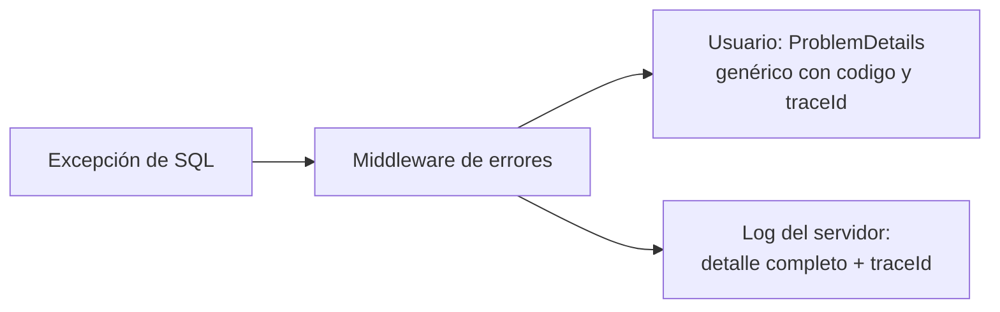

# SQL injection - manejo de errores sin filtrar detalles

Parte de: [[12-Seguridad/02 Inyección SQL/_Índice Inyección SQL|Inyección SQL]]

> [!info] Cómo avanzar
> `progreso`: **pendiente** → **viendo** (estudiando) → **visto** (contestaste la autoevaluación sin abrir las respuestas) → **dominado** (hiciste el laboratorio o lo aplicaste de verdad).

## Contenido

### Qué es
El **manejo de errores** seguro consiste en que, cuando algo falla en la base de datos, el usuario reciba un mensaje **genérico** y el detalle técnico quede solo en el **log del servidor**. Un error de SQL mostrado al usuario (el texto de la excepción, el nombre de la tabla, la consulta) le entrega a cualquiera información valiosa para afinar un ataque y revela estructura interna.

### Cómo funciona
**Por qué no se debe mostrar el error de SQL al usuario**:
- Confirma que su dato llegó hasta la base y rompió la sintaxis: es la señal que busca para saber que un parámetro es manipulable (ver [[SQL injection - cómo funciona un ataque (conceptual)]]).
- Revela nombres de tablas y columnas, el motor y su versión, y a veces fragmentos de la consulta.
- Convierte una inyección "ciega" (sin pistas) en una "basada en errores" (con retroalimentación), mucho más fácil de aprovechar.
- Incluso sin inyección, filtra detalles internos que ayudan a otros ataques.



**Cómo se hace en ASP.NET Core**: con un manejador global que captura cualquier excepción, registra el detalle y responde un `ProblemDetails` sin información interna. En producción, además, nunca se activa la página de excepciones para desarrolladores.

**Qué debe incluir el log del servidor** (no la respuesta al usuario): el mensaje y tipo de la excepción, el `traceId` para correlacionar con la petición, el endpoint y método, el identificador del usuario si lo hay, y la hora. **Sin** datos sensibles de la petición (contraseñas, tokens) ni, idealmente, los valores que provocaron el error si son datos personales. Ver [[Logs y datos sensibles]].

### Ejemplo
Manejador global que corta la fuga de detalles en Itzamna.Dionisio:

```csharp
var builder = WebApplication.CreateBuilder(args);
builder.Services.AddProblemDetails();

var app = builder.Build();

// La página de detalle de excepciones solo en desarrollo
if (!app.Environment.IsDevelopment())
{
    app.UseExceptionHandler(a => a.Run(async ctx =>
    {
        var feature = ctx.Features.Get<IExceptionHandlerFeature>();
        var logger = ctx.RequestServices.GetRequiredService<ILogger<Program>>();
        var traceId = ctx.TraceIdentifier;

        // Detalle completo al log, no al usuario
        logger.LogError(feature?.Error, "Error no controlado. Traza {TraceId}", traceId);

        ctx.Response.StatusCode = StatusCodes.Status500InternalServerError;
        await ctx.Response.WriteAsJsonAsync(new ProblemDetails
        {
            Title = "Ocurrió un error al procesar la solicitud.",
            Status = 500,
            Extensions = { ["codigo"] = "ERROR_INTERNO", ["traceId"] = traceId }
        });
    }));
}
```

El usuario ve `{ "title": "...", "codigo": "ERROR_INTERNO", "traceId": "..." }` y puede dar ese `traceId` a soporte; el equipo encuentra en el log el detalle para diagnosticar. Nunca `SqlException` con el texto de la consulta.

Revisa también que no haya rutas que filtren detalles por otros caminos: respuestas de validación demasiado específicas ("no existe el cliente con ese RFC" revela existencia), o un modo de depuración encendido en producción. Ver [[Configuración insegura]].

### Cuándo usarlo y cuándo no
Siempre en producción. En desarrollo local sí conviene ver el detalle (la página de excepciones de ASP.NET Core) para depurar rápido; por eso el manejador genérico se activa solo fuera de desarrollo. Cuida que `ASPNETCORE_ENVIRONMENT` no quede en `Development` en un ambiente accesible.

### Errores comunes
- **Devolver `ex.Message` o `ex.ToString()`** en la respuesta "para depurar más fácil".
- **Dejar la página de excepciones de desarrollo** activa en producción por un `Environment` mal configurado.
- **Mensajes de validación que revelan existencia** de registros o estructura.
- **Registrar el detalle sin `traceId`**, imposible de correlacionar.
- **Loggear la consulta con sus parámetros** cuando contienen datos personales.

### Para profundizar
- [Manejo de errores en ASP.NET Core](https://learn.microsoft.com/en-us/aspnet/core/fundamentals/error-handling)
- [ProblemDetails (RFC 9457)](https://www.rfc-editor.org/rfc/rfc9457)
- [OWASP Error Handling Cheat Sheet](https://cheatsheetseries.owasp.org/cheatsheets/Error_Handling_Cheat_Sheet.html)

## Autoevaluación

Contesta primero en voz alta o en papel; luego despliega la respuesta.

> [!question]- ¿Por qué no se debe mostrar el error de SQL al usuario?
> Revela estructura (tablas, columnas, motor, versión) y facilita la variante basada en errores. El usuario solo necesita un mensaje genérico y un id de correlación.

> [!question]- ¿Cómo se hace en ASP.NET Core?
> `app.UseExceptionHandler()` con `AddProblemDetails()` fuera de Development, devolviendo un ProblemDetails genérico; el detalle va al log del servidor. La página de excepciones de desarrollador solo en Development.

> [!question]- ¿Qué debe incluir el log del servidor?
> El detalle de la excepción, el id de correlación (`traceId`) que también recibe el usuario, la ruta y el usuario, sin valores sensibles.

## Práctica

- [[Lab 3 - Consulta vulnerable y su corrección con Dapper]]

