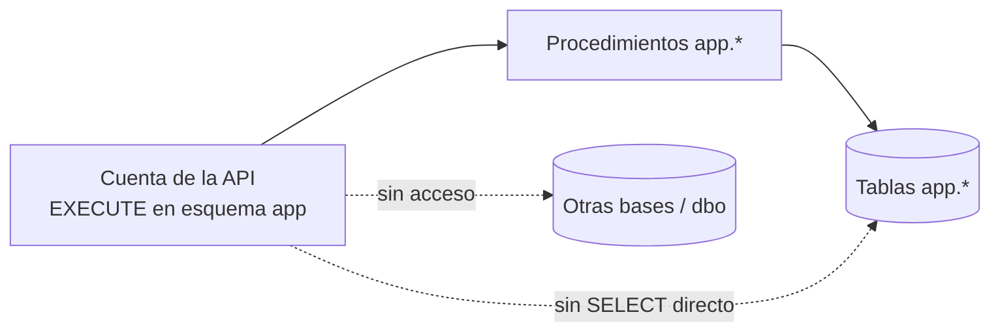

# SQL injection - mínimo privilegio en la cuenta de base de datos

Parte de: [[12-Seguridad/02 Inyección SQL/_Índice Inyección SQL|Inyección SQL]]

> [!info] Cómo avanzar
> `progreso`: **pendiente** → **viendo** (estudiando) → **visto** (contestaste la autoevaluación sin abrir las respuestas) → **dominado** (hiciste el laboratorio o lo aplicaste de verdad).

## Contenido

### Qué es
Aplicar el **mínimo privilegio** a la cuenta con la que tu aplicación se conecta a la base significa darle **solo los permisos que necesita para operar**, y nada más. No evita la inyección (eso lo hacen los parámetros), pero **limita el daño** si una inyección ocurre: con permisos acotados, el atacante no puede ir más allá de lo que la cuenta ya podía hacer. Ver [[Principio de mínimo privilegio]] para el concepto general.

### Cómo funciona
La cuenta de la API **no** debería ser `sa` ni miembro de `db_owner`, ni tener permisos de `ALTER`, `DROP`, crear usuarios o leer otras bases. Debería poder, exactamente, ejecutar las operaciones que la aplicación realiza en su funcionamiento normal.

Si tu acceso a datos es por **procedimientos almacenados** (tu convención), el permiso ideal es solo `EXECUTE` sobre el esquema de esos procedimientos. Al conceder `EXECUTE` sobre un esquema, SQL Server aplica el *ownership chaining*: el procedimiento puede leer y escribir las tablas de su mismo dueño sin que la cuenta tenga permiso **directo** sobre esas tablas. Resultado: la app ejecuta su lógica, pero una consulta arbitraria contra las tablas falla por falta de permiso.



**¿El mínimo privilegio evita la inyección?** No. Una consulta manipulable sigue siendo manipulable; lo que cambia es **hasta dónde llega** el atacante. Es una capa de contención, no de prevención. La prevención es parametrizar.

### Ejemplo
Configurar una cuenta acotada en SQL Server para Itzamna.Dionisio:

```sql
-- 1. Usuario de la aplicación (en Azure SQL, idealmente identidad de Entra ID sin contraseña)
CREATE USER app_dionisio WITHOUT LOGIN;   -- o FROM EXTERNAL PROVIDER en Azure SQL

-- 2. Rol con permisos mínimos
CREATE ROLE rol_api_dionisio;

-- 3. Solo ejecutar los procedimientos del esquema app
GRANT EXECUTE ON SCHEMA::app TO rol_api_dionisio;

-- 4. Nada de acceso directo a tablas, ni a dbo, ni DDL
ALTER ROLE rol_api_dionisio ADD MEMBER app_dionisio;

-- Comprobación: esto debe FALLAR para la cuenta de la app
-- SELECT * FROM app.Clientes;   -> permiso denegado
-- EXEC app.Clientes_Buscar @Nombre = N'...';  -> permitido
```

Separa cuentas por función: la de **migraciones** (que sí necesita `ALTER`, `CREATE`) es distinta de la de **tiempo de ejecución**, y corre solo durante el despliegue. La de **reportes** de Wee.Reporteria puede ser de solo lectura (`db_datareader` o `SELECT` acotado a vistas), sin tocar las de escritura.

Si usas consultas directas (Dapper contra tablas) en lugar de procedimientos, concede permisos finos: `GRANT SELECT, INSERT, UPDATE ON SCHEMA::app` y evita `DELETE` donde no aplique, en lugar de agregar a `db_datawriter` completo.

### Cuándo usarlo y cuándo no
Siempre, en todos los ambientes (es fácil que "desarrollo con `sa`" se filtre a producción). El costo es definir y mantener permisos; hazlo **como código** (scripts en el repo, idempotentes) para que el despliegue los aplique y queden versionados. Documenta qué cuenta usa cada componente.

### Errores comunes
- **Usar `sa` o `db_owner`** "mientras tanto".
- **Una sola cuenta** para API, migraciones y reportes.
- **`GRANT CONTROL` o permisos de servidor** por comodidad.
- **Permisos concedidos a mano** en el servidor, no reproducibles y fáciles de olvidar al recrear el entorno.
- **Creer que con esto basta** y relajar la parametrización: es contención, no prevención.

### Para profundizar
- [GRANT de permisos de esquema (Microsoft Learn)](https://learn.microsoft.com/en-us/sql/t-sql/statements/grant-schema-permissions-transact-sql)
- [Cadenas de propiedad (ownership chaining)](https://learn.microsoft.com/en-us/sql/relational-databases/security/securing-sql-server)
- [OWASP SQL Injection Prevention Cheat Sheet](https://cheatsheetseries.owasp.org/cheatsheets/SQL_Injection_Prevention_Cheat_Sheet.html)

## Autoevaluación

Contesta primero en voz alta o en papel; luego despliega la respuesta.

> [!question]- ¿Qué permisos debería tener la cuenta de la API?
> Solo `EXECUTE` sobre los procedimientos que usa o `SELECT/INSERT/UPDATE/DELETE` sobre sus tablas, sin `db_owner`, sin `ALTER`, sin acceso a otras bases.

> [!question]- ¿Cómo das permiso de ejecutar solo los procedimientos de un esquema?
> ```sql
> CREATE ROLE rol_api;
> GRANT EXECUTE ON SCHEMA::dbo TO rol_api;
> ALTER ROLE rol_api ADD MEMBER usuario_api;
> ```

> [!question]- ¿El mínimo privilegio evita la inyección?
> No la evita; limita lo que se puede hacer si ocurre. Es una capa de defensa en profundidad.

## Práctica

- [[Lab 3 - Consulta vulnerable y su corrección con Dapper]]

