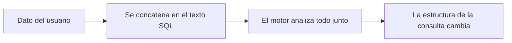

# SQL injection - qué es y por qué ocurre

Parte de: [[12-Seguridad/02 Inyección SQL/_Índice Inyección SQL|Inyección SQL]]

> [!info] Cómo avanzar
> `progreso`: **pendiente** → **viendo** (estudiando) → **visto** (contestaste la autoevaluación sin abrir las respuestas) → **dominado** (hiciste el laboratorio o lo aplicaste de verdad).

## Contenido

### Qué es
**SQL injection** es una vulnerabilidad en la que datos controlados por el usuario cambian la **estructura** de una consulta SQL, de modo que la base de datos ejecuta algo distinto de lo que el programador pretendía: leer datos ajenos, saltarse una autenticación, alterar o borrar registros. Es una de las vulnerabilidades más antiguas y conocidas, y sigue apareciendo porque su causa es un patrón de programación fácil de repetir.

### Cómo funciona
Ocurre por una sola razón de fondo: la aplicación **mezcla en un mismo texto** las instrucciones SQL y los datos del usuario (ver [[SQL injection - concatenación de cadenas, la causa raíz]]). Cuando el motor analiza ese texto, no puede distinguir qué parte es instrucción y qué parte es dato; interpreta todo como SQL. Si el dato contiene símbolos con significado para el lenguaje, cambia el sentido de la consulta.



La defensa elimina esa mezcla: con **consultas parametrizadas**, el texto va por un lado y los valores por otro, así que el motor nunca analiza un dato como instrucción.

**¿Puede ocurrir con datos que no vienen de un formulario?** Sí. Cualquier dato que la app no controla es sospechoso: parámetros de la URL y de la ruta, encabezados HTTP, cookies, cuerpos JSON, archivos importados (CSV, Excel), mensajes de una cola, respuestas de otra API y **valores que ya están en la base** y se usan después para armar otra consulta. Este último caso es la **inyección de segundo orden**: un dato se guarda "inofensivo" y causa daño cuando más tarde se concatena en otra consulta. Ver [[SQL injection - tipos (basada en errores, UNION, ciega y de segundo orden)]].

**¿El tipo de base de datos (SQL Server, MySQL, PostgreSQL) evita el problema?** No. Cambia la sintaxis exacta y algunas capacidades, pero todos analizan texto SQL y todos son vulnerables si se concatenan datos. La protección —parámetros— existe en todos y es la misma idea en cada uno. Lo mismo aplica a los ORM: EF Core y Dapper protegen **si** los usas bien (ver [[SQL injection - Dapper y parámetros]] y [[SQL injection - EF Core (FromSqlRaw vs FromSqlInterpolated)]]).

### Ejemplo
El mismo endpoint, antes y después, en Itzamna.Dionisio:

```csharp
// Por qué ocurre: el dato se concatena en el texto
// var sql = "SELECT * FROM app.Usuarios WHERE Correo = '" + correo + "'";

// Por qué deja de ocurrir: el dato viaja como parámetro, el texto es fijo
const string sql = "SELECT Id, Nombre, Rol FROM app.Usuarios WHERE Correo = @Correo AND TenantId = @TenantId";
var usuario = await cn.QuerySingleOrDefaultAsync<UsuarioDto>(sql, new { Correo = correo, TenantId = tenant });
```

Nota que el segundo caso también agrega el filtro por `TenantId`: la parametrización resuelve la inyección, pero la autorización (que un usuario solo vea su tenant) es un problema aparte que hay que resolver explícitamente.

### Cuándo usarlo y cuándo no
No hay un "cuándo usarlo": SQL injection es algo a **prevenir siempre**. La regla práctica es tratar **todo** dato externo como no confiable y nunca construir SQL concatenando valores. La defensa principal es parametrizar; las capas complementarias (validación, mínimo privilegio, manejo de errores, WAF) contienen el daño si algo falla. Ver [[SQL injection]] para el panorama de defensas.

### Errores comunes
- **Pensar que solo los formularios son entrada.**
- **Confiar en datos de la propia base** al armar nuevas consultas (segundo orden).
- **Creer que "usamos un ORM" basta**: `FromSqlRaw` con interpolación o `$"..."` en Dapper vuelven a abrir el hueco.
- **Suponer que cierto motor es inmune.**
- **Validar en lugar de parametrizar**: la validación ayuda, pero no es la defensa principal.

### Para profundizar
- [OWASP: SQL Injection](https://owasp.org/www-community/attacks/SQL_Injection)
- [OWASP SQL Injection Prevention Cheat Sheet](https://cheatsheetseries.owasp.org/cheatsheets/SQL_Injection_Prevention_Cheat_Sheet.html)
- [PortSwigger Web Security Academy: SQL injection](https://portswigger.net/web-security/sql-injection)

## Autoevaluación

Contesta primero en voz alta o en papel; luego despliega la respuesta.

> [!question]- ¿Por qué ocurre SQL injection?
> Porque el código construye la consulta como texto pegando la entrada del usuario, y el motor no distingue qué parte escribió el programador y qué parte el usuario.

> [!question]- ¿Puede ocurrir con datos que no vienen de un formulario?
> Sí: headers, cookies, parámetros de URL, JSON de un API, nombres de archivo, datos leídos de la misma base (segundo orden). Toda entrada externa cuenta.

> [!question]- ¿El tipo de base de datos (SQL Server, MySQL, PostgreSQL) evita el problema?
> No. Todos los motores relacionales son vulnerables si se concatena; cambian detalles de sintaxis, no el riesgo.

