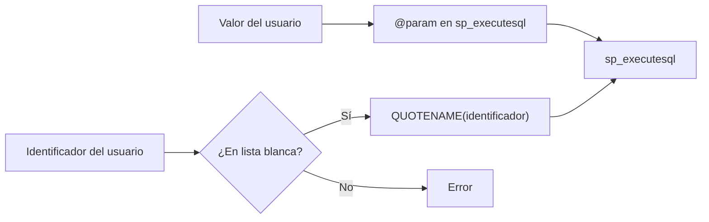

# SQL injection - stored procedures y SQL dinámico seguro (sp_executesql y QUOTENAME)

Parte de: [[12-Seguridad/02 Inyección SQL/_Índice Inyección SQL|Inyección SQL]]

> [!info] Cómo avanzar
> `progreso`: **pendiente** → **viendo** (estudiando) → **visto** (contestaste la autoevaluación sin abrir las respuestas) → **dominado** (hiciste el laboratorio o lo aplicaste de verdad).

## Contenido

### Qué es
Un **procedimiento almacenado** encapsula lógica SQL en la base. Es cómodo y encaja con tu convención, pero **no es seguro por sí mismo**: si dentro del procedimiento armas SQL dinámico concatenando parámetros, la inyección se traslada de C# a T-SQL. Esta nota trata de escribir SQL dinámico **seguro** dentro de SQL Server con `sp_executesql` (para valores) y `QUOTENAME` (para identificadores).

### Cómo funciona
**¿Un procedimiento es seguro por sí mismo?** No. Un procedimiento que recibe `@Nombre` y hace `WHERE Nombre = @Nombre` es seguro porque usa el parámetro como valor. Pero uno que arma un texto `@sql` concatenando `@columna` y `@valor` y lo ejecuta con `EXEC(@sql)` es tan vulnerable como la concatenación en C#. El procedimiento ayuda a la organización y a los permisos, no a la inyección.

**SQL dinámico con parámetros**: `sp_executesql` permite ejecutar un texto SQL **con una lista de parámetros tipados**, igual que una consulta parametrizada desde la aplicación. Los **valores** nunca se concatenan: van como parámetros.

**`QUOTENAME` para identificadores**: cuando lo dinámico es un **identificador** (nombre de columna o tabla), no puedes parametrizarlo. `QUOTENAME` lo envuelve en corchetes y **escapa** los corchetes internos, de modo que el resultado sea un identificador válido y no pueda romper la sintaxis. Su **límite**: `QUOTENAME` hace seguro el formato del identificador, pero **no verifica que ese objeto deba usarse**; alguien podría pasar el nombre de una columna sensible. Por eso se combina con una **lista blanca** (validar contra `sys.columns`, o contra un conjunto fijo) antes de usarlo.



### Ejemplo
Procedimiento que ordena por una columna elegida por el usuario, de forma segura:

```sql
CREATE OR ALTER PROCEDURE app.Pedidos_Listar
    @TenantId   INT,
    @Columna    SYSNAME,          -- columna de orden elegida por el usuario
    @Direccion  VARCHAR(4) = 'ASC'
AS
BEGIN
    SET NOCOUNT ON;

    -- 1. Lista blanca: la columna debe existir en la tabla y estar permitida
    IF @Columna NOT IN (N'Fecha', N'Total', N'Folio')
        THROW 50001, 'Columna de orden no permitida', 1;

    -- 2. Dirección validada a un valor conocido
    SET @Direccion = CASE WHEN UPPER(@Direccion) = 'DESC' THEN 'DESC' ELSE 'ASC' END;

    -- 3. Identificador protegido con QUOTENAME; el valor (@TenantId) va como parámetro
    DECLARE @sql NVARCHAR(MAX) =
        N'SELECT Id, Folio, Total, Fecha FROM app.Pedidos WHERE TenantId = @TenantId ' +
        N'ORDER BY ' + QUOTENAME(@Columna) + N' ' + @Direccion;

    EXEC sys.sp_executesql @sql,
         N'@TenantId INT',       -- declaración de parámetros
         @TenantId = @TenantId;  -- el valor viaja parametrizado
END
```

Puntos clave: el **valor** (`@TenantId`) nunca se concatena; va por `sp_executesql`. La **columna** pasa por lista blanca **y** `QUOTENAME`. La **dirección** se normaliza a dos valores fijos. Desde Dapper se llama como cualquier procedimiento:

```csharp
var r = await cn.QueryAsync<PedidoDto>("app.Pedidos_Listar",
    new { TenantId = tenant, Columna = columna, Direccion = dir },
    commandType: CommandType.StoredProcedure);
```

### Cuándo usarlo y cuándo no
Usa `sp_executesql` con parámetros siempre que necesites SQL dinámico en T-SQL. Recurre al SQL dinámico solo cuando de verdad haga falta (ordenar o filtrar por columnas variables, nombres de tabla por partición); si la consulta es fija, escríbela fija. Evita `EXEC(@cadena)` con texto construido: casi siempre puede reescribirse con `sp_executesql` y `QUOTENAME`.

### Errores comunes
- **`EXEC(@sql)`** con valores concatenados dentro del procedimiento.
- **Usar `QUOTENAME` para valores**: es para identificadores; los valores van como parámetros.
- **Confiar en `QUOTENAME` sin lista blanca**: protege el formato, no la autorización de usar esa columna.
- **Creer que "está en un SP, entonces es seguro".**
- **Concatenar la dirección de orden** sin normalizarla a `ASC`/`DESC`.

### Para profundizar
- [sp_executesql (Transact-SQL)](https://learn.microsoft.com/en-us/sql/relational-databases/system-stored-procedures/sp-executesql-transact-sql)
- [QUOTENAME (Transact-SQL)](https://learn.microsoft.com/en-us/sql/t-sql/functions/quotename-transact-sql)
- [The Curse and Blessings of Dynamic SQL (Erland Sommarskog)](https://www.sommarskog.se/dynamic_sql.html)

## Ejercicios

Resuélvelos en papel o en la herramienta; la solución está plegada.

> [!question]- Escribe un SP que ordene por una columna elegida por el usuario de forma segura.
> ```sql
> CREATE OR ALTER PROCEDURE dbo.Clientes_Listar @Orden sysname, @Dir varchar(4)
> AS
> BEGIN
>   IF @Orden NOT IN (N'Nombre', N'FechaAlta', N'Id') SET @Orden = N'Id';
>   IF @Dir NOT IN ('ASC','DESC') SET @Dir = 'ASC';
>   DECLARE @sql nvarchar(max) = N'SELECT Id, Nombre, FechaAlta FROM dbo.Clientes ORDER BY '
>       + QUOTENAME(@Orden) + N' ' + @Dir;
>   EXEC sp_executesql @sql;
> END
> ```

## Autoevaluación

Contesta primero en voz alta o en papel; luego despliega la respuesta.

> [!question]- ¿Un procedimiento almacenado es seguro por sí mismo?
> No. Si dentro arma SQL dinámico concatenando parámetros y lo ejecuta con `EXEC(@sql)`, es vulnerable igual.

> [!question]- ¿Cómo se ejecuta SQL dinámico con parámetros en T-SQL?
> ```sql
> DECLARE @sql nvarchar(max) = N'SELECT Id, Nombre FROM dbo.Clientes WHERE Estado = @Estado';
> EXEC sp_executesql @sql, N'@Estado tinyint', @Estado = @EstadoParam;
> ```

> [!question]- ¿Para qué sirve `QUOTENAME` y cuál es su límite?
> Delimita un identificador con corchetes y duplica `]` internos, para usar un nombre de objeto dinámico como identificador y no como código. Su límite es 128 caracteres de entrada (devuelve NULL si se pasa). Aun así, valida el nombre contra una lista o contra `sys.columns`.

