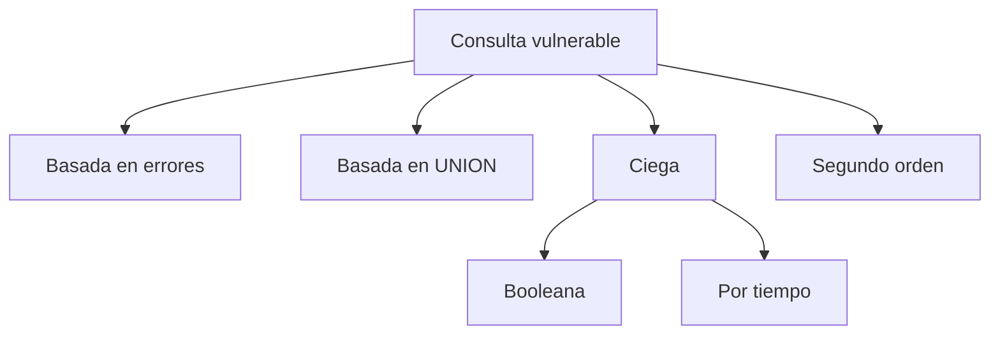

# SQL injection - tipos (basada en errores, UNION, ciega y de segundo orden)

Parte de: [[12-Seguridad/02 Inyección SQL/_Índice Inyección SQL|Inyección SQL]]

> [!info] Cómo avanzar
> `progreso`: **pendiente** → **viendo** (estudiando) → **visto** (contestaste la autoevaluación sin abrir las respuestas) → **dominado** (hiciste el laboratorio o lo aplicaste de verdad).

## Contenido

### Qué es
Las inyecciones SQL se clasifican según **cómo obtiene información** quien las aprovecha. La causa y la defensa son las mismas en todos los tipos (parametrizar); conocer las variantes te ayuda a entender tus logs, a diseñar detección y a no caer en una falsa sensación de seguridad ("oculté los errores, ya está").

### Cómo funciona

**Basada en errores**: la aplicación muestra los mensajes de error de la base, y esos mensajes revelan datos o estructura. Se diferencia de la de UNION en que aquí el canal de información es el **mensaje de error**, no el resultado de la consulta. Es la más fácil de aprovechar y se corta en gran parte **no mostrando errores** al usuario. Ver [[SQL injection - manejo de errores sin filtrar detalles]].

**Basada en UNION**: aprovecha el operador `UNION` para **añadir filas** de otras tablas al resultado que la aplicación ya muestra. La diferencia con la basada en errores es el canal: aquí los datos salen por la **respuesta normal** (la tabla de resultados), no por un error. Requiere que la consulta devuelva resultados visibles y que coincidan el número y tipo de columnas.

**Ciega (*blind*)**: la aplicación **no** muestra ni resultados ni errores útiles, pero su comportamiento cambia según si una condición es verdadera o falsa. Tiene dos variantes:
- **Booleana**: la respuesta cambia (aparece o no un contenido, cambia el código de estado) según la condición. Se infiere la información bit a bit observando ese cambio.
- **Por tiempo**: la respuesta **tarda** más o menos según la condición (usando funciones de retardo). Se usa cuando no hay ninguna diferencia visible en el contenido.

**De segundo orden**: el dato malicioso se **guarda** primero sin causar daño (pasa las validaciones de ese momento) y causa el problema **más tarde**, cuando otra parte del sistema lo lee y lo concatena en una nueva consulta. Es traicionera porque la entrada y el efecto están separados en el tiempo y en el código, y porque el dato "ya estaba en la base", lo que da falsa confianza.

### Ejemplo
Cómo se refleja cada tipo en la **defensa y detección** de Itzamna.Dionisio:

| Tipo | Señal en logs / síntoma | Defensa principal | Capa extra |
|---|---|---|---|
| Basada en errores | Errores 500 con texto de SQL | Parametrizar | Errores genéricos |
| UNION | Respuestas con más columnas/filas de lo normal | Parametrizar | Validar formas de respuesta |
| Ciega booleana | Muchas peticiones casi iguales con respuestas que alternan | Parametrizar | Rate limiting, alertas |
| Ciega por tiempo | Respuestas con tiempos anómalos y repetitivos | Parametrizar | Timeouts, monitoreo de latencia |
| Segundo orden | Error al **leer** un dato guardado antes | Parametrizar **también** al releer datos propios | Revisar todo flujo que relea datos |

El segundo orden deja una lección de diseño: trata los datos que vienen de tu propia base como no confiables al armar nuevas consultas. Si `Nombre` se guardó y después se concatena en otro reporte, el reporte es vulnerable aunque el guardado fuera seguro.

### Cuándo usarlo y cuándo no
Esta taxonomía es para **entender y detectar**, no para explotar. Para practicar los tipos de forma legal, usa PortSwigger Web Security Academy, que tiene laboratorios por categoría. Ver [[Lab 4 - PortSwigger - laboratorios de SQL injection nivel Apprentice]]. Nunca contra sistemas de terceros ni en producción.

### Errores comunes
- **Creer que ocultar los errores elimina la vulnerabilidad.** Deja de funcionar la variante **basada en errores**, pero la **ciega** (booleana y por tiempo) no necesita ningún mensaje: solo observa cambios de comportamiento o de tiempo. La consulta sigue siendo manipulable; ocultar errores es una capa útil, no la solución. La solución es parametrizar.
- **Validar solo al escribir** y confiar al releer (segundo orden).
- **No monitorear latencia ni ráfagas** de peticiones casi idénticas.
- **Pensar que "no veo nada raro" significa "no es explotable"**.

### Para profundizar
- [PortSwigger: SQL injection (incluye blind y UNION)](https://portswigger.net/web-security/sql-injection)
- [OWASP: Blind SQL Injection](https://owasp.org/www-community/attacks/Blind_SQL_Injection)
- [OWASP: Testing for SQL Injection (WSTG)](https://owasp.org/www-project-web-security-testing-guide/latest/4-Web_Application_Security_Testing/07-Input_Validation_Testing/05-Testing_for_SQL_Injection)

> [!warning] Ética
> Las pruebas de esta nota se hacen solo en tu propio código, en tu máquina o en plataformas de entrenamiento (PortSwigger Web Security Academy, DVWA, OWASP Juice Shop). Ver [[Marco legal y autorización por escrito]].

## Autoevaluación

Contesta primero en voz alta o en papel; luego despliega la respuesta.

> [!question]- ¿En qué se diferencian la basada en errores y la de UNION?
> Basada en errores: el atacante saca información de los mensajes de error que la app muestra. UNION: combina el resultado de la consulta original con otra que él controla, y los datos aparecen en la página.

> [!question]- ¿Qué es una inyección ciega y sus dos variantes?
> La app no muestra datos ni errores; el atacante infiere la información con preguntas de sí/no. **Booleana**: cambia la respuesta según la condición. **Basada en tiempo**: la respuesta tarda más si la condición es verdadera.

> [!question]- ¿Qué es la inyección de segundo orden?
> El valor se guarda sin problema (quizá parametrizado) y más adelante otra parte del sistema lo lee de la base y lo concatena en otra consulta. Por eso los datos de tu propia BD también son no confiables.

> [!question]- ¿Ocultar los errores elimina la vulnerabilidad?
> No; solo dificulta la variante basada en errores. Las técnicas ciegas siguen funcionando.

## Práctica

- [[Lab 4 - PortSwigger - laboratorios de SQL injection nivel Apprentice]]

