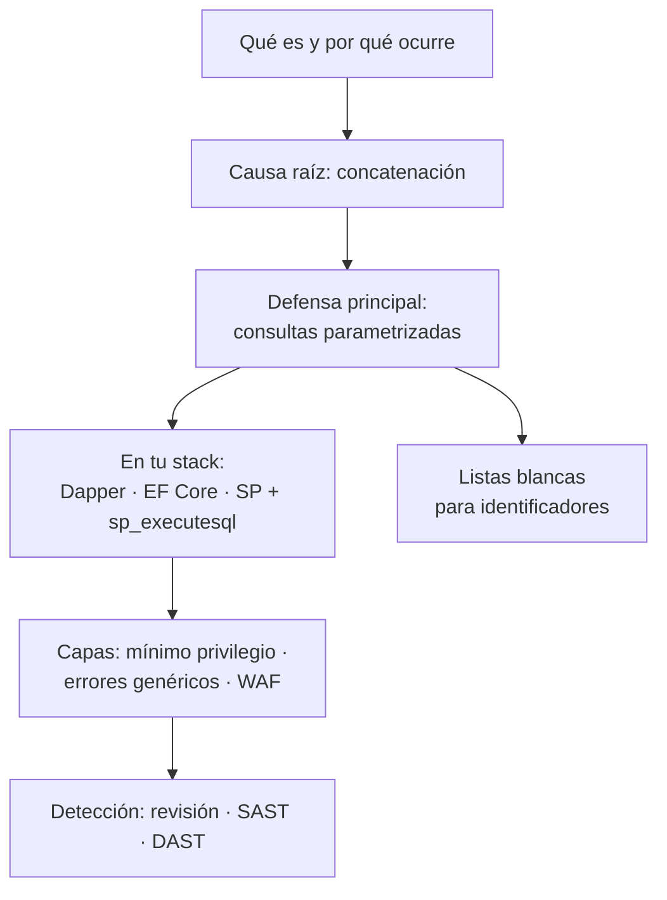

# SQL injection

Parte de: [[12-Seguridad/02 Inyección SQL/_Índice Inyección SQL|Inyección SQL]]

> [!info] Cómo avanzar
> `progreso`: **pendiente** → **viendo** (estudiando) → **visto** (contestaste la autoevaluación sin abrir las respuestas) → **dominado** (hiciste el laboratorio o lo aplicaste de verdad).

## Contenido

### Qué es
**SQL injection** (inyección SQL) es la vulnerabilidad en la que un dato del usuario altera la estructura de una consulta SQL y hace que la base de datos ejecute algo no previsto: leer datos ajenos, saltarse autenticación, o alterar y borrar registros. Esta nota es el panorama del tema; cada subtema entra en detalle.

### Cómo funciona
La causa es siempre **mezclar instrucciones SQL con datos del usuario en el mismo texto** (ver [[SQL injection - concatenación de cadenas, la causa raíz]]). La **defensa principal** es la **consulta parametrizada**: el texto y los valores viajan por separado, así que un valor nunca se interpreta como instrucción. Alrededor de esa defensa se construyen capas de contención.

El tema se organiza así:



- **Entender**: [[SQL injection - qué es y por qué ocurre]], [[SQL injection - cómo funciona un ataque (conceptual)]], [[SQL injection - tipos (basada en errores, UNION, ciega y de segundo orden)]], [[SQL injection - impacto real]].
- **Defensa principal**: [[SQL injection - consultas parametrizadas]], [[SQL injection - Dapper y parámetros]], [[SQL injection - EF Core (FromSqlRaw vs FromSqlInterpolated)]], [[SQL injection - stored procedures y SQL dinámico seguro (sp_executesql y QUOTENAME)]], [[SQL injection - listas blancas para ORDER BY y nombres de columnas]].
- **Capas complementarias**: [[SQL injection - mínimo privilegio en la cuenta de base de datos]], [[SQL injection - manejo de errores sin filtrar detalles]], [[SQL injection - WAF como capa adicional]].
- **Detección**: [[SQL injection - cómo detectarla (revisión de código, SAST y DAST)]].

### Ejemplo
La regla que resume todo el tema, aplicada a tus proyectos con Dapper:

```csharp
// Valores: SIEMPRE parámetros
const string sql = "SELECT Id, Folio, Total FROM app.Pedidos WHERE TenantId = @TenantId AND Estado = @Estado";
var r = await cn.QueryAsync<PedidoDto>(sql, new { TenantId = tenant, Estado = estado });

// Identificadores (columna de orden): lista blanca, nunca el dato tal cual
string columna = new[] { "Fecha", "Total", "Folio" }.Contains(sort) ? sort : "Fecha";
```

### Cuándo usarlo y cuándo no
Las defensas aplican **siempre** que haya acceso a datos con entradas no totalmente controladas, que es casi todo. No hay escenario donde concatenar valores sea aceptable. La única parte que no se parametriza son los identificadores y palabras clave, que se resuelven con listas blancas.

**¿En qué categoría del OWASP Top 10 2021 cae?** En **A03:2021 - Inyección**, que agrupa SQL injection junto con otras inyecciones (comandos, LDAP, XPath) y también el XSS. En la edición 2025 la inyección sigue siendo una categoría propia del Top 10. Ver [[OWASP Top 10]].

Una última idea que ata el tema: la inyección SQL no es un problema "de la base de datos" ni "de seguridad" que resuelva otro equipo, sino una consecuencia directa de **cómo escribes el acceso a datos**. Por eso la responsabilidad es del desarrollador y la defensa vive en el código de cada consulta: si todas tus consultas parametrizan los valores y usan listas blancas para los identificadores, la vulnerabilidad simplemente no existe, sin importar qué mande el usuario. Las capas de contención (mínimo privilegio, errores genéricos, WAF, detección) reducen el daño cuando algo se escapa, pero no son un sustituto de escribir bien la consulta.

### Errores comunes
- **Parametrizar casi todo** y dejar un valor concatenado.
- **Confiar en el ORM** sin cuidar `FromSqlRaw` ni la interpolación en Dapper.
- **Usar solo una capa** (por ejemplo, solo WAF) y olvidar la parametrización.
- **No detectar**: sin revisión ni análisis, el hueco vive hasta que alguien lo encuentra.

### Para profundizar
- [OWASP SQL Injection Prevention Cheat Sheet](https://cheatsheetseries.owasp.org/cheatsheets/SQL_Injection_Prevention_Cheat_Sheet.html)
- [OWASP Top 10 2021 - A03 Injection](https://owasp.org/Top10/A03_2021-Injection/)
- [PortSwigger Web Security Academy: SQL injection](https://portswigger.net/web-security/sql-injection)

## Autoevaluación

Contesta primero en voz alta o en papel; luego despliega la respuesta.

> [!question]- ¿Qué es SQL injection en una frase?
> Una vulnerabilidad en la que datos del usuario se mezclan con el texto de una consulta SQL y terminan interpretándose como parte del comando.

> [!question]- ¿Cuál es la defensa principal y cuáles las complementarias?
> Principal: consultas parametrizadas en todas partes. Complementarias: listas blancas para identificadores, mínimo privilegio en la cuenta de BD, errores genéricos, revisión con SAST/DAST y WAF.

> [!question]- ¿En qué categoría del OWASP Top 10 2021 cae?
> A03 - Inyección (que también incluye XSS y otras inyecciones).

## Práctica

- [[Lab 3 - Consulta vulnerable y su corrección con Dapper]]
- [[Lab 4 - PortSwigger - laboratorios de SQL injection nivel Apprentice]]

