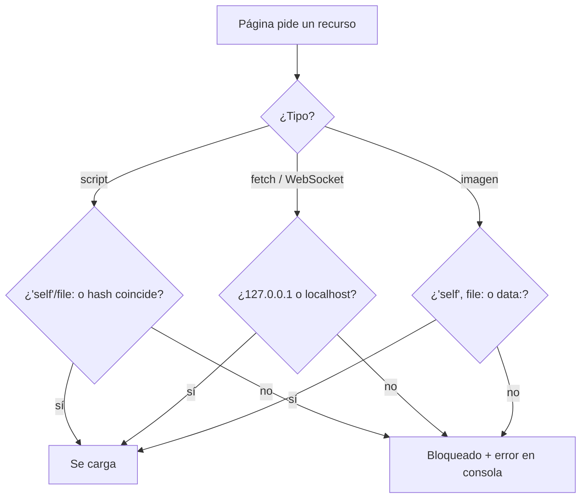

---
proyecto:
  - Ocelotl.Iris
  - Itzamna.Clio
proyectos:
  - "[[Ocelotl.Iris]]"
  - "[[Itzamna.Clio]]"
tipo: tecnologia
nivel: intermedio
estado: completo
tags:
  - conocimiento
  - frontend
  - seguridad
  - csp
progreso: pendiente
area: Seguridad
---
# Content Security Policy
> [!warning] Cambio 2026-11-08: ya no hay hash en `script-src`
> Con [[Vite]] no queda ningún script inline: la CSP de Iris es `script-src 'self' file:`, sin `sha256-…`, y ya no hay que recalcular nada. La misma CSP sirve en desarrollo (servidor de Vite en `localhost:5173`, HMR por `ws://localhost:*`) y en producción (`file://`). Las secciones sobre el hash del import map describen la versión anterior.


> Política que la página declara para decirle al navegador de qué orígenes puede cargar scripts, estilos, imágenes y conexiones; todo lo demás se bloquea.

## Qué es y qué problema resuelve
CSP es una capa de defensa contra XSS e inyección de contenido: aunque un atacante logre meter un `<script>` o un `onclick` en la página, el navegador no lo ejecuta si no cumple la política. También limita a dónde puede conectarse la página (exfiltración de datos).

En una app Electron es aún más importante: Electron muestra una advertencia de seguridad si no hay CSP, y una página comprometida está muy cerca del sistema operativo.

## Cómo funciona por dentro
- Se declara con el header HTTP `Content-Security-Policy` o con `<meta http-equiv="Content-Security-Policy" content="...">`.
- Está formada por **directivas**, cada una con una lista de fuentes:
  - `default-src`: valor por defecto para las directivas no declaradas.
  - `script-src`, `style-src`, `img-src`: scripts, estilos, imágenes.
  - `connect-src`: `fetch`, `XMLHttpRequest`, WebSocket, EventSource.
- Fuentes típicas: `'self'`, esquemas (`file:`, `data:`), hosts con puerto comodín (`http://127.0.0.1:*`), `'unsafe-inline'`, y **hashes** `'sha256-<base64>'`.
- Un **hash** autoriza un script inline concreto: el navegador calcula el SHA-256 del contenido exacto entre `<script>` y `</script>` (espacios y saltos de línea incluidos) y lo compara.
- Por defecto, con `script-src` declarado, se bloquean scripts inline, atributos `on*` y `eval`.



## Cuándo usarla y cuándo no
### Ventajas
- Mitiga XSS aunque haya un bug de escape.
- Impide que la página hable con servidores externos no previstos.
- Se declara una vez y protege toda la página.
### Desventajas
- Fácil de romper: un script inline nuevo o un cambio en el import map sin actualizar el hash deja la app en blanco.
- En `<meta>` no se admiten algunas directivas (`frame-ancestors`, `report-uri`, `sandbox`).
- `'unsafe-inline'` en estilos reduce la protección frente a inyección de CSS.

## Alternativas
| Alternativa | En qué se diferencia |
|---|---|
| Header HTTP CSP | Más completo que `<meta>`; en Electron con `file://` requiere interceptar respuestas (`session.webRequest.onHeadersReceived`). |
| Nonces (`'nonce-...'`) | Valor aleatorio por respuesta; útil con servidor, no con archivos estáticos. |
| Trusted Types | Complementa CSP controlando sinks peligrosos (`innerHTML`). |
| Solo escapar bien (sin CSP) | Una sola capa de defensa; cualquier fallo es explotable. |

## Cómo se usó en Ocelotl

En [[Ocelotl.Iris]], `src/index.html` declara la política con `<meta>`:
- `default-src 'self' file:` → solo recursos locales.
- `script-src 'self' file: 'sha256-...'` → scripts locales y **solo** el script inline cuyo hash coincide: el **import map** (ver [[ES Modules e import maps]]). Se verificó que el hash corresponde exactamente al contenido actual del import map.
- `style-src 'self' file: 'unsafe-inline'` → hojas locales y estilos inline.
- `img-src 'self' file: data:` → imágenes locales y `data:` URIs.
- `connect-src 'self' http://127.0.0.1:* ws://127.0.0.1:* http://localhost:* ws://localhost:*` → HTTP y WebSocket **solo** hacia Hermes en la máquina local, con cualquier puerto porque el puerto de Hermes se conoce al arrancar (ver [[Electron]]).

`Ocelotl.Iris/src/index.html`:
```html
<!-- Solo recursos locales; conexiones únicamente a Hermes en 127.0.0.1. -->
<meta http-equiv="Content-Security-Policy"
      content="default-src 'self' file:; script-src 'self' file: 'sha256-WdlXOSI8xuSzCxBdWlwQgVoHIIbX0Q0pjeWlqGRqzVs='; style-src 'self' file: 'unsafe-inline'; img-src 'self' file: data:; connect-src 'self' http://127.0.0.1:* ws://127.0.0.1:* http://localhost:* ws://localhost:*" />
```

Funcionalidades relacionadas: [[Arranque y seguridad local]] (junto con el secreto de sesión y el sandbox), [[Eventos en tiempo real]] (`ws://127.0.0.1`).

Si se edita el import map hay que recalcular el hash: SHA-256 del contenido **exacto** entre `<script type="importmap">` y `</script>`, codificado en base64, y escribirlo como `'sha256-<base64>'` en `script-src`. La consola de DevTools (F12 en desarrollo) muestra el hash esperado cuando bloquea el script.

> [!warning] Pendiente de confirmar
> No hay en el repo un script que recalcule el hash automáticamente; parece mantenerse a mano. El motivo concreto de `'unsafe-inline'` en `style-src` no está documentado en el código.

> [!tip] Reutilizable
> La política "todo local + `connect-src` solo a `127.0.0.1:*` + hash para el import map" es una base sólida para cualquier app Electron con backend local.


## Cómo se usó en Itzamna
[[Itzamna.Clio]] **no define una CSP completa** (sin `default-src`, `script-src`, `connect-src`…). Lo único relacionado está en los `globalHeaders` de `public/staticwebapp.config.json` de cada app ([[Azure Static Web Apps]]):

| App | Encabezado | Para qué |
|---|---|---|
| `apps/web` | `Content-Security-Policy: frame-ancestors 'self' https://wonderful-cliff-018ec1310.6.azurestaticapps.net` | Solo el propio sitio y el Studio desplegado pueden incrustarlo en un iframe ([[Vista previa en vivo]], [[postMessage e iframes]]) |
| `apps/studio` | `X-Frame-Options: DENY` | Nadie puede incrustar el Studio (anti-clickjacking) |
| ambas | `X-Content-Type-Options: nosniff`, `Referrer-Policy: strict-origin-when-cross-origin` | Endurecimiento básico |
| studio (global) y web (`/preview`) | `X-Robots-Tag: noindex, nofollow` | No indexar |

`frame-ancestors` es justo la directiva que **no** funciona en `<meta>` (la limitación anotada arriba), por eso aquí va como encabezado HTTP del hosting.

`Itzamna.Clio/apps/web/public/staticwebapp.config.json`:
```json
"globalHeaders": {
  "X-Content-Type-Options": "nosniff",
  "Referrer-Policy": "strict-origin-when-cross-origin",
  "Content-Security-Policy": "frame-ancestors 'self' https://wonderful-cliff-018ec1310.6.azurestaticapps.net"  }
```

Diferencia con [[Ocelotl.Iris]]: allí la CSP protege una app [[Electron]] con todo local; en Clio las páginas cargan fuentes de Google Fonts, llaman a la API en otro dominio y muestran imágenes del almacenamiento ([[Azure Blob Storage]]), así que una CSP completa tendría que listar esos orígenes.

> [!note] Pendiente de confirmar
> No hay `script-src`/`connect-src`/`img-src` en ninguna de las dos apps: si se quiere CSP completa, falta definirla (orígenes de la API, Blob Storage, `fonts.googleapis.com`, `fonts.gstatic.com`). El dominio del Studio en `frame-ancestors` está escrito a mano y no sale de `VITE_STUDIO_ORIGIN`.

## Errores comunes y buenas prácticas
- Cambiar el import map (aunque sea indentación) y olvidar el hash → la app no carga módulos. Revisa la consola: el error trae el hash esperado.
- Evitar `'unsafe-eval'` y `'unsafe-inline'` en `script-src`.
- No usar `*` en `connect-src`; limitar a los hosts realmente necesarios.
- Mantener los manejadores de eventos en JavaScript (lit-html `@click`), no en atributos `onclick` del HTML.
- Probar la CSP en modo *report-only* (header `Content-Security-Policy-Report-Only`) cuando se endurece.

## Qué estudiar después
- [[ES Modules e import maps]]
- [[Electron]] (checklist de seguridad)
- [[Preload y contextBridge]]
- Trusted Types y Subresource Integrity (SRI).
- XSS y escape de contenido (ver [[lit-html]]).

## Documentación oficial
- https://developer.mozilla.org/en-US/docs/Web/HTTP/CSP
- https://developer.mozilla.org/en-US/docs/Web/HTTP/Headers/Content-Security-Policy
- https://www.electronjs.org/docs/latest/tutorial/security

## Autoevaluación

Contesta primero en voz alta o en papel; luego despliega la respuesta.

> [!question]- ¿Qué hace una Content Security Policy?
> Le indica al navegador de qué orígenes puede cargar scripts, estilos, imágenes y conexiones. Lo que no cumple se bloquea, así que un script inyectado no se ejecuta aunque exista un bug de escape.

> [!question]- ¿Qué ventaja tiene `Content-Security-Policy-Report-Only`?
> Reporta violaciones sin bloquear. Sirve para probar una política nueva en producción sin romper la app.

> [!question]- ¿Por qué `'unsafe-inline'` en `script-src` le quita casi todo el valor a la CSP?
> Porque la mayoría de los XSS son justamente scripts o manejadores inline; si se permiten, la CSP ya no los detiene. La alternativa es usar nonces o hashes.

> [!question]- ¿Qué directiva protege contra clickjacking y dónde debe declararse?
> `frame-ancestors`. Debe ir en el header HTTP; no funciona en `<meta>`.

## Práctica

- [[Lab 5 - CSP y codificación de salida en una página propia]]

