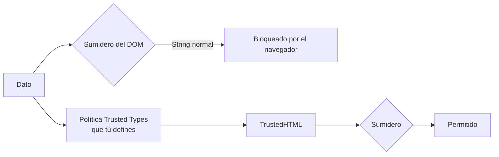

# Trusted Types

Parte de: [[12-Seguridad/03 XSS/_Índice XSS|XSS]]

> [!info] Cómo avanzar
> `progreso`: **pendiente** → **viendo** (estudiando) → **visto** (contestaste la autoevaluación sin abrir las respuestas) → **dominado** (hiciste el laboratorio o lo aplicaste de verdad).

## Contenido

### Qué es
**Trusted Types** es una función de seguridad del navegador, dirigida por **Content Security Policy**, que ataca el **XSS basado en DOM** desde la raíz: hace que los **sumideros peligrosos** del DOM (`innerHTML`, `outerHTML`, `document.write`, `eval`, asignar a `src` de un script, etc.) **dejen de aceptar cadenas de texto normales** y solo acepten objetos "de confianza" creados por una **política** que tú defines. Así, un dato del usuario no puede llegar directo a un sumidero: tiene que pasar por tu política, donde lo sanitizas o lo rechazas.

### Cómo funciona


Se activa con un encabezado CSP: `Content-Security-Policy: require-trusted-types-for 'script';`. A partir de ahí, cualquier asignación de una cadena a un sumisero peligroso lanza un error (y genera un reporte si configuras `report-uri`/`report-to`). Para seguir operando, defines una política con `trustedTypes.createPolicy` que produce los objetos `TrustedHTML`/`TrustedScript`; dentro de esa política es donde sanitizas con DOMPurify (que tiene soporte integrado de Trusted Types).

**Qué problema resuelve mejor que una revisión de código**: una revisión humana (o un linter) puede **olvidar** un sumidero entre miles de líneas, y las dependencias de terceros también escriben al DOM sin que las revises. Trusted Types lo vuelve una **garantía del navegador en tiempo de ejecución**: no depende de que alguien recuerde usar `textContent`; el navegador **bloquea** toda cadena cruda hacia un sumidero, incluido el código de las librerías. Convierte "esperamos que nadie use `innerHTML` mal" en "el navegador no deja usar `innerHTML` mal".

### Ejemplo
Política mínima que sanitiza con DOMPurify:

```js
// Requiere el encabezado CSP: require-trusted-types-for 'script';
import DOMPurify from "dompurify";

if (window.trustedTypes) {
  trustedTypes.createPolicy("default", {
    createHTML: (entrada) => DOMPurify.sanitize(entrada),
  });
}

// A partir de aquí, asignar una cadena cruda a innerHTML falla;
// pasar por la política (o por DOMPurify, que devuelve TrustedHTML) funciona
elemento.innerHTML = DOMPurify.sanitize(htmlDelUsuario);
```

En desarrollo conviene empezar en modo reporte para encontrar las violaciones sin romper la app:

```text
Content-Security-Policy-Report-Only: require-trusted-types-for 'script'; report-uri /csp-reportes
```

En ASP.NET Core, el encabezado se agrega con un middleware junto al resto de la CSP (ver [[Content Security Policy]]). En Itzamna.Clio, como React casi no usa sumideros directos, la mayor parte del trabajo es ajustar librerías de terceros que sí los usan.

### Cuándo usarlo y cuándo no
Úsalo como **capa extra** en aplicaciones donde el XSS de DOM es un riesgo real y quieres una garantía fuerte, especialmente SPAs grandes con muchas dependencias. **Limitación**: históricamente solo lo soportaban los navegadores basados en Chromium (Chrome, Edge); Firefox y Safari no lo implementaban, por lo que no protege a esos usuarios y debía verse como refuerzo, no como única defensa. El soporte ha ido ampliándose entre navegadores en fechas recientes; confirma la cobertura actual en las tablas de compatibilidad antes de depender de él (Pendiente de confirmar el estado exacto por navegador). En todo caso, **no sustituye** la codificación de salida ni la sanitización: es una red de seguridad encima de ellas.

### Errores comunes
- **Creer que reemplaza la codificación y la sanitización**: es una capa adicional.
- **Depender de él para todos los usuarios** sin verificar el soporte de su navegador.
- **Una política `default` demasiado permisiva** que devuelve el HTML sin sanitizar.
- **Activarlo en modo bloqueo de golpe** y romper la app; empieza en report-only.

### Para profundizar
- [MDN: Trusted Types API](https://developer.mozilla.org/en-US/docs/Web/API/Trusted_Types_API)
- [web.dev: Prevent DOM-based XSS with Trusted Types](https://web.dev/articles/trusted-types)
- [DOMPurify y Trusted Types](https://github.com/cure53/DOMPurify#what-about-dompurify-and-trusted-types)

## Autoevaluación

Contesta primero en voz alta o en papel; luego despliega la respuesta.

> [!question]- ¿Qué son los Trusted Types?
> Una función del navegador que, activada por CSP (`require-trusted-types-for 'script'`), obliga a que los sinks peligrosos del DOM (`innerHTML`, `eval`, `script.src`) solo acepten objetos creados por una política aprobada, no strings sueltos.

> [!question]- ¿Qué problema resuelven mejor que una revisión de código?
> El XSS basado en DOM: el navegador rechaza en tiempo de ejecución cualquier asignación de string a un sink, aunque esté escondida en una librería.

> [!question]- ¿Qué limitación tienen?
> El soporte varía entre navegadores; revisa la compatibilidad actual en MDN (Pendiente de confirmar). Además requieren adaptar el código y las librerías que usan `innerHTML`.

