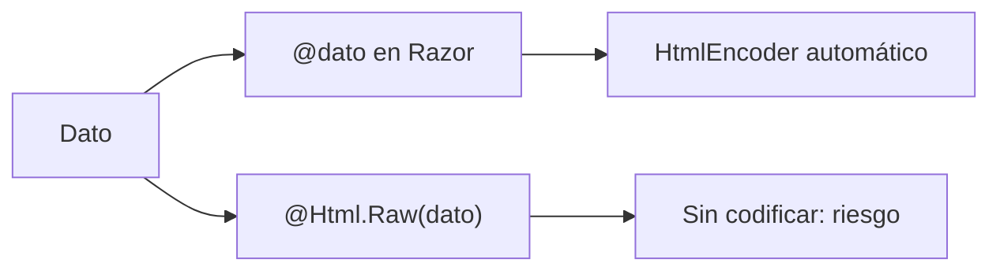

# XSS - Razor y HtmlEncoder en ASP.NET Core

Parte de: [[12-Seguridad/03 XSS/_Índice XSS|XSS]]

> [!info] Cómo avanzar
> `progreso`: **pendiente** → **viendo** (estudiando) → **visto** (contestaste la autoevaluación sin abrir las respuestas) → **dominado** (hiciste el laboratorio o lo aplicaste de verdad).

## Contenido

### Qué es
En **ASP.NET Core**, Razor es el motor de vistas, y su comportamiento por defecto es **codificar para HTML** cualquier dato que muestres con `@`. Además, el framework expone *encoders* explícitos (`HtmlEncoder`, `JavaScriptEncoder`, `UrlEncoder`) para codificar en otros contextos o fuera de una vista. Aunque tus front-ends sean React, conviene conocerlo: Xolotl.Hecate y otras apps pueden tener páginas Razor (login, consentimiento, páginas de error).

### Cómo funciona
**¿Razor codifica por defecto?** Sí. `@Model.Nombre` codifica el valor para el contexto HTML antes de escribirlo, igual que React con `{valor}`. Un nombre con `<` o `>` se muestra literal. La forma de **salirte** de esa protección es `@Html.Raw(...)`, que escribe el HTML sin codificar: solo con contenido de confianza o sanitizado.

**Para qué sirven los encoders**:
- **`HtmlEncoder`**: codifica para contexto HTML (lo que Razor hace por ti; útil al generar HTML fuera de una vista, como un correo).
- **`JavaScriptEncoder`**: codifica para insertar dentro de JavaScript; aun así, la forma preferida es pasar datos como JSON, no incrustarlos en el código.
- **`UrlEncoder`**: codifica para usar un valor como parte de una URL.



### Ejemplo
**Cómo pasar datos a un script en una vista Razor** sin caer en XSS: no incrustes el valor dentro del código JavaScript; **serialízalo a JSON** y léelo desde un contenedor de datos.

```cshtml
@* Vista Razor *@
@using System.Text.Json

@* Opción recomendada: JSON en un bloque de datos, no en el código JS *@
<script id="estado" type="application/json">@Html.Raw(JsonSerializer.Serialize(Model.Estado))</script>
<script>
  const estado = JSON.parse(document.getElementById("estado").textContent);
  // usar 'estado' con textContent / createElement, nunca innerHTML con datos
</script>
```

El `JsonSerializer` produce JSON válido y escapado para ese contexto; `type="application/json"` evita que el navegador lo ejecute, y `JSON.parse` lo lee como datos. Evita el patrón peligroso de incrustar el valor directamente en el código:

```cshtml
@* Evita: el valor queda dentro del código JS *@
<script>var nombre = "@Model.Nombre";</script>  @* si el framework no cubre bien este contexto, es riesgo *@
```

Para un atributo o una URL en Razor:

```cshtml
<a href="@Url.Action("Detalle", new { id = Model.Id })">Ver</a>  @* Url.Action codifica *@
          @* atributos codificados por Razor *@
```

Cuando necesites codificar en código C# (no en una vista), inyecta los encoders:

```csharp
public sealed class CorreoService(HtmlEncoder html)
{
    public string Cuerpo(string nombre) => $"<p>Hola, {html.Encode(nombre)}</p>";
}
```

### Cuándo usarlo y cuándo no
Confía en la codificación por defecto de Razor para todo el texto. Usa los encoders explícitos al generar HTML, JS o URLs **fuera** de una vista (correos, archivos, respuestas que arman HTML a mano). Reserva `@Html.Raw` para HTML estático o sanitizado. Para datos hacia scripts, siempre JSON en un bloque de datos, nunca interpolado dentro del código. El mismo principio de [[XSS - codificación de salida según el contexto|codificar según el contexto]] que aplicas en el front vale en Razor: el contexto HTML está cubierto por defecto, pero atributos de URL, bloques de script y HTML crudo necesitan cuidado explícito.

### Errores comunes
- **`@Html.Raw` con datos del usuario** sin sanitizar.
- **Incrustar valores dentro de `<script>`** en lugar de pasarlos como JSON.
- **Construir URLs a mano** en vez de `Url.Action`/`Url.Content`.
- **Codificar para el contexto equivocado** (HTML donde se necesitaba JavaScript o URL).
- **Asumir que porque el front es React, las páginas Razor no importan.**

### Para profundizar
- [Prevención de XSS en ASP.NET Core (Microsoft Learn)](https://learn.microsoft.com/en-us/aspnet/core/security/cross-site-scripting)
- [System.Text.Encodings.Web](https://learn.microsoft.com/en-us/dotnet/api/system.text.encodings.web)
- [OWASP XSS Prevention Cheat Sheet](https://cheatsheetseries.owasp.org/cheatsheets/Cross_Site_Scripting_Prevention_Cheat_Sheet.html)

## Autoevaluación

Contesta primero en voz alta o en papel; luego despliega la respuesta.

> [!question]- ¿Razor codifica por defecto?
> Sí. `@Model.Nombre` se codifica como HTML. `@Html.Raw(...)` desactiva la codificación y solo debe usarse con HTML confiable o sanitizado.

> [!question]- ¿Para qué sirven `HtmlEncoder`, `JavaScriptEncoder` y `UrlEncoder`?
> Son los codificadores de `System.Text.Encodings.Web` para cada contexto. Se inyectan o se usan con `.Default` cuando generas HTML, JS o URLs fuera de Razor.

> [!question]- ¿Cómo pasarías datos a un script en una vista Razor?
> Serializarlos con `System.Text.Json` y ponerlos en un atributo `data-` (`<div data-config="@json">`), que Razor codifica como atributo; luego `JSON.parse` en JS.

