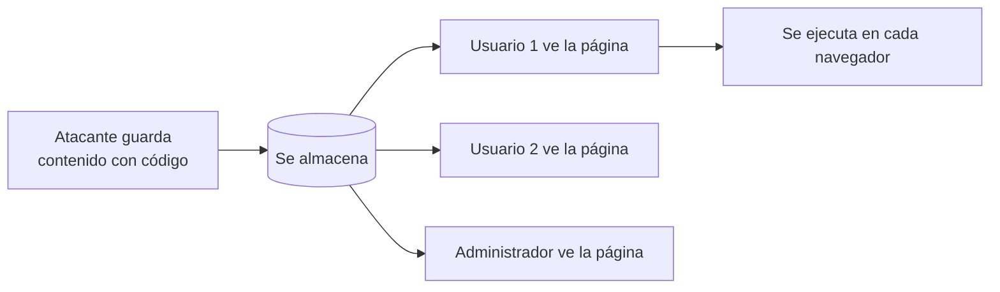

# XSS - almacenado

Parte de: [[12-Seguridad/03 XSS/_Índice XSS|XSS]]

> [!info] Cómo avanzar
> `progreso`: **pendiente** → **viendo** (estudiando) → **visto** (contestaste la autoevaluación sin abrir las respuestas) → **dominado** (hiciste el laboratorio o lo aplicaste de verdad).

## Contenido

### Qué es
El **XSS almacenado** (o persistente) es la variante en la que el dato malicioso se **guarda** en el sistema (base de datos, archivo, caché) y después se **sirve a otros usuarios** cuando ven la página que lo muestra. No necesita un enlace preparado: cualquiera que abra la página afectada ejecuta el código.

### Cómo funciona


Un comentario, un nombre de perfil, el campo "notas" de un registro, el nombre de un archivo subido: cualquier dato que un usuario guarda y otro ve es un vector potencial.

**Por qué suele ser el más grave**:
- **Alcance**: una sola inyección afecta a **todos** los que ven ese contenido, no a una víctima por enlace.
- **No requiere interacción especial**: la víctima solo usa la aplicación normalmente.
- **Puede alcanzar a administradores**: si el contenido aparece en un panel interno (una lista de usuarios, un tablero de comentarios reportados), el código corre con la sesión de quien tiene más permisos, lo que puede escalar a un compromiso total.
- **Persistente**: queda activo hasta que alguien lo limpia.

### Ejemplo
**¿Dónde conviene codificar: al guardar o al mostrar?** Al **mostrar**. Guardar el dato tal cual (crudo) y codificarlo en cada punto de salida es lo correcto, porque:
- El mismo dato puede mostrarse en varios contextos (HTML, un atributo, un correo, un PDF, una exportación a Excel), y cada uno necesita codificación distinta.
- Codificar al guardar ata el dato a un contexto y suele provocar doble codificación cuando el framework vuelve a codificar al mostrar (ver [[XSS - codificación de salida según el contexto]]).
- Si guardas codificado, las búsquedas y comparaciones se complican.

Guardar crudo no significa guardar sin validar: valida longitud y formato razonables a la entrada; solo no uses esa validación como sustituto de la codificación de salida.

```tsx
// Guardar: el valor va como parámetro a la API (sin codificar para HTML)
await api.post("/comentarios", { texto });   // el back lo parametriza hacia SQL

// Mostrar: React codifica al renderizar
function Comentario({ texto }: { texto: string }) {
  return <p className="comentario">{texto}</p>;
}
```

**Lugares que se olvidan con frecuencia** (y que también necesitan codificación o tratamiento seguro):
- **Atributos** generados con datos: `title`, `alt`, `data-*`, y sobre todo `href`/`src` (ver [[XSS - contextos de salida (HTML, atributo, JavaScript y URL)]]).
- **Nombres de archivos subidos** mostrados en una lista.
- **Correos de notificación** en HTML que incluyen datos del usuario.
- **Exportaciones**: un CSV o Excel con una fórmula al inicio de una celda (inyección de fórmulas en Wee.Reporteria); prefija con comilla simple los valores que empiezan con `=`, `+`, `-`, `@`.
- **Mensajes de error y logs** que se muestran en una interfaz.
- **Paneles de administración** que listan contenido reportado.

### Cuándo usarlo y cuándo no
La prevención aplica a todo flujo "un usuario guarda, otro ve". Si el campo admite **texto plano**, codifica a la salida y listo. Si de verdad necesita **formato HTML** (un editor enriquecido), hay que **sanitizar** con una librería probada, no solo codificar. Ver [[XSS - sanitización de HTML (DOMPurify)]].

### Errores comunes
- **Codificar al guardar** y terminar con doble codificación o datos atados a un contexto.
- **Olvidar los canales secundarios**: correos, exportaciones, paneles internos.
- **Confiar en la validación de entrada** como única defensa.
- **Permitir HTML "porque el editor lo manda"** sin sanitizar en el servidor.

### Para profundizar
- [PortSwigger: Stored XSS](https://portswigger.net/web-security/cross-site-scripting/stored)
- [OWASP XSS Prevention Cheat Sheet](https://cheatsheetseries.owasp.org/cheatsheets/Cross_Site_Scripting_Prevention_Cheat_Sheet.html)
- [OWASP: CSV Injection](https://owasp.org/www-community/attacks/CSV_Injection)

> [!warning] Ética
> Las pruebas de esta nota se hacen solo en tu propio código, en tu máquina o en plataformas de entrenamiento (PortSwigger Web Security Academy, DVWA, OWASP Juice Shop). Ver [[Marco legal y autorización por escrito]].

## Autoevaluación

Contesta primero en voz alta o en papel; luego despliega la respuesta.

> [!question]- ¿Por qué el XSS almacenado suele ser el más grave?
> Se guarda en la base (comentario, nombre de perfil, ticket) y se ejecuta a cada usuario que ve ese contenido, incluso administradores, sin que tengan que hacer clic en nada raro.

> [!question]- ¿Dónde conviene codificar: al guardar o al mostrar?
> Al **mostrar**, según el contexto de salida. Guardar el texto original permite usarlo en distintos contextos (HTML, JSON, PDF) y evita doble codificación.

> [!question]- ¿Qué lugares se olvidan con frecuencia?
> Paneles de administración internos, correos HTML generados, exportaciones, notificaciones y vistas previas de archivos.

## Práctica

- [[Lab 6 - PortSwigger - laboratorios de XSS nivel Apprentice]]

