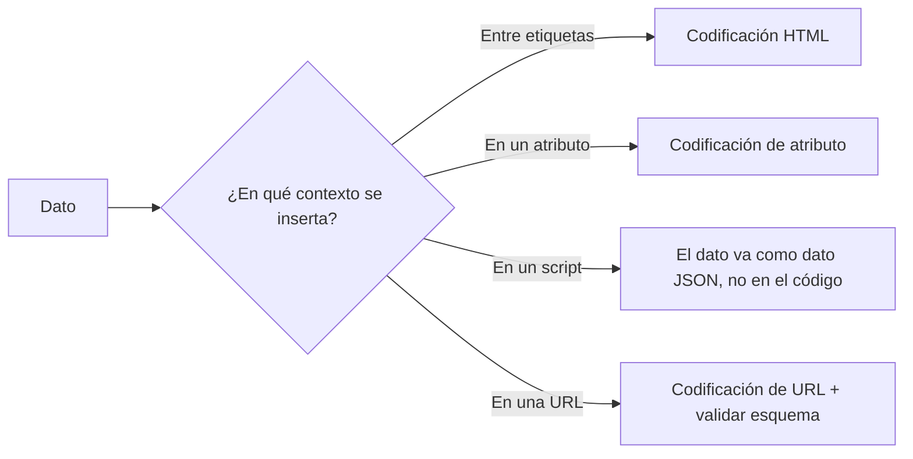

# XSS - codificación de salida según el contexto

Parte de: [[12-Seguridad/03 XSS/_Índice XSS|XSS]]

> [!info] Cómo avanzar
> `progreso`: **pendiente** → **viendo** (estudiando) → **visto** (contestaste la autoevaluación sin abrir las respuestas) → **dominado** (hiciste el laboratorio o lo aplicaste de verdad).

## Contenido

### Qué es
La **codificación de salida** (*output encoding*) es la defensa principal contra XSS: transformar un dato, **en el momento de insertarlo** en la página, para que el navegador lo trate como texto y no como código. "Según el contexto" porque la transformación necesaria depende de **dónde** se inserta: no es lo mismo poner un dato entre etiquetas HTML, dentro de un atributo, dentro de un `<script>` o en una URL. Cada contexto tiene su codificación. Ver el detalle por contexto en [[XSS - contextos de salida (HTML, atributo, JavaScript y URL)]].

### Cómo funciona


**Qué hacen los motores de plantillas modernos por defecto**: codifican para **HTML** automáticamente. React (`{valor}` en JSX), Razor (`@valor`), Angular y la mayoría de los motores escapan el dato al renderizar, de modo que el contexto por defecto (texto dentro de HTML) es seguro sin que hagas nada. El riesgo aparece cuando **sales** de ese camino (HTML crudo: `dangerouslySetInnerHTML`, `innerHTML`, `@Html.Raw`) o cuando el dato cae en un contexto distinto (atributo, script, URL) donde la codificación HTML por defecto no basta.

**Qué escape mínimo tiene la codificación HTML**: convierte los caracteres con significado en HTML en sus entidades. El conjunto mínimo es:

| Carácter | Entidad |
|---|---|
| `&` | `&amp;` |
| `<` | `&lt;` |
| `>` | `&gt;` |
| `"` | `&quot;` |
| `'` | `&#39;` (o `&#x27;`) |

Con `<` y `>` convertidos, el dato no puede abrir una etiqueta; con las comillas convertidas, no puede escapar de un atributo entrecomillado. Por eso un nombre como `O'Brien <admin>` se muestra literal en lugar de interpretarse.

### Ejemplo
El contexto por defecto es seguro; el problema es cambiar de contexto o usar HTML crudo:

```tsx
// Seguro: contexto HTML, React codifica
<span title="comentario">{texto}</span>

// Contexto atributo: también seguro cuando React pone el valor como propiedad

// ...pero una URL necesita además validar el esquema (no 'javascript:')

// Riesgo: HTML crudo, hay que sanitizar
<div dangerouslySetInnerHTML={{ __html: sanitizar(html) }} />
```

En .NET, cuando necesitas codificar fuera de una vista (por ejemplo, al generar HTML en un correo), usa los *encoders* en lugar de hacerlo a mano:

```csharp
using System.Text.Encodings.Web;

string seguroHtml = HtmlEncoder.Default.Encode(nombre);
string seguroUrl  = UrlEncoder.Default.Encode(parametro);
```

Ver [[XSS - Razor y HtmlEncoder en ASP.NET Core]].

### Cuándo usarlo y cuándo no
Siempre que insertes datos no confiables en una página. La regla práctica: **deja que el framework codifique** y solo sal de ahí con una razón clara. Cuando salgas (HTML crudo), no "codifiques" el HTML (lo romperías): **sanitízalo** con DOMPurify, que es distinto. Codificar sirve para mostrar texto; sanitizar sirve para permitir un subconjunto de HTML. Ver [[XSS - sanitización de HTML (DOMPurify)]].

### Errores comunes
- **Codificar dos veces.** Si codificas manualmente y además el framework codifica, el usuario ve las entidades crudas en pantalla: `O&amp;#39;Brien` en lugar de `O'Brien`, o `&lt;b&gt;` como texto. La señal es "aparecen `&amp;`, `&lt;` visibles". La causa casi siempre es codificar al guardar y otra vez al mostrar; la solución es codificar **solo** en la salida y una sola vez.
- **Codificar para HTML un dato que va en un atributo de evento, en un `<script>` o en un `href`**: la codificación HTML no cubre esos contextos.
- **Usar `@Html.Raw` o `innerHTML`** "para que se vea el formato" sin sanitizar.
- **Creer que validar la entrada sustituye la codificación.**

### Para profundizar
- [OWASP XSS Prevention Cheat Sheet](https://cheatsheetseries.owasp.org/cheatsheets/Cross_Site_Scripting_Prevention_Cheat_Sheet.html)
- [System.Text.Encodings.Web (Microsoft Learn)](https://learn.microsoft.com/en-us/dotnet/api/system.text.encodings.web)
- [MDN: Cross-site scripting](https://developer.mozilla.org/en-US/docs/Web/Security/Attacks/XSS)

## Autoevaluación

Contesta primero en voz alta o en papel; luego despliega la respuesta.

> [!question]- ¿Qué hacen los motores de plantillas modernos por defecto?
> Codifican como HTML todo lo que interpolas (`@valor` en Razor, `{valor}` en JSX, `{{ valor }}` en Angular). El riesgo aparece cuando usas la salida "cruda".

> [!question]- ¿Qué escape mínimo tiene la codificación HTML?
> `&` → `&amp;`, `<` → `&lt;`, `>` → `&gt;`, `"` → `&quot;`, `'` → `&#x27;`.

> [!question]- Error común: codificar dos veces. ¿Qué se ve?
> El usuario ve `&amp;lt;` o `&lt;` como texto literal. Suele pasar al codificar al guardar y otra vez al mostrar. Codifica una sola vez, al mostrar.

## Práctica

- [[Lab 5 - CSP y codificación de salida en una página propia]]

