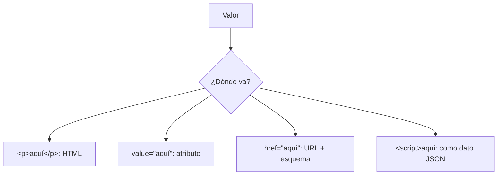

# XSS - contextos de salida (HTML, atributo, JavaScript y URL)

Parte de: [[12-Seguridad/03 XSS/_Índice XSS|XSS]]

> [!info] Cómo avanzar
> `progreso`: **pendiente** → **viendo** (estudiando) → **visto** (contestaste la autoevaluación sin abrir las respuestas) → **dominado** (hiciste el laboratorio o lo aplicaste de verdad).

## Contenido

### Qué es
Un **contexto de salida** es el lugar exacto de la página donde insertas un dato, y determina qué codificación necesita para ser seguro. Un mismo valor requiere tratamiento distinto según si va **entre etiquetas HTML**, dentro de un **atributo**, dentro de **JavaScript**, o en una **URL**. Usar la codificación de un contexto en otro deja la puerta abierta a XSS.

### Cómo funciona
**Los contextos principales y su codificación**:

| Contexto | Ejemplo | Qué necesita |
|---|---|---|
| **HTML** (entre etiquetas) | `<p>DATO</p>` | Codificación HTML (`<`, `>`, `&`, comillas) |
| **Atributo** entrecomillado | `<input value="DATO">` | Codificación de atributo (sobre todo las comillas) |
| **URL** (valor de `href`/`src` o parámetro) | `<a href="/x?q=DATO">` | Codificación de URL **y** validar el esquema |
| **JavaScript** (dentro de `<script>`) | `var x = DATO;` | No insertar en el código: pasar el dato **como dato** (JSON) |
| **CSS** | `style="width: DATO"` | Evitar datos del usuario; si acaso, codificación CSS |



**Por qué importa el contexto**: la codificación HTML neutraliza `<` y `>`, pero **no** impide, por ejemplo, que un dato dentro de un `href` sea `javascript:...`, ni que un dato dentro de un `<script>` cierre una cadena y agregue código. Cada contexto tiene su forma de "escaparse", así que cada uno tiene su defensa.

Respondiendo a los casos concretos:
- **Un nombre de usuario dentro de `<p>...</p>`**: contexto HTML → **codificación HTML**. React, Razor y Angular lo hacen por defecto.
- **Un valor dentro de `<a href="...">`**: la codificación de atributo **no basta**. Un `href` acepta el esquema `javascript:`, que ejecuta código aunque las comillas estén bien. Hay que **validar el esquema** (permitir solo rutas internas o `https:`/`mailto:`) además de codificar. Lo mismo para `src`.
- **Pasar un objeto del servidor a un script**: no lo escribas dentro del código JS. Serialízalo como **JSON** en un contenedor de datos y léelo desde JavaScript. Ver [[XSS - escape de datos del API en templates de JS]] y [[XSS - Razor y HtmlEncoder en ASP.NET Core]].
- **Un texto como parámetro de consulta en una URL, en JS**: usa **`encodeURIComponent`**, que codifica los caracteres con significado en una URL.

**Qué contextos deberías evitar por completo** con datos del usuario: insertarlos **dentro de `<script>`**, dentro de un controlador de evento en línea (`onclick="..."`), como **esquema de URL** sin validar, dentro de `eval`/`Function`, y en **CSS** dinámico. Son contextos difíciles de codificar bien; es mejor rediseñar para no ponerlos ahí.

### Ejemplo
```tsx
// HTML: por defecto, seguro
<p>{usuario.nombre}</p>

// URL en href: validar el esquema además de interpolar
const url = usuario.sitio ?? "";
const segura = /^https:\/\//.test(url) ? url : "#";
<a href={segura} rel="noopener noreferrer">Sitio</a>

// Parámetro de URL en JS
const q = encodeURIComponent(textoBusqueda);
location.assign(`/buscar?q=${q}`);
```

```js
// Pasar datos del servidor a JS SIN meterlos en el código:
// En el HTML: <script id="datos" type="application/json">{{json}}</script>
const datos = JSON.parse(document.getElementById("datos").textContent);
```

### Cuándo usarlo y cuándo no
Piensa el contexto **cada vez** que insertes un dato. En React y Razor, el contexto HTML y de atributo normal ya están cubiertos; concéntrate en URLs, scripts y cualquier HTML crudo. Si un dato debe ir en un contexto "a evitar", busca rediseñar antes que codificar a mano.

### Errores comunes
- **Codificación HTML en un `href`**: no frena `javascript:`.
- **Insertar datos dentro de `<script>`** armando el código con interpolación.
- **Controladores de evento en línea** (`onclick`) con datos.
- **Olvidar validar el esquema** de URLs provenientes del usuario.
- **Usar una sola función de "escape"** para todos los contextos.

### Para profundizar
- [OWASP XSS Prevention Cheat Sheet (reglas por contexto)](https://cheatsheetseries.owasp.org/cheatsheets/Cross_Site_Scripting_Prevention_Cheat_Sheet.html)
- [MDN: encodeURIComponent](https://developer.mozilla.org/en-US/docs/Web/JavaScript/Reference/Global_Objects/encodeURIComponent)
- [System.Text.Encodings.Web](https://learn.microsoft.com/en-us/dotnet/api/system.text.encodings.web)

## Ejercicios

Resuélvelos en papel o en la herramienta; la solución está plegada.

> [!question]- ¿Qué codificación necesita un nombre de usuario mostrado dentro de `<p>...</p>`?
> Codificación HTML de cuerpo (Razor lo hace automáticamente con `@nombre`).

> [!question]- Un valor va en `<a href="...">`. ¿Basta con codificación de atributo?
> No: también hay que validar que la URL use un esquema permitido (`https:` o relativa), porque un esquema como `javascript:` es válido sintácticamente.

> [!question]- Necesitas pasar un objeto del servidor a un script de la página. ¿Cómo lo haces seguro?
> Serializarlo a JSON y ponerlo en un atributo `data-` (codificado como atributo) o en un `<script type="application/json">` y leerlo con `JSON.parse`; no generarlo como código JavaScript.

> [!question]- Un texto se pone como parámetro de consulta en una URL. ¿Qué función usas en JS?
> `encodeURIComponent(valor)`, o construir con `URLSearchParams`.

## Autoevaluación

Contesta primero en voz alta o en papel; luego despliega la respuesta.

> [!question]- ¿Por qué importa el contexto de salida?
> Cada contexto tiene caracteres especiales distintos. Codificar para HTML no protege dentro de un `<script>` ni dentro de una URL; hay que aplicar la codificación del contexto exacto.

> [!question]- Menciona los contextos principales y su codificación.
> Cuerpo HTML: codificación HTML (`<` → `&lt;`). Atributo: codificación de atributo y **siempre con comillas**. JavaScript: codificación JavaScript o, mejor, pasar datos por JSON en un atributo `data-` o una petición. URL: codificación de URL para parámetros y validar el esquema (`https:`) para URLs completas.

> [!question]- ¿Qué contextos deberías evitar por completo?
> Insertar datos en manejadores de eventos (`onclick`), dentro de `<script>` como código, en CSS o en `javascript:` URLs. Rediseña para no necesitarlos.

## Práctica

- [[Lab 6 - PortSwigger - laboratorios de XSS nivel Apprentice]]

