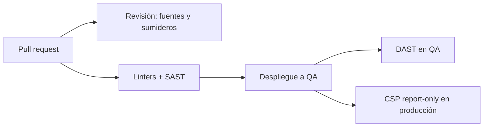

# XSS - cómo detectarlo

Parte de: [[12-Seguridad/03 XSS/_Índice XSS|XSS]]

> [!info] Cómo avanzar
> `progreso`: **pendiente** → **viendo** (estudiando) → **visto** (contestaste la autoevaluación sin abrir las respuestas) → **dominado** (hiciste el laboratorio o lo aplicaste de verdad).

## Contenido

### Qué es
Detectar XSS en **tu propia aplicación** combina revisión de código, herramientas automáticas y pruebas manuales seguras en tu entorno. Como el XSS puede vivir en el servidor (reflejado, almacenado) o solo en el cliente (basado en DOM), ninguna técnica sola lo cubre todo.

### Cómo funciona
**Qué buscas en una revisión de código**:
- **Sumideros de HTML en el cliente**: `innerHTML`, `outerHTML`, `insertAdjacentHTML`, `document.write`, `$(...).html()`, y en React `dangerouslySetInnerHTML`.
- **Sumideros de ejecución**: `eval`, `new Function`, `setTimeout`/`setInterval` con cadenas.
- **Fuentes no confiables** que llegan a esos sumideros: `location` (`search`, `hash`), `document.referrer`, `postMessage`, valores de `localStorage`, y datos del API.
- **HTML crudo en el servidor**: `@Html.Raw` en Razor, respuestas que arman HTML concatenando datos.
- **URLs construidas con datos del usuario** en `href`/`src` sin validar el esquema.
- **Plantillas de JS** que arman HTML con datos (ver [[XSS - escape de datos del API en templates de JS]]).

Un primer barrido con `grep` sobre el front:

```bash
# Sumideros comunes en el cliente
git grep -nE 'innerHTML|outerHTML|insertAdjacentHTML|document\.write|dangerouslySetInnerHTML|\beval\(|new Function' -- '*.ts' '*.tsx' '*.js'
# HTML crudo en Razor
git grep -nE 'Html\.Raw' -- '*.cshtml'
```

**Qué herramientas ayudan**:
- **SAST** como CodeQL, Semgrep o SonarQube, que siguen el flujo de fuente a sumidero y marcan patrones de XSS de DOM.
- **Linters** del front: `eslint-plugin-react` avisa sobre `dangerouslySetInnerHTML`, y reglas de seguridad adicionales marcan sumideros.
- **DAST** como OWASP ZAP (escaneo activo) y Burp Suite, contra una instancia **tuya** en un ambiente de pruebas. Ver [[OWASP ZAP]] y [[Burp Suite Community]].
- **CSP en modo `report-only`** con un endpoint de reportes: te avisa de scripts inesperados sin romper la página. Ver [[Content Security Policy]].



### Ejemplo
**Método manual seguro en tu propia app**: en tu instancia local de Itzamna.Clio, escribe en cada campo que luego se muestre un **marcador inofensivo con caracteres especiales** (por ejemplo, un texto con `<`, `>`, comillas y un nombre como `a<b>c "d" 'e'`) y observa **cómo se renderiza**:
- Si en pantalla ves el texto **literal** (`a<b>c "d" 'e'`), el dato se está codificando: bien.
- Si los caracteres **desaparecen** o cambian el formato de la página (aparece algo en negritas, se rompe el diseño), el dato se está interpretando como HTML: ahí hay un problema que corregir.

Inspecciona el DOM con las herramientas de desarrollo para confirmar si el dato quedó como texto o como nodos. Repite en los canales olvidados: atributos, URLs, correos, exportaciones. Para practicar la explotación de forma legal, usa PortSwigger: [[Lab 6 - PortSwigger - laboratorios de XSS nivel Apprentice]] y [[Lab 5 - CSP y codificación de salida en una página propia]].

### Cuándo usarlo y cuándo no
Combina las técnicas: revisión y linters en cada PR, SAST en el build, DAST y CSP report-only en QA/producción. **Nunca** pruebes XSS contra sitios de terceros ni en producción ajena sin autorización por escrito. Ver [[Marco legal y autorización por escrito]].

### Errores comunes
- **Buscar solo en el servidor** y perder el XSS de DOM, que vive en el cliente.
- **Confiar en una sola herramienta.**
- **Probar solo el campo "obvio"** y olvidar atributos, URLs, correos y exportaciones.
- **No revisar los `.cshtml`** ni el uso de `dangerouslySetInnerHTML`.
- **Interpretar mal el marcador**: hay que ver el DOM, no solo la pantalla.

### Para profundizar
- [OWASP: Testing for Cross Site Scripting (WSTG)](https://owasp.org/www-project-web-security-testing-guide/latest/4-Web_Application_Security_Testing/07-Input_Validation_Testing/01-Testing_for_Reflected_Cross_Site_Scripting)
- [CodeQL](https://codeql.github.com/)
- [OWASP ZAP](https://www.zaproxy.org/)

> [!warning] Ética
> Las pruebas de esta nota se hacen solo en tu propio código, en tu máquina o en plataformas de entrenamiento (PortSwigger Web Security Academy, DVWA, OWASP Juice Shop). Ver [[Marco legal y autorización por escrito]].

## Autoevaluación

Contesta primero en voz alta o en papel; luego despliega la respuesta.

> [!question]- ¿Qué buscas en una revisión de código?
> Usos de `innerHTML`, `outerHTML`, `insertAdjacentHTML`, `document.write`, `eval`, `dangerouslySetInnerHTML`, `@Html.Raw`, `[innerHTML]` en Angular, `v-html` en Vue, y atributos `href` construidos con datos externos.

> [!question]- ¿Qué herramientas ayudan?
> SAST (CodeQL, reglas de ESLint como `no-unsanitized`), DAST ([[OWASP ZAP]]), pruebas manuales con [[Burp Suite Community]] en entornos de práctica y los reportes de violación de CSP.

> [!question]- ¿Qué método manual seguro usas en tu propia app?
> Meter un texto marcador con caracteres especiales (`<`, `"`, `'`) en cada campo y ver en el HTML resultante si aparece codificado o crudo. Si aparece crudo, hay un punto a corregir.

## Práctica

- [[Lab 6 - PortSwigger - laboratorios de XSS nivel Apprentice]]

