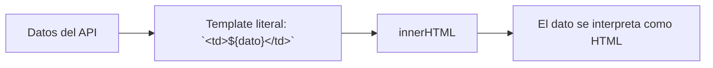

# XSS - escape de datos del API en templates de JS

Parte de: [[12-Seguridad/03 XSS/_Índice XSS|XSS]]

> [!info] Cómo avanzar
> `progreso`: **pendiente** → **viendo** (estudiando) → **visto** (contestaste la autoevaluación sin abrir las respuestas) → **dominado** (hiciste el laboratorio o lo aplicaste de verdad).

## Contenido

### Qué es
Cuando construyes HTML en el cliente a partir de datos del API usando *template literals* (plantillas con comillas invertidas) y lo asignas a `innerHTML`, estás creando HTML a mano con datos no confiables: un sumidero clásico de XSS de DOM. Esta nota trata cómo evitarlo: no escapar a mano, sino usar APIs que tratan el dato como texto.

### Cómo funciona
Un template literal como `` `<td>${c.nombre}</td>` `` **no** escapa nada: `${c.nombre}` se inserta tal cual en la cadena. Si esa cadena va a `innerHTML`, el navegador la interpreta como HTML, y un `nombre` con etiquetas o controladores de evento se procesa.



**Por qué es peligroso** aunque el dato venga de "tu propio API": el API puede servir datos que otro usuario guardó (XSS almacenado), y el template no distingue texto de marcado. El problema no es el origen del dato, es la mezcla de datos con HTML en una cadena que luego se interpreta.

### Ejemplo
**Alternativa que evita escapar a mano**: construir nodos y asignar `textContent`.

```js
// Riesgo: template + innerHTML
// tbody.innerHTML = clientes.map(c => `<tr><td>${c.nombre}</td><td>${c.correo}</td></tr>`).join("");

// Seguro: nodos con textContent, sin HTML a mano
function filaCliente(c) {
  const tr = document.createElement("tr");
  for (const valor of [c.nombre, c.correo]) {
    const td = document.createElement("td");
    td.textContent = valor;
    tr.appendChild(td);
  }
  return tr;
}
tbody.replaceChildren(...clientes.map(filaCliente));
```

Si por alguna razón necesitas generar una **cadena** HTML, aquí va una **función de escape HTML mínima** (para el contexto HTML; no cubre atributos de URL ni JavaScript):

```js
// Escape mínimo para contexto HTML
function escaparHtml(s) {
  return String(s)
    .replaceAll("&", "&amp;")
    .replaceAll("<", "&lt;")
    .replaceAll(">", "&gt;")
    .replaceAll('"', "&quot;")
    .replaceAll("'", "&#39;");
}
// Uso: tbody.innerHTML = clientes.map(c => `<tr><td>${escaparHtml(c.nombre)}</td></tr>`).join("");
```

Aun así, **prefiere** construir nodos o usar un framework: una función a mano es fácil de olvidar en un campo y no sirve para datos que van en `href`, en `<script>` o en atributos de evento. La mejor alternativa de todas es usar **React** (o similar), que codifica por defecto, en lugar de construir HTML a mano. Y si el dato **debe** contener HTML con formato, sanitízalo con DOMPurify. Ver [[XSS - sanitización de HTML (DOMPurify)]] y [[XSS - textContent vs innerHTML]].

### Cuándo usarlo y cuándo no
Evita por completo el patrón "template literal → `innerHTML`" con datos. Úsalo solo con contenido estático que tú controlas. Para datos del API: nodos con `textContent`, o un framework que codifique. El escape a mano es un último recurso para código heredado que no puedes migrar pronto, y aun así solo cubre el contexto HTML.

### Errores comunes
- **Creer que los template literals escapan**: no lo hacen, solo interpolan.
- **Un escape a mano incompleto** (olvidar comillas o el `&`).
- **Reusar el escape HTML para atributos de URL o JavaScript**, donde no aplica.
- **Confiar en el dato por venir del propio API.**

### Para profundizar
- [OWASP DOM based XSS Prevention Cheat Sheet](https://cheatsheetseries.owasp.org/cheatsheets/DOM_based_XSS_Prevention_Cheat_Sheet.html)
- [MDN: Template literals](https://developer.mozilla.org/en-US/docs/Web/JavaScript/Reference/Template_literals)
- [DOMPurify](https://github.com/cure53/DOMPurify)

> [!warning] Ética
> Las pruebas de esta nota se hacen solo en tu propio código, en tu máquina o en plataformas de entrenamiento (PortSwigger Web Security Academy, DVWA, OWASP Juice Shop). Ver [[Marco legal y autorización por escrito]].

## Autoevaluación

Contesta primero en voz alta o en papel; luego despliega la respuesta.

> [!question]- ¿Por qué es peligroso un template literal como `` `<td>${c.nombre}</td>` `` asignado a `innerHTML`?
> Porque el valor del API se inserta como HTML. Si un nombre trae etiquetas, se crean en la página. Los datos del API son entrada no confiable aunque vengan de tu propio backend.

> [!question]- Escribe una función de escape HTML mínima.
> ```js
> const esc = s => String(s ?? '')
>   .replaceAll('&','&amp;').replaceAll('<','&lt;').replaceAll('>','&gt;')
>   .replaceAll('"','&quot;').replaceAll("'",'&#x27;');
> ```
> Úsala solo para contexto HTML; para atributos, siempre entre comillas.

> [!question]- ¿Qué alternativa evita escapar a mano?
> Usar una librería de plantillas que escape por defecto (lit-html, React) o construir nodos con `createElement` + `textContent`.

## Práctica

- [[Lab 5 - CSP y codificación de salida en una página propia]]

