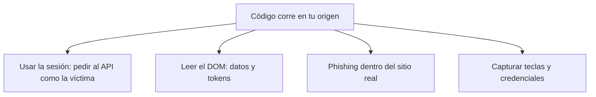

# XSS - impacto real

Parte de: [[12-Seguridad/03 XSS/_Índice XSS|XSS]]

> [!info] Cómo avanzar
> `progreso`: **pendiente** → **viendo** (estudiando) → **visto** (contestaste la autoevaluación sin abrir las respuestas) → **dominado** (hiciste el laboratorio o lo aplicaste de verdad).

## Contenido

### Qué es
El **impacto** de un XSS es lo que el código inyectado puede hacer una vez que corre en el navegador de la víctima, **dentro de tu origen**. Como hereda los privilegios de tu front-end, el daño va mucho más allá de "mostrar una alerta": puede actuar como el usuario y, si la víctima es administrador, comprometer el sistema.

### Cómo funciona
El código inyectado se ejecuta con el mismo acceso que tu JavaScript legítimo. **Cuatro impactos** representativos:

1. **Secuestro de sesión y acciones en nombre del usuario**: hace peticiones autenticadas a tu API (transferencias, cambios de datos, compras) usando la sesión de la víctima. Aunque no robe la cookie, actúa mientras la página está abierta.
2. **Robo de datos del DOM y de la página**: lee lo que la víctima ve y escribe: formularios, datos personales, tokens presentes en la página, contenido de pantallas internas.
3. **Phishing y modificación de la interfaz**: inyecta un formulario de login falso que parece tuyo (mismo dominio, mismo diseño) para capturar credenciales, o cambia enlaces y botones.
4. **Robo de credenciales almacenadas y keylogging**: captura lo que se teclea, lee tokens guardados en `localStorage`, o se encadena con el navegador para otros ataques.

**Si la cookie de sesión es `HttpOnly`, ¿el XSS ya no importa?** Sí importa, y mucho. `HttpOnly` impide que el JavaScript **lea** la cookie, así que frena su **robo** directo, lo cual es valioso. Pero el navegador **sigue enviando** esa cookie en cada petición al mismo origen, así que el código inyectado puede hacer peticiones autenticadas en nombre de la víctima sin necesidad de leer la cookie. Además puede robar datos del DOM, hacer phishing y leer tokens que no estén en cookies (por ejemplo en `localStorage`). `HttpOnly` es una capa útil, no una solución al XSS.

**Por qué un XSS en un panel de administración es crítico**: el código corre con la sesión de un administrador, es decir con permisos elevados. Puede crear usuarios, cambiar permisos, leer o exportar toda la base a través de las APIs administrativas, o modificar configuración. Un XSS almacenado que aparezca en una pantalla interna (una lista de comentarios reportados, un detalle de usuario) convierte a cualquier atacante que logre guardar contenido en alguien con acceso de administrador en cuanto un admin abra esa pantalla. Por eso el XSS almacenado que alcanza paneles internos es de los peores escenarios. Ver [[XSS - almacenado]].

### Ejemplo
Cómo se encadena en tus proyectos: un XSS almacenado en el campo "notas" de un cliente de Itzamna.Dionisio, visible en el panel interno. Cuando un agente de soporte (con permisos amplios) abre la ficha, el código inyectado usa su sesión para llamar `/api/usuarios` y exfiltrar la lista, todo desde el origen de confianza y sobre HTTPS. Las defensas que lo habrían evitado: codificar la salida en el panel, CSP que restrinja a dónde puede enviar datos el script, y no mostrar HTML crudo.

### Cuándo usarlo y cuándo no
Usa esta nota para **comunicar por qué el XSS no es menor** y para justificar las capas (codificación, CSP, `HttpOnly`, sanitización). No la uses para minimizar: incluso sin robo de cookie, el impacto de actuar como la víctima es serio.

### Errores comunes
- **Creer que `HttpOnly` resuelve el XSS.**
- **Pensar que un XSS "solo con alert" es inofensivo**: demuestra ejecución de código, el resto es cuestión de carga.
- **Descuidar las pantallas internas** por asumir que "solo las ve gente de confianza".
- **Guardar tokens en `localStorage`** sin considerar que un XSS los lee.

### Para profundizar
- [OWASP: Cross Site Scripting (XSS)](https://owasp.org/www-community/attacks/xss/)
- [PortSwigger: XSS](https://portswigger.net/web-security/cross-site-scripting)
- [MDN: Set-Cookie HttpOnly](https://developer.mozilla.org/en-US/docs/Web/HTTP/Headers/Set-Cookie#httponly)

## Autoevaluación

Contesta primero en voz alta o en papel; luego despliega la respuesta.

> [!question]- Menciona cuatro impactos de un XSS.
> Robo de tokens en `localStorage`; acciones en nombre del usuario (cambiar correo, transferir); páginas falsas de inicio de sesión dentro del sitio legítimo; registro de teclas en formularios; propagación tipo gusano en contenido almacenado.

> [!question]- Si la cookie de sesión es HttpOnly, ¿el XSS ya no importa?
> Sí importa: el script no puede leer la cookie, pero puede hacer peticiones con ella desde la misma página. HttpOnly limita el robo, no las acciones.

> [!question]- ¿Por qué un XSS en un panel de administración es crítico?
> Porque el script corre con privilegios de administrador: puede crear usuarios, cambiar permisos o leer datos de todos.

## Práctica

- [[Lab 6 - PortSwigger - laboratorios de XSS nivel Apprentice]]

