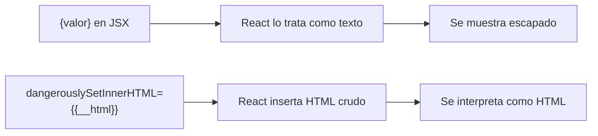

# XSS - protección por defecto de React y dangerouslySetInnerHTML

Parte de: [[12-Seguridad/03 XSS/_Índice XSS|XSS]]

> [!info] Cómo avanzar
> `progreso`: **pendiente** → **viendo** (estudiando) → **visto** (contestaste la autoevaluación sin abrir las respuestas) → **dominado** (hiciste el laboratorio o lo aplicaste de verdad).

## Contenido

### Qué es
**React codifica por defecto**: cuando interpolas un valor en JSX con `{valor}`, React lo inserta como **texto**, no como HTML. Un valor con `<`, `>` o etiquetas se muestra literal y no se ejecuta. Por eso una app de React bien escrita está protegida contra la mayoría del XSS sin esfuerzo extra. La excepción deliberada es `dangerouslySetInnerHTML`, cuyo nombre advierte el riesgo.

### Cómo funciona


**Qué hace React con `{texto}` en JSX**: escapa el contenido para el contexto HTML antes de ponerlo en el DOM. Esto cubre el texto entre etiquetas y los atributos normales que asignas como propiedades (`value`, `alt`, `title`). No tienes que llamar a ninguna función de escape.

**Cuándo vuelve el riesgo en React**, a pesar de la protección por defecto:
1. **`dangerouslySetInnerHTML`**: le pides a React que inserte HTML sin escapar. Si ese HTML viene de datos del usuario sin sanitizar, es XSS.
2. **URLs en `href`/`src`** construidas con datos del usuario: React no valida el **esquema**, así que un `href={valorUsuario}` puede ser `javascript:...`. Hay que validar que sea una ruta interna o `https:`.
3. **Pasar props a librerías** que internamente usan `innerHTML` o `eval`.
4. **Inyección de DOM fuera de React**: usar `ref` para manipular el nodo con `innerHTML`, o leer `location`/`postMessage` y escribir en el DOM. Ver [[XSS - basado en DOM]].
5. **Datos interpretados como código** (`eval`, `new Function`) con valores del usuario.

### Ejemplo
**Uso seguro de `dangerouslySetInnerHTML`**: solo con HTML **sanitizado** por una librería probada (DOMPurify), nunca con datos crudos.

```tsx
import DOMPurify from "dompurify";

function Descripcion({ html }: { html: string }) {
  // Sanitiza justo antes de insertar; useMemo evita rehacerlo en cada render
  const limpio = React.useMemo(() => DOMPurify.sanitize(html), [html]);
  return <div dangerouslySetInnerHTML={{ __html: limpio }} />;
}

// Lo seguro por defecto: dejar que React codifique
function Comentario({ texto }: { texto: string }) {
  return <p>{texto}</p>;
}

// URL del usuario: validar el esquema
function EnlaceSitio({ sitio }: { sitio: string }) {
  const seguro = /^https:\/\//.test(sitio) ? sitio : "#";
  return <a href={seguro} rel="noopener noreferrer">Sitio</a>;
}
```

En la práctica, en Itzamna.Clio solo necesitarías HTML crudo para mostrar contenido con formato (descripciones enriquecidas, notas de un editor). En esos casos: sanitiza en el cliente con DOMPurify y, si el HTML se guarda, sanitiza también en el servidor. Ver [[XSS - sanitización de HTML (DOMPurify)]].

### Cuándo usarlo y cuándo no
Confía en la protección por defecto para todo el texto: es el 95 % de los casos. Reserva `dangerouslySetInnerHTML` para cuando **de verdad** necesites renderizar HTML, y siempre con sanitización. Si solo necesitas saltos de línea o formato simple, prefiere CSS (`white-space: pre-wrap`) o construir los elementos, en lugar de HTML crudo.

### Errores comunes
- **Usar `dangerouslySetInnerHTML` sin sanitizar** "porque el dato es de confianza".
- **Olvidar validar URLs** en `href`/`src` (el esquema `javascript:`).
- **Sanitizar en el render sin memoizar** (problema de rendimiento, no de seguridad) o, peor, sanitizar en un sitio y olvidarlo en otro.
- **Manipular el DOM con `ref` + `innerHTML`**, saliéndote de la protección de React.
- **Confiar solo en React**: la sanitización del servidor sigue siendo necesaria para HTML que se guarda.

### Para profundizar
- [React: dangerouslySetInnerHTML](https://react.dev/reference/react-dom/components/common#dangerously-setting-the-inner-html)
- [DOMPurify](https://github.com/cure53/DOMPurify)
- [OWASP XSS Prevention Cheat Sheet](https://cheatsheetseries.owasp.org/cheatsheets/Cross_Site_Scripting_Prevention_Cheat_Sheet.html)

## Autoevaluación

Contesta primero en voz alta o en papel; luego despliega la respuesta.

> [!question]- ¿Qué hace React con `{texto}` en JSX?
> Lo inserta como nodo de texto, así que las etiquetas no se interpretan.

> [!question]- ¿Cuándo vuelve el riesgo en React?
> Con `dangerouslySetInnerHTML`, con `href` o `src` construidos con datos del usuario (esquemas peligrosos), con acceso directo al DOM por `ref` y con librerías que inyectan HTML.

> [!question]- Uso seguro de `dangerouslySetInnerHTML`.
> ```jsx
> <div dangerouslySetInnerHTML={{ __html: DOMPurify.sanitize(html) }} />
> ```
> Siempre sanitizado y solo cuando de verdad necesitas HTML.

