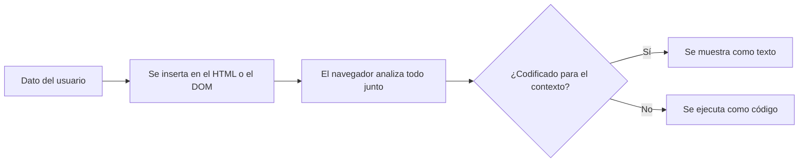

# XSS - qué es y por qué ocurre

Parte de: [[12-Seguridad/03 XSS/_Índice XSS|XSS]]

> [!info] Cómo avanzar
> `progreso`: **pendiente** → **viendo** (estudiando) → **visto** (contestaste la autoevaluación sin abrir las respuestas) → **dominado** (hiciste el laboratorio o lo aplicaste de verdad).

## Contenido

### Qué es
**XSS** ocurre cuando un dato no confiable se inserta en una página web de forma que el navegador lo **ejecuta como código** en lugar de mostrarlo como texto. El nombre (*Cross-Site Scripting*) es histórico; lo esencial es que es **inyección en el navegador**: el mismo problema de fondo que SQL injection, pero el intérprete es el navegador y el lenguaje es HTML/JavaScript.

### Cómo funciona
**Por qué ocurre**: una página mezcla el marcado que escribió el desarrollador con datos que escribió otra persona, sin marcar la frontera entre ambos. Cuando el navegador analiza el HTML, no puede saber que cierto fragmento "era solo un comentario de usuario"; si ese fragmento contiene etiquetas o controladores de eventos, los interpreta como parte de la página.



La solución es no mezclar: **codificar la salida** según dónde se inserte el dato, o usar APIs que tratan el dato como texto (`textContent`, interpolación de React).

**Por qué es tan peligroso que "solo corre en el navegador".** Porque corre **dentro de tu origen**, con los mismos privilegios que tu propio front-end:
- Puede leer y usar la **sesión** del usuario (hacer peticiones autenticadas a tu API como si fuera él).
- Puede leer el **DOM**: lo que la víctima ve y escribe, incluidos formularios y tokens en la página.
- Puede **modificar la página**: inyectar un formulario de phishing que parece tuyo, cambiar botones, redirigir.
- Si la cookie de sesión no es `HttpOnly`, puede **robarla**; si lo es, igual actúa en nombre del usuario mientras la página está abierta.

No es "solo el navegador de una persona": si el XSS es almacenado, afecta a **todos** los que ven ese contenido, y si la víctima es un administrador, el atacante actúa con sus permisos.

**¿HTTPS protege contra XSS?** No. HTTPS cifra el tráfico entre el navegador y el servidor (protege de escuchas y manipulación en la red), pero el XSS viaja **dentro** de ese canal cifrado, como contenido legítimo de la página. Son problemas distintos: HTTPS es confidencialidad e integridad en tránsito; XSS es inyección en el navegador.

### Ejemplo
El mismo dato, inseguro y seguro, en una página de Itzamna.Clio:

```tsx
// Seguro: React codifica; un texto con < > se muestra literal
<span>{usuario.nombre}</span>
```

```js
// Inseguro: el dato se interpreta como HTML
contenedor.innerHTML = "Hola, " + usuario.nombre;
// Seguro: se trata como texto
contenedor.textContent = "Hola, " + usuario.nombre;
```

### Cuándo usarlo y cuándo no
No hay "cuándo usarlo": XSS se previene siempre que muestres datos que no controlas. La regla práctica: usa las herramientas que codifican por defecto y trata todo dato externo (y los datos guardados que vienen de usuarios) como no confiable.

### Errores comunes
- **Creer que "es solo el front" y por eso importa poco.**
- **Pensar que HTTPS o un login ya lo cubren.**
- **Validar la entrada** y asumir que con eso basta, en vez de codificar la salida.
- **Insertar HTML con `innerHTML`** por comodidad.

### Para profundizar
- [OWASP: Cross Site Scripting (XSS)](https://owasp.org/www-community/attacks/xss/)
- [MDN: Cross-site scripting](https://developer.mozilla.org/en-US/docs/Web/Security/Attacks/XSS)
- [OWASP XSS Prevention Cheat Sheet](https://cheatsheetseries.owasp.org/cheatsheets/Cross_Site_Scripting_Prevention_Cheat_Sheet.html)

## Autoevaluación

Contesta primero en voz alta o en papel; luego despliega la respuesta.

> [!question]- ¿Por qué ocurre XSS?
> Porque la aplicación inserta datos no confiables en HTML o JavaScript sin convertirlos al contexto, y el navegador no puede distinguir el código del programador del texto del usuario.

> [!question]- ¿Por qué el código inyectado es tan peligroso si "solo corre en el navegador"?
> Corre con el origen de tu app: puede leer el DOM, hacer peticiones autenticadas en nombre del usuario, leer tokens guardados en `localStorage` y modificar lo que ve el usuario.

> [!question]- ¿HTTPS protege contra XSS?
> No. HTTPS protege el transporte; el XSS viene en el contenido que tu propia app entrega.

