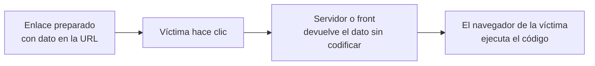

# XSS - reflejado

Parte de: [[12-Seguridad/03 XSS/_Índice XSS|XSS]]

> [!info] Cómo avanzar
> `progreso`: **pendiente** → **viendo** (estudiando) → **visto** (contestaste la autoevaluación sin abrir las respuestas) → **dominado** (hiciste el laboratorio o lo aplicaste de verdad).

## Contenido

### Qué es
El **XSS reflejado** es la variante en la que el dato malicioso viaja en la **petición** (un parámetro de la URL, un campo de búsqueda, un encabezado) y la aplicación lo **devuelve sin codificar** en la respuesta inmediata. "Reflejado" porque el servidor hace eco del dato en la misma respuesta. No se guarda: afecta a quien hace esa petición concreta, por lo general tras seguir un enlace preparado.

### Cómo funciona


El atacante prepara un enlace a **tu** sitio con el dato en la URL y logra que la víctima lo abra (correo, mensaje, otra página). Como el dominio es el tuyo y la víctima confía en él, el navegador ejecuta el código dentro de tu origen, con la sesión de la víctima.

**Qué lo diferencia del almacenado**: en el reflejado el dato **no se guarda**; vive solo en esa petición y respuesta, así que requiere que cada víctima abra el enlace. En el [[XSS - almacenado]] el dato queda guardado y se sirve a todos los que ven la página, sin enlace. El reflejado suele ser algo menos grave por eso, pero sigue permitiendo robo de sesión y phishing dirigido.

### Ejemplo
Un caso típico es una **página de error o de resultados que repite lo que el usuario escribió**. Conceptualmente, el patrón vulnerable toma un parámetro y lo inserta en el HTML sin codificar:

```js
// Vulnerable (ilustrativo): el término de búsqueda se mete como HTML
const q = new URLSearchParams(location.search).get("q");
resultado.innerHTML = "No se encontró: " + q;   // si q trae etiquetas, se ejecutan
```

Correcciones, según el stack:

```js
// JS sin framework: tratar el dato como texto
resultado.textContent = "No se encontró: " + q;
```

```tsx
// React: interpolar en JSX codifica automáticamente
function SinResultados({ q }: { q: string }) {
  return <p>No se encontró: {q}</p>;
}
```

```csharp
// ASP.NET Core con Razor: @ codifica por defecto
// <p>No se encontró: @Model.Termino</p>
```

En las tres, el dato se muestra como texto y nunca se ejecuta. Si el dato va a un **atributo** o a una **URL**, la codificación necesaria cambia; ver [[XSS - contextos de salida (HTML, atributo, JavaScript y URL)]].

### Cuándo usarlo y cuándo no
La prevención aplica a cualquier punto donde la respuesta repita datos de la petición: búsquedas, mensajes de error, confirmaciones, campos "echo". La defensa es la misma que para todo XSS: **codificar según el contexto** y preferir APIs seguras. Para practicarlo de forma legal, usa PortSwigger. Ver [[Lab 6 - PortSwigger - laboratorios de XSS nivel Apprentice]].

### Errores comunes
- **Repetir parámetros de la URL** en mensajes de error o resultados con `innerHTML`.
- **Codificar para el contexto equivocado**: HTML cuando el dato va en un atributo o en JavaScript.
- **Confiar en que "nadie va a mandar ese enlace"**: el atacante solo necesita que una víctima lo abra.
- **Asumir que el framework cubre todo**: sí para la interpolación normal, no si usas HTML crudo.

### Para profundizar
- [PortSwigger: Reflected XSS](https://portswigger.net/web-security/cross-site-scripting/reflected)
- [OWASP XSS Prevention Cheat Sheet](https://cheatsheetseries.owasp.org/cheatsheets/Cross_Site_Scripting_Prevention_Cheat_Sheet.html)
- [MDN: Cross-site scripting](https://developer.mozilla.org/en-US/docs/Web/Security/Attacks/XSS)

> [!warning] Ética
> Las pruebas de esta nota se hacen solo en tu propio código, en tu máquina o en plataformas de entrenamiento (PortSwigger Web Security Academy, DVWA, OWASP Juice Shop). Ver [[Marco legal y autorización por escrito]].

## Autoevaluación

Contesta primero en voz alta o en papel; luego despliega la respuesta.

> [!question]- ¿Cómo funciona un XSS reflejado conceptualmente?
> El servidor toma un parámetro de la petición (por ejemplo el texto de búsqueda) y lo devuelve en el HTML sin codificar. El atacante convence a la víctima de abrir un enlace con ese parámetro preparado.

> [!question]- ¿Qué lo diferencia del almacenado?
> No se guarda: solo afecta a quien abre el enlace manipulado. Requiere ingeniería social, pero es común en páginas de búsqueda y de error.

> [!question]- Ejemplo típico de código vulnerable en una página de error.
> Mostrar "No se encontró: " + el valor de la URL concatenado directamente en el HTML. La corrección es codificar ese valor como texto HTML.

## Práctica

- [[Lab 6 - PortSwigger - laboratorios de XSS nivel Apprentice]]

