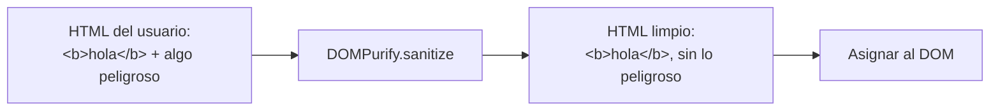

# XSS - sanitización de HTML (DOMPurify)

Parte de: [[12-Seguridad/03 XSS/_Índice XSS|XSS]]

> [!info] Cómo avanzar
> `progreso`: **pendiente** → **viendo** (estudiando) → **visto** (contestaste la autoevaluación sin abrir las respuestas) → **dominado** (hiciste el laboratorio o lo aplicaste de verdad).

## Contenido

### Qué es
**Sanitizar** HTML es tomar una cadena de HTML que puede contener elementos peligrosos y devolver una versión **limpia**: conserva el formato permitido (negritas, listas, enlaces) y elimina lo que puede ejecutar código (scripts, controladores de evento, esquemas `javascript:`). Es distinto de **codificar**: codificar convierte todo el HTML en texto visible; sanitizar permite un subconjunto seguro de HTML real. **DOMPurify** es la librería estándar para hacerlo en el navegador.

### Cómo funciona


**Cuándo necesitas sanitizar en lugar de codificar**: solo cuando el dato **debe mostrarse como HTML con formato**. Si el usuario escribe en un editor enriquecido (comentarios con negritas y enlaces, descripciones), no puedes codificar (perderías el formato) ni insertar crudo (sería XSS). La sanitización es el punto medio. Para texto plano —la gran mayoría de los casos— **no** sanitices: codifica o usa `textContent`/React, que es más simple y seguro.

**Por qué no escribir tu propio sanitizador con expresiones regulares**: el HTML no es un lenguaje regular, y los navegadores son muy permisivos al analizarlo (toleran etiquetas mal cerradas, atributos raros, codificaciones mezcladas, comentarios condicionales). Un filtro con regex siempre deja huecos: variantes de mayúsculas, espacios y saltos de línea dentro de etiquetas, atributos de evento poco conocidos, `svg`/`mathml`, codificaciones alternativas. DOMPurify, en cambio, **analiza** el HTML con el motor del navegador y recorre el árbol real aplicando una lista blanca, que es la única forma robusta. Está mantenido por especialistas y se actualiza ante nuevas técnicas de evasión.

### Ejemplo
Uso básico de DOMPurify, en JavaScript y en React:

```js
import DOMPurify from "dompurify";

// Por defecto permite un conjunto seguro de etiquetas y atributos
const limpio = DOMPurify.sanitize(htmlDelUsuario);
contenedor.innerHTML = limpio;

// Restringir aún más: solo formato básico, sin enlaces ni imágenes
const soloTexto = DOMPurify.sanitize(htmlDelUsuario, {
  ALLOWED_TAGS: ["b", "i", "em", "strong", "p", "ul", "ol", "li", "br"],
  ALLOWED_ATTR: [],
});
```

```tsx
import DOMPurify from "dompurify";

function NotaEnriquecida({ html }: { html: string }) {
  const limpio = React.useMemo(() => DOMPurify.sanitize(html), [html]);
  return <div dangerouslySetInnerHTML={{ __html: limpio }} />;
}
```

En tu arquitectura, si el HTML enriquecido se **guarda** en Itzamna.Dionisio y lo ven otros usuarios (XSS almacenado), sanitiza **también en el servidor** antes de guardar o al servir, porque un cliente malicioso puede saltarse el front. En .NET puedes usar la librería **HtmlSanitizer** (de mganss). No confíes solo en la sanitización del cliente para contenido que persiste y se comparte.

### Cuándo usarlo y cuándo no
- **Sanitiza** solo cuando necesitas renderizar HTML con formato proveniente de usuarios.
- **No sanitices** texto plano: codifica o usa APIs seguras, que es más simple.
- **Combina con [[Content Security Policy]] y [[Trusted Types]]**: DOMPurify soporta Trusted Types, lo que refuerza que solo HTML sanitizado llegue a los sumideros del DOM.
- Mantén la librería actualizada.

### Errores comunes
- **Escribir tu propio filtro con regex.**
- **Sanitizar solo en el cliente** para contenido que se guarda y se comparte.
- **Sanitizar y luego modificar** el HTML limpio (reabrir el hueco).
- **Usar sanitización cuando bastaba codificar** (texto plano): complejidad innecesaria.
- **Configuraciones demasiado permisivas** que vuelven a permitir `javascript:` o `on*`.

### Para profundizar
- [DOMPurify (repositorio oficial)](https://github.com/cure53/DOMPurify)
- [HtmlSanitizer para .NET (mganss)](https://github.com/mganss/HtmlSanitizer)
- [OWASP XSS Prevention Cheat Sheet](https://cheatsheetseries.owasp.org/cheatsheets/Cross_Site_Scripting_Prevention_Cheat_Sheet.html)

## Autoevaluación

Contesta primero en voz alta o en papel; luego despliega la respuesta.

> [!question]- ¿Cuándo necesitas sanitizar en lugar de codificar?
> Cuando el usuario tiene derecho a enviar HTML con formato (editor enriquecido, Markdown renderizado) y quieres conservar etiquetas seguras como `<b>` o `<a>`.

> [!question]- ¿Cómo se usa DOMPurify?
> ```js
> import DOMPurify from 'dompurify';
> contenedor.innerHTML = DOMPurify.sanitize(htmlDelUsuario);
> ```
> Quita elementos y atributos peligrosos y deja el resto.

> [!question]- ¿Por qué no escribir tu propio sanitizador con expresiones regulares?
> El HTML tiene demasiadas formas de ocultar código (mayúsculas, entidades, atributos raros, parsers que corrigen errores). Una librería mantenida trabaja sobre el DOM real y se actualiza ante evasiones.

