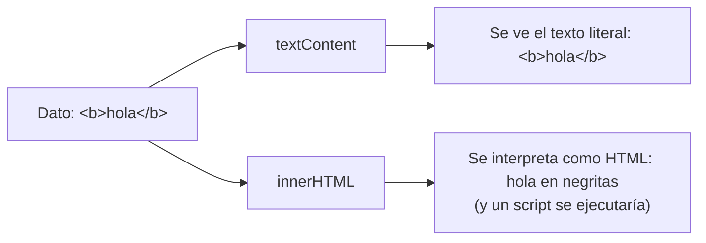

# XSS - textContent vs innerHTML

Parte de: [[12-Seguridad/03 XSS/_Índice XSS|XSS]]

> [!info] Cómo avanzar
> `progreso`: **pendiente** → **viendo** (estudiando) → **visto** (contestaste la autoevaluación sin abrir las respuestas) → **dominado** (hiciste el laboratorio o lo aplicaste de verdad).

## Contenido

### Qué es
`textContent` e `innerHTML` son dos formas de poner contenido en un elemento del DOM, y la diferencia es de seguridad:
- **`textContent`** asigna **texto**: lo que pongas se muestra tal cual, aunque contenga `<`, `>` o etiquetas. El navegador no lo interpreta como HTML.
- **`innerHTML`** asigna **HTML**: el navegador analiza la cadena como marcado y crea los nodos correspondientes. Si contiene etiquetas o controladores de evento, se procesan.

Para mostrar datos no confiables, `textContent` es seguro; `innerHTML` es un sumidero de XSS de DOM.

### Cómo funciona


`innerHTML` no ejecuta directamente una etiqueta `<script>` insertada después de la carga, pero sí procesa otras construcciones que ejecutan código (por ejemplo, controladores de evento como `onerror` en una imagen que falla al cargar). Por eso se considera peligroso con datos del usuario, y `textContent` no: este último nunca crea nodos nuevos ni interpreta marcado, solo asigna una cadena de texto plano al contenido del elemento.

### Ejemplo
**Construir una lista con datos del API sin `innerHTML`**, creando nodos y asignando texto:

```js
async function pintarClientes(contenedor) {
  const clientes = await fetch("/api/clientes").then(r => r.json());
  contenedor.replaceChildren();                 // limpia sin innerHTML = ""
  const ul = document.createElement("ul");
  for (const c of clientes) {
    const li = document.createElement("li");
    li.textContent = `${c.nombre} — ${c.correo}`;  // texto, nunca HTML
    ul.appendChild(li);
  }
  contenedor.appendChild(ul);
}
```

En **React** esto no es un problema habitual porque JSX ya trata los valores como texto; el equivalente de `innerHTML` es `dangerouslySetInnerHTML`, que se evita salvo con sanitización. Ver [[XSS - protección por defecto de React y dangerouslySetInnerHTML]].

**¿`insertAdjacentHTML` y `outerHTML` son seguros?** No: ambos interpretan HTML igual que `innerHTML`, así que son sumideros peligrosos con datos no confiables. Sus equivalentes seguros son `insertAdjacentText` y, para reemplazar un nodo, crear el nuevo con `textContent` y usar `replaceWith`. También son sumideros `document.write` y, en jQuery, `.html()`.

La diferencia práctica es fácil de recordar: `textContent` responde "muéstrame este texto", mientras que `innerHTML` responde "interpreta esta cadena como HTML y constrúyelo". Para datos que no controlas, casi nunca quieres lo segundo. La misma distinción existe en otras APIs: `setAttribute` frente a construir el atributo dentro de una cadena HTML, o `createElement` frente a `document.write`.

### Cuándo usarlo y cuándo no
- **`textContent`** (o `insertAdjacentText`, `createElement` + propiedades): siempre que muestres datos. Es la opción por defecto.
- **`innerHTML`/`insertAdjacentHTML`/`outerHTML`**: solo con contenido **totalmente estático** que tú controlas, o con HTML del usuario **sanitizado** con DOMPurify. Ver [[XSS - sanitización de HTML (DOMPurify)]].
- Para atributos, usa propiedades (`el.value`, `el.src` con URL validada), no construyas el atributo como texto HTML.

### Errores comunes
- **`innerHTML` por costumbre** cuando `textContent` bastaba.
- **Creer que `innerHTML` es seguro "porque los `<script>` no se ejecutan"**: otras construcciones sí ejecutan código.
- **Usar `insertAdjacentHTML`/`outerHTML`** pensando que son más seguros que `innerHTML` (no lo son).
- **Limpiar con `innerHTML = ""`** y, en el mismo flujo, reasignar `innerHTML` con datos.

### Para profundizar
- [MDN: Node.textContent](https://developer.mozilla.org/en-US/docs/Web/API/Node/textContent)
- [MDN: Element.innerHTML (nota de seguridad)](https://developer.mozilla.org/en-US/docs/Web/API/Element/innerHTML)
- [OWASP DOM based XSS Prevention Cheat Sheet](https://cheatsheetseries.owasp.org/cheatsheets/DOM_based_XSS_Prevention_Cheat_Sheet.html)

## Autoevaluación

Contesta primero en voz alta o en papel; luego despliega la respuesta.

> [!question]- ¿Diferencia entre `textContent` e `innerHTML`?
> `textContent` asigna texto plano: el navegador no interpreta etiquetas. `innerHTML` interpreta el string como HTML, así que puede crear elementos y atributos ejecutables.

> [!question]- ¿Cómo construyes una lista con datos del API sin `innerHTML`?
> ```js
> for (const p of productos) {
>   const li = document.createElement('li');
>   li.textContent = p.nombre;
>   lista.append(li);
> }
> ```

> [!question]- ¿`insertAdjacentHTML` y `outerHTML` son seguros?
> No, se comportan como `innerHTML`. Úsalos solo con HTML fijo o sanitizado.

## Práctica

- [[Lab 5 - CSP y codificación de salida en una página propia]]

