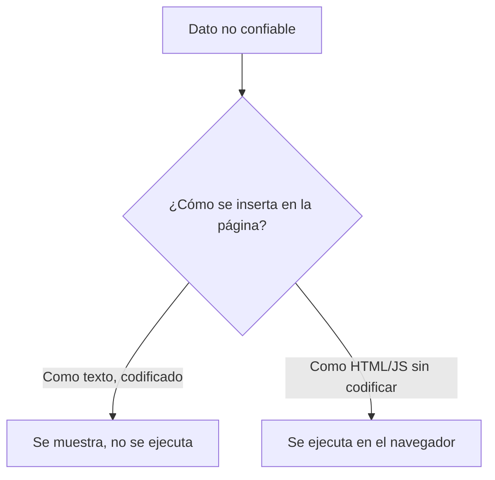

# XSS

Parte de: [[12-Seguridad/03 XSS/_Índice XSS|XSS]]

> [!info] Cómo avanzar
> `progreso`: **pendiente** → **viendo** (estudiando) → **visto** (contestaste la autoevaluación sin abrir las respuestas) → **dominado** (hiciste el laboratorio o lo aplicaste de verdad).

## Contenido

### Qué es
**XSS** (*Cross-Site Scripting*) es una vulnerabilidad en la que datos controlados por un atacante terminan **ejecutándose como código** (normalmente JavaScript) en el navegador de otra persona, dentro del **origen** de tu aplicación. Al correr dentro de tu origen, ese código tiene el mismo acceso que tu propio front: la sesión del usuario, el DOM, las APIs que llama. Esta nota es el panorama; cada subtema entra en detalle.

### Cómo funciona
XSS es, en el fondo, **inyección en el contexto del navegador**: un dato que debía mostrarse como texto se interpreta como HTML o JavaScript porque se insertó sin la codificación adecuada. La [[Same-origin policy]] no ayuda aquí, porque el código inyectado **ya corre dentro** de tu origen.

Los **tres tipos clásicos**:
- **Reflejado**: el dato viene en la petición (una URL, un formulario) y la respuesta lo devuelve sin codificar. Ver [[XSS - reflejado]].
- **Almacenado**: el dato se guarda (un comentario, un perfil) y se sirve a otros usuarios. Es el más grave. Ver [[XSS - almacenado]].
- **Basado en DOM**: el propio JavaScript del cliente toma un dato y lo inserta en la página de forma insegura; el servidor nunca ve el problema. Ver [[XSS - basado en DOM]].



**Defensa principal**: **codificar la salida según el contexto** (HTML, atributo, JavaScript, URL) y usar APIs seguras como `textContent` y el escape automático de React. **Capas extra**: sanitizar HTML cuando de verdad se permite formato ([[XSS - sanitización de HTML (DOMPurify)]]), [[Content Security Policy]], [[Trusted Types]] y cookies `HttpOnly` para que el JavaScript no lea la cookie de sesión.

### Ejemplo
Tus herramientas por defecto ya codifican; el riesgo aparece cuando las evitas:

```tsx
// React: seguro, codifica el texto automáticamente
<p>{comentario.texto}</p>

// Riesgo: dangerouslySetInnerHTML inserta HTML sin codificar
// <div dangerouslySetInnerHTML={{ __html: comentario.texto }} />  // solo con DOMPurify
```

```js
// JS sin framework: textContent (seguro) vs innerHTML (riesgo)
nodo.textContent = comentario.texto;       // se muestra como texto
// nodo.innerHTML = comentario.texto;       // se interpreta como HTML
```

### Cuándo usarlo y cuándo no
Las defensas aplican siempre que muestres datos que no controlas por completo, que es casi cualquier pantalla. La regla: **deja que el framework o la API segura codifiquen por ti**, y solo sal de ese camino (HTML crudo) con una razón clara y sanitización. Trata como no confiable no solo lo que el usuario acaba de escribir, sino también lo que lees de tu propia base (lo guardó alguien antes), lo que viene de otra API y lo que llega por parámetros de la URL o `postMessage`.

### Errores comunes
- **Pensar que validar la entrada basta**: muchos datos válidos llevan caracteres especiales; la defensa es la codificación de **salida**. Ver [[XSS - codificación de salida según el contexto]].
- **Usar `innerHTML` o `dangerouslySetInnerHTML`** con datos del usuario sin sanitizar.
- **Olvidar el contexto**: codificar para HTML un dato que va dentro de un `<script>` o de un `href`.
- **Confiar solo en CSP**: es una capa de mitigación, no la defensa principal.

### Para profundizar
- [OWASP Cross Site Scripting Prevention Cheat Sheet](https://cheatsheetseries.owasp.org/cheatsheets/Cross_Site_Scripting_Prevention_Cheat_Sheet.html)
- [OWASP: Cross Site Scripting (XSS)](https://owasp.org/www-community/attacks/xss/)
- [PortSwigger Web Security Academy: XSS](https://portswigger.net/web-security/cross-site-scripting)

## Autoevaluación

Contesta primero en voz alta o en papel; luego despliega la respuesta.

> [!question]- ¿Qué es XSS en una frase?
> Una vulnerabilidad en la que datos controlados por un atacante terminan ejecutándose como código (normalmente JavaScript) en el navegador de otra persona, dentro del origen de la aplicación.

> [!question]- ¿Cuáles son los tres tipos clásicos?
> Reflejado (el dato viene en la petición y vuelve en la respuesta), almacenado (se guarda y se muestra a otros) y basado en DOM (el propio JavaScript del cliente lo inserta en la página).

> [!question]- ¿Cuál es la defensa principal y cuáles las capas extra?
> Principal: codificar la salida según el contexto (y usar APIs seguras como `textContent`). Extras: sanitizar HTML cuando se permite, [[Content Security Policy]], [[Trusted Types]] y cookies HttpOnly (ver [[Cookies - Secure y HttpOnly]]).

## Práctica

- [[Lab 5 - CSP y codificación de salida en una página propia]]
- [[Lab 6 - PortSwigger - laboratorios de XSS nivel Apprentice]]

