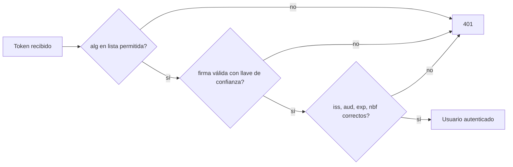

# Ataques a JWT y cómo evitarlos

Parte de: [[12-Seguridad/04 Otras vulnerabilidades web/_Índice Otras vulnerabilidades web|Otras vulnerabilidades web]]

> [!info] Cómo avanzar
> `progreso`: **pendiente** → **viendo** (estudiando) → **visto** (contestaste la autoevaluación sin abrir las respuestas) → **dominado** (hiciste el laboratorio o lo aplicaste de verdad).

## Contenido

### Qué es
Un JWT (JSON Web Token) es una cadena con tres partes separadas por puntos: encabezado, carga (payload) y firma, cada una en Base64URL. El servidor que lo recibe confía en lo que dice el payload (quién es el usuario, qué roles tiene, a qué API va dirigido) **solo si la firma es válida y las afirmaciones (claims) son las esperadas**. Los "ataques a JWT" casi nunca rompen la criptografía: aprovechan validaciones que el servidor se saltó o configuró mal. Como defensor, tu trabajo es que tu API acepte únicamente tokens emitidos por tu proveedor de identidad (en tu caso Xolotl.Hecate), para tu API y vigentes.

### Cómo funciona
Al recibir un token, una validación correcta hace, en este orden:

1. Lee el encabezado, pero **no** deja que el token decida el algoritmo: compara `alg` contra una lista fija (por ejemplo solo `RS256`).
2. Obtiene la llave pública de una fuente confiable (tu configuración o el JWKS de tu emisor), nunca de una URL o un `kid` arbitrario que venga en el token.
3. Verifica la firma.
4. Valida `iss` (quién lo emitió), `aud` (para quién es), `exp` y `nbf` (vigencia) con una tolerancia pequeña de reloj.
5. Solo entonces construye el usuario (`ClaimsPrincipal`) y aplica autorización.



Las fallas típicas corresponden a saltarse alguno de esos pasos:

- **`alg: none` o firma no verificada**: librerías antiguas o código propio que "decodifica" el token sin validarlo. Decodificar no es validar.
- **Confusión de algoritmo**: el servidor espera RS256 pero acepta HS256; un atacante firma con HMAC usando como "secreto" la llave pública (que es pública). Se evita fijando los algoritmos permitidos y el tipo de llave.
- **Claims sin validar**: aceptar tokens vencidos, de otro emisor o emitidos para otra API del mismo proveedor (falta de `aud`).
- **Llaves HMAC débiles**: un secreto corto o de diccionario permite adivinarlo fuera de línea y fabricar tokens.
- **`kid`, `jku` o `x5u` manipulados**: si tu código usa esos campos para ir a buscar la llave a donde el token diga, el atacante te apunta a su propia llave.

Un detalle que confunde: un JWT firmado (JWS) **no está cifrado**. Cualquiera que lo tenga puede leer el payload pegándolo en un decodificador. Si necesitas confidencialidad existe JWE, pero lo normal es simplemente no poner datos sensibles en el token. Para el detalle de algoritmos y JWKS consulta [[Firmas de JWT (HS256 vs RS256) y JWKS]].

### Ejemplo
Configuración de Itzamna.Dionisio validando tokens RS256 de Xolotl.Hecate. Los valores vienen de configuración por entorno, no del código:

```csharp
// Program.cs
builder.Services
    .AddAuthentication(JwtBearerDefaults.AuthenticationScheme)
    .AddJwtBearer(o =>
    {
        // Authority permite descubrir el JWKS del emisor (/.well-known/openid-configuration)
        o.Authority = builder.Configuration["Jwt:Authority"]; // https://hecate.midominio.com
        o.Audience = builder.Configuration["Jwt:Audience"];   // api-dionisio
        o.RequireHttpsMetadata = true;
        o.MapInboundClaims = false; // conserva los nombres originales de los claims (sub, roles)
        o.TokenValidationParameters = new TokenValidationParameters
        {
            ValidateIssuer = true,
            ValidIssuer = builder.Configuration["Jwt:Authority"],
            ValidateAudience = true,
            ValidateLifetime = true,
            RequireExpirationTime = true,
            RequireSignedTokens = true,
            ValidateIssuerSigningKey = true,
            ClockSkew = TimeSpan.FromMinutes(1), // el valor por defecto (5 min) suele ser demasiado
            ValidAlgorithms = [SecurityAlgorithms.RsaSha256]
        };
    });
```

En el front (Itzamna.Clio) recuerda que el token es legible: no lo uses para decidir permisos de forma definitiva; el front solo oculta botones, la API es la que autoriza.

### Cerrar sesión y revocación
Un JWT es autocontenido: la API lo acepta hasta que expira sin consultar a nadie. Por eso "cerrar sesión" no lo invalida por sí mismo. Las estrategias habituales:

- **Tokens de acceso cortos** (5 a 15 minutos) y **refresh tokens** guardados en el servidor, rotados en cada uso y revocables. Cerrar sesión revoca el refresh token; el de acceso muere pronto.
- **Lista de revocación por `jti`** para casos graves (cuenta comprometida), consultada en un evento de validación; tiene costo, úsala solo si la necesitas.
- **Versión de seguridad del usuario** (un `sv` en el token que se compara contra la base) para invalidar todo de un usuario al cambiar contraseña.

### Cuándo usarlo y cuándo no
Los JWT con firma asimétrica son buena opción cuando varias APIs validan tokens de un mismo emisor sin compartir secretos. Para una app web con un solo backend, una cookie de sesión `HttpOnly` puede ser más simple y fácil de revocar (ver [[Cookies vs tokens]]). No uses JWT como "sesión eterna" ni como contenedor de datos personales.

### Errores comunes
- **Usar `ReadJwtToken` o decodificar a mano** para "leer el usuario" en un middleware propio: lee pero no valida. Usa el esquema de autenticación del framework.
- **Desactivar validaciones para que "funcione"** en desarrollo (`ValidateAudience = false`) y llevarlo a producción. Haz que la configuración por entorno cambie valores, no que apague controles.
- **Secretos HMAC en `appsettings.json`** dentro del repo: además de débiles, quedan expuestos. Mejor RS256 con la llave privada solo en el emisor (Key Vault).
- **Guardar el token en `localStorage`** sin una CSP fuerte: un XSS lo roba. Valora cookies `HttpOnly` o un patrón BFF.
- **Confiar en claims de rol sin verificar `aud`**: un token válido para otra API del mismo emisor termina dando acceso a la tuya.

### Para profundizar
- [RFC 8725 - JSON Web Token Best Current Practices](https://datatracker.ietf.org/doc/html/rfc8725)
- [OWASP - JSON Web Token Cheat Sheet](https://cheatsheetseries.owasp.org/cheatsheets/JSON_Web_Token_for_Java_Cheat_Sheet.html)
- [PortSwigger Academy - JWT attacks](https://portswigger.net/web-security/jwt)
- [Microsoft Learn - Configurar autenticación JWT Bearer en ASP.NET Core](https://learn.microsoft.com/aspnet/core/security/authentication/configure-jwt-bearer-authentication)

## Autoevaluación

Contesta primero en voz alta o en papel; luego despliega la respuesta.

> [!question]- ¿Qué fallas de validación de JWT son las más comunes?
> Aceptar `alg: none` o no verificar la firma; confusión de algoritmo (aceptar HS256 firmado con la llave pública de RS256); no validar `exp`, `iss` o `aud`; llaves HMAC débiles; confiar en `kid`/`jku` para buscar llaves en lugares controlados por el atacante.

> [!question]- ¿Cómo se configura una validación correcta en ASP.NET Core?
> ```csharp
> .AddJwtBearer(o => o.TokenValidationParameters = new()
> {
>     ValidateIssuer = true, ValidIssuer = issuer,
>     ValidateAudience = true, ValidAudience = audience,
>     ValidateLifetime = true, ClockSkew = TimeSpan.FromMinutes(1),
>     ValidateIssuerSigningKey = true, IssuerSigningKey = llave,
>     ValidAlgorithms = new[] { SecurityAlgorithms.RsaSha256 }
> });
> ```

> [!question]- ¿Un JWT está cifrado?
> Normalmente no: es Base64URL y cualquiera puede leer el payload. No guardes datos sensibles en él (para eso existe JWE).

> [!question]- ¿Por qué es difícil "cerrar sesión" con JWT y qué se hace?
> El token es válido hasta que expira. Se usan tokens de acceso cortos, refresh tokens revocables y, si hace falta, una lista de revocación por `jti`. Ver [[Firmas de JWT (HS256 vs RS256) y JWKS]].

## Práctica

- [[Lab 7 - Revisión de un JWT mal validado en tu propio código]]

