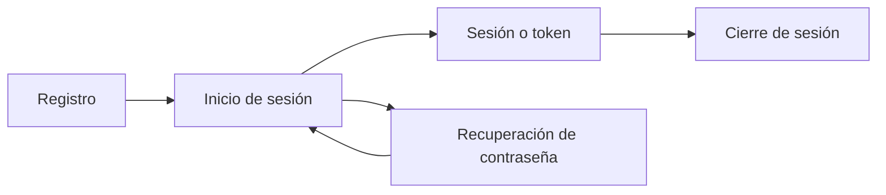

# Autenticación rota

Parte de: [[12-Seguridad/04 Otras vulnerabilidades web/_Índice Otras vulnerabilidades web|Otras vulnerabilidades web]]

> [!info] Cómo avanzar
> `progreso`: **pendiente** → **viendo** (estudiando) → **visto** (contestaste la autoevaluación sin abrir las respuestas) → **dominado** (hiciste el laboratorio o lo aplicaste de verdad).

## Contenido

### Qué es
"Autenticación rota" agrupa los fallos que permiten a alguien hacerse pasar por otro usuario: adivinar o reutilizar contraseñas, secuestrar sesiones o abusar de la recuperación de cuenta. En el OWASP Top 10 2025 aparece como *A07: Authentication Failures*. No se trata de un solo bug, sino de un conjunto de controles que deben estar todos presentes: si uno falta, el resto no alcanza.

### Cómo funciona
El ciclo de autenticación tiene varias puertas, y cada una tiene su falla típica:



- **Registro**: se aceptan contraseñas débiles o que ya aparecen en filtraciones públicas.
- **Inicio de sesión**: no hay límite de intentos, así que se puede probar sin parar (fuerza bruta) o probar pares usuario/contraseña robados de otros sitios (**relleno de credenciales** o *credential stuffing*). Funciona porque la gente reutiliza contraseñas; el atacante no adivina, prueba combinaciones que ya fueron válidas en otro lado.
- **Enumeración**: mensajes como "el usuario no existe" frente a "contraseña incorrecta", o tiempos de respuesta distintos, revelan qué cuentas existen.
- **Sesión**: identificadores predecibles, sesiones que no expiran, que no se renuevan al iniciar sesión (fijación de sesión) o que siguen vivas después de cerrar sesión.
- **Recuperación**: tokens de restablecimiento cortos, reutilizables, sin expiración, o preguntas "secretas" fáciles de investigar.

### Cómo se detecta
- En revisión de código: busca endpoints de login sin rate limiting, comparación de contraseñas en texto plano o con hash rápido (MD5, SHA-256 sin sal ni iteraciones), y tokens generados con `Random` en vez de un generador criptográfico.
- En logs: muchos fallos de login desde una IP, o un mismo par de intentos repartido entre muchas cuentas (patrón de credential stuffing).
- Con pruebas: la sección de autenticación de la guía [[Metodología de pruebas web (OWASP WSTG)]] da casos concretos.

### Cómo se previene
- **MFA** como control principal: aunque la contraseña se filtre, falta el segundo factor. Prefiere TOTP o passkeys sobre SMS ([[MFA]]).
- **Límite de intentos** por cuenta y por IP, con retraso progresivo o bloqueo temporal, y alertas.
- **Contraseñas**: largo mínimo razonable, sin reglas raras de composición, y verificación contra listas de contraseñas filtradas.
- **Almacenamiento**: [[Hashing de contraseñas]] con un algoritmo lento y sal (en ASP.NET Core Identity, `PasswordHasher` usa PBKDF2).
- **Mensajes genéricos**: "usuario o contraseña incorrectos" y la misma respuesta en "olvidé mi contraseña" exista o no la cuenta.
- **Sesiones**: identificador nuevo al iniciar sesión, expiración por inactividad, invalidación real al cerrar sesión y al cambiar contraseña; cookies `Secure`, `HttpOnly` y `SameSite`.
- **Recuperación**: token aleatorio criptográfico, de un solo uso, con expiración corta y guardado como hash.

### Ejemplo
Token de recuperación en una API .NET: se genera con `RandomNumberGenerator`, se manda por correo y en la base solo se guarda su hash, para que una filtración de la tabla no sirva para restablecer cuentas.

```csharp
public sealed record TokenRecuperacion(string ParaCorreo, byte[] HashParaBase);

public static class Recuperacion
{
    public static TokenRecuperacion Generar()
    {
        // 32 bytes aleatorios criptográficos = 256 bits
        var bytes = RandomNumberGenerator.GetBytes(32);
        var token = Base64Url.EncodeToString(bytes);   // System.Buffers.Text (.NET 9+)
        var hash = SHA256.HashData(bytes);              // en la base solo va el hash
        return new TokenRecuperacion(token, hash);
    }
}
```

El procedimiento almacenado guarda `HashToken`, `UsuarioId` y `ExpiraEn` (por ejemplo 15 minutos). Al canjearlo, la API calcula el hash del token recibido, busca la fila vigente y no usada, y la marca como usada **en la misma sentencia** (ver [[Condiciones de carrera]]). La respuesta del endpoint de "olvidé mi contraseña" siempre es `202 Accepted` con el mismo texto, exista o no el correo.

Para el límite de intentos, el middleware integrado de [[Rate limiting]] de ASP.NET Core sirve como primera barrera por IP; el bloqueo por cuenta (`LockoutOptions` en Identity, o un contador propio en la base) cubre el ataque distribuido desde muchas IP.

### Cuándo usarlo y cuándo no
Si puedes delegar la autenticación a un proveedor maduro (Entra ID, un servidor OpenID Connect como tu Xolotl.Hecate bien probado), hazlo: implementar login desde cero multiplica los lugares donde fallar. Si debes implementarlo, apóyate en ASP.NET Core Identity en vez de escribir tu propio hash, bloqueo y tokens.

### Errores comunes
- **Bloquear solo por IP**: el credential stuffing usa miles de IP. Combina límites por IP, por cuenta y detección de patrones.
- **Bloqueo permanente**: permite que cualquiera bloquee cuentas ajenas a propósito (denegación de servicio). Usa bloqueos temporales.
- **Revelar existencia de la cuenta en el registro** ("ese correo ya está registrado"): a veces es inevitable; mitígalo con rate limiting y confirmación por correo.
- **Olvidar invalidar sesiones** al cambiar contraseña o al desactivar al usuario.
- **Considerar el SMS como MFA fuerte**: es mejor que nada, pero es vulnerable a cambio de SIM; ofrece TOTP o passkeys.

### Para profundizar
- [OWASP - Authentication Cheat Sheet](https://cheatsheetseries.owasp.org/cheatsheets/Authentication_Cheat_Sheet.html)
- [OWASP - Credential Stuffing Prevention Cheat Sheet](https://cheatsheetseries.owasp.org/cheatsheets/Credential_Stuffing_Prevention_Cheat_Sheet.html)
- [NIST SP 800-63B - Digital Identity Guidelines](https://pages.nist.gov/800-63-4/sp800-63b.html)
- [Microsoft Learn - Introducción a Identity en ASP.NET Core](https://learn.microsoft.com/aspnet/core/security/authentication/identity)

## Autoevaluación

Contesta primero en voz alta o en papel; luego despliega la respuesta.

> [!question]- Menciona fallas típicas de autenticación.
> Permitir contraseñas débiles o filtradas, no limitar intentos (fuerza bruta y relleno de credenciales), mensajes que revelan si el usuario existe, sesiones que no expiran o no se invalidan al cerrar sesión, recuperación de contraseña con tokens predecibles.

> [!question]- ¿Qué controles aplicarías?
> MFA, bloqueo o retraso progresivo por intentos, revisión contra listas de contraseñas filtradas, mensajes genéricos ("usuario o contraseña incorrectos"), [[Hashing de contraseñas]] con algoritmo lento, tokens de recuperación aleatorios de un solo uso y con expiración.

> [!question]- ¿Qué es el relleno de credenciales (credential stuffing)?
> Probar pares usuario/contraseña filtrados de otros sitios, aprovechando que la gente reutiliza contraseñas. Se mitiga con MFA, límites de intentos y detección de patrones.

## Práctica

- [[Lab 7 - Revisión de un JWT mal validado en tu propio código]]

