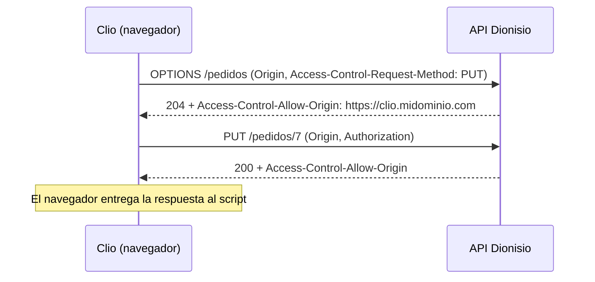

# CORS

Parte de: [[12-Seguridad/04 Otras vulnerabilidades web/_Índice Otras vulnerabilidades web|Otras vulnerabilidades web]]

> [!info] Cómo avanzar
> `progreso`: **pendiente** → **viendo** (estudiando) → **visto** (contestaste la autoevaluación sin abrir las respuestas) → **dominado** (hiciste el laboratorio o lo aplicaste de verdad).

## Contenido

### Qué es
CORS (Cross-Origin Resource Sharing) es un mecanismo del **navegador** que relaja de forma controlada la [[Same-origin policy]]. Por defecto, JavaScript de `https://clio.midominio.com` no puede leer la respuesta de una petición a `https://api.midominio.com` porque son orígenes distintos. Con CORS, el servidor dice mediante headers qué orígenes sí pueden **leer** sus respuestas. Es importante entender qué no es: no es un control de acceso de tu API, no bloquea que la petición llegue al servidor y no protege contra clientes que no son navegadores.

### Cómo funciona
1. El navegador agrega a la petición el header `Origin` con el origen de la página.
2. Para peticiones "no simples" (por ejemplo `PUT`, `DELETE`, `Content-Type: application/json` o un header `Authorization`), primero manda una petición **preflight** `OPTIONS` preguntando si el método y los headers están permitidos.
3. El servidor responde con `Access-Control-Allow-Origin`, `Access-Control-Allow-Methods`, `Access-Control-Allow-Headers` y, si aplica, `Access-Control-Allow-Credentials: true`.
4. Si la respuesta no autoriza ese origen, el navegador **oculta la respuesta** al script. Ojo: en peticiones simples, el servidor ya la procesó.



### La configuración peligrosa
El riesgo real aparece cuando se combinan **credenciales** (cookies o autenticación HTTP que el navegador manda sola) con orígenes demasiado abiertos:

- **Reflejar cualquier `Origin`** que llegue, junto con `Access-Control-Allow-Credentials: true`. Cualquier sitio que visite el usuario puede leer respuestas autenticadas de tu API con sus cookies. En ASP.NET Core esto pasa con `SetIsOriginAllowed(_ => true)` más `AllowCredentials()`.
- **Validar el origen con `Contains` o `EndsWith` mal hecho**: `midominio.com.atacante.net` o `atacantemidominio.com` pasan la verificación.
- **Permitir `null`** como origen: lo envían iframes con sandbox y archivos locales, que un atacante controla.
- `Access-Control-Allow-Origin: *` sin credenciales es aceptable para datos realmente públicos; el navegador no permite `*` junto con credenciales, y ASP.NET Core lanza un error si combinas `AllowAnyOrigin()` con `AllowCredentials()`.

Si tu API usa `Authorization: Bearer` y no cookies, una CORS abierta no permite a otro sitio usar el token del usuario (no lo tiene), pero sigue siendo mala práctica. Con cookies, revisa además [[Cookies y CORS con credenciales]].

### Ejemplo
Política explícita por entorno en Itzamna.Dionisio, leyendo los orígenes de configuración:

```csharp
// appsettings.Production.json -> "Cors": { "Origenes": [ "https://clio.midominio.com" ] }
var origenes = builder.Configuration.GetSection("Cors:Origenes").Get<string[]>() ?? [];

builder.Services.AddCors(o => o.AddPolicy("clio", p => p
    .WithOrigins(origenes)                          // comparación exacta de origen
    .WithMethods("GET", "POST", "PUT", "DELETE")
    .WithHeaders("Content-Type", "Authorization")
    .SetPreflightMaxAge(TimeSpan.FromMinutes(10))));

var app = builder.Build();
app.UseCors("clio");      // antes de autenticación y autorización
app.UseAuthentication();
app.UseAuthorization();
app.MapControllers().RequireCors("clio");
```

En desarrollo, el `appsettings.Development.json` agrega `http://localhost:5173` (Vite). Así no hay `if (env.IsDevelopment())` que abra todo. Con Vite también puedes usar su proxy de desarrollo y evitar CORS en local.

### Cómo se detecta
- Manda una petición con `Origin: https://ejemplo-no-permitido.test` (con curl o el Repeater de [[Burp Suite Community]]) y revisa si la respuesta lo refleja en `Access-Control-Allow-Origin`.
- El escaneo pasivo de [[OWASP ZAP]] marca políticas CORS demasiado permisivas.
- En revisión de código, busca `AllowAnyOrigin`, `SetIsOriginAllowed` y listas de orígenes armadas con comodines.

### Cuándo usarlo y cuándo no
Configura CORS solo si un front en otro origen debe llamar a tu API desde el navegador. Si el front se sirve desde el mismo origen (o detrás del mismo dominio con un proxy inverso), no necesitas CORS. Para integraciones servidor a servidor CORS no aplica: lo que protege es la autenticación (por ejemplo OAuth Client Credentials) y la autorización.

### Errores comunes
- **Creer que CORS protege la API** de curl, Postman o un script: esos clientes ignoran CORS. La protección es autenticación y autorización.
- **Abrir todo "temporalmente"** para resolver un error en desarrollo y olvidarlo en producción.
- **Poner `UseCors` en el orden incorrecto** del pipeline: los preflight fallan y alguien "lo arregla" abriendo más. Revisa [[Orden de los middleware en ASP.NET Core]].
- **Confundir CORS con CSRF**: CORS limita quién lee respuestas; no impide que un formulario de otro sitio envíe una petición. Para eso ver [[CSRF]].

### Para profundizar
- [MDN - Cross-Origin Resource Sharing (CORS)](https://developer.mozilla.org/es/docs/Web/HTTP/CORS)
- [Microsoft Learn - Habilitar CORS en ASP.NET Core](https://learn.microsoft.com/aspnet/core/security/cors)
- [PortSwigger Academy - CORS](https://portswigger.net/web-security/cors)

## Autoevaluación

Contesta primero en voz alta o en papel; luego despliega la respuesta.

> [!question]- ¿Qué controla CORS?
> Qué orígenes pueden **leer** las respuestas de tu API desde un navegador, mediante headers como `Access-Control-Allow-Origin`. El servidor igual recibe la petición.

> [!question]- ¿Qué configuración es peligrosa?
> Reflejar cualquier `Origin` recibido junto con `Access-Control-Allow-Credentials: true`: cualquier sitio podría leer respuestas autenticadas del usuario.

> [!question]- Configuración segura en ASP.NET Core.
> ```csharp
> builder.Services.AddCors(o => o.AddPolicy("spa", p => p
>     .WithOrigins("https://app.midominio.com")
>     .WithMethods("GET", "POST", "PUT", "DELETE")
>     .WithHeaders("Content-Type", "Authorization")));
> app.UseCors("spa");
> ```
> Orígenes explícitos, por entorno, nunca `*` con credenciales.

> [!question]- ¿CORS protege tu API de clientes como curl o Postman?
> No. CORS lo aplica el navegador. La protección de la API es autenticación y autorización.

