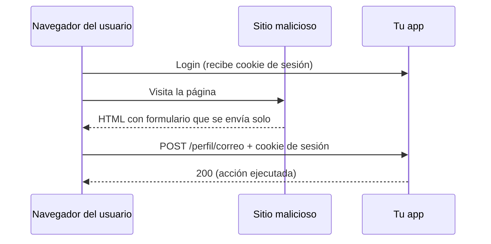

# CSRF

Parte de: [[12-Seguridad/04 Otras vulnerabilidades web/_Índice Otras vulnerabilidades web|Otras vulnerabilidades web]]

> [!info] Cómo avanzar
> `progreso`: **pendiente** → **viendo** (estudiando) → **visto** (contestaste la autoevaluación sin abrir las respuestas) → **dominado** (hiciste el laboratorio o lo aplicaste de verdad).

## Contenido

### Qué es
CSRF (Cross-Site Request Forgery, falsificación de petición entre sitios) ocurre cuando un sitio malicioso logra que el navegador de la víctima envíe una petición a tu aplicación y esta la ejecuta como si el usuario la hubiera pedido. La clave es que el navegador **adjunta automáticamente** las cookies de tu dominio, incluida la de sesión. El atacante no ve la respuesta; solo necesita que la acción ocurra: cambiar el correo, hacer una transferencia, borrar un registro.

### Cómo funciona
1. El usuario inicia sesión en tu app; el navegador guarda la cookie de sesión.
2. Sin cerrar sesión, visita otro sitio (o abre un correo con HTML) que contiene un formulario que se envía solo hacia tu app.
3. El navegador manda la petición con la cookie de sesión.
4. Tu servidor ve una sesión válida y ejecuta la acción.



Condiciones para que funcione: la app autentica con algo que el navegador manda solo (cookies, autenticación básica o de Windows), la acción se puede disparar con una petición que el atacante sabe armar y no hay ningún valor impredecible que el atacante desconozca.

### Defensas
Combina varias capas:

- **Token antifalsificación**: un valor aleatorio ligado a la sesión que debe ir en el formulario o en un header. El sitio malicioso no puede leerlo (la [[Same-origin policy]] se lo impide), así que no puede incluirlo.
- **Cookies `SameSite`**: con `Lax` el navegador no manda la cookie en `POST` iniciados desde otro sitio; con `Strict` ni siquiera en navegación. Los navegadores modernos tratan las cookies sin atributo como `Lax`, pero no dependas de ese valor por defecto: ponlo explícito. Ver [[Cookies - SameSite]].
- **Verificar `Origin` o `Referer`** en peticiones que cambian estado.
- **Nunca cambiar estado con `GET`**: un `` basta para dispararlo.
- **Reautenticación o confirmación** en acciones críticas (cambio de correo o contraseña).

### Ejemplo
**App con cookies (Razor Pages o MVC)**: Razor Pages valida el token antifalsificación automáticamente en `POST`. En controllers MVC con vistas, aplica el filtro global:

```csharp
builder.Services.AddControllersWithViews(o =>
    o.Filters.Add(new AutoValidateAntiforgeryTokenAttribute())); // valida en POST/PUT/PATCH/DELETE
```

**SPA en React que usa cookies con la API** (por ejemplo un patrón BFF): la API emite el token en una cookie legible por JavaScript y exige que vuelva en un header:

```csharp
builder.Services.AddAntiforgery(o => o.HeaderName = "X-XSRF-TOKEN");

// Endpoint que entrega el token al cargar la SPA
app.MapGet("/antiforgery/token", (IAntiforgery af, HttpContext ctx) =>
{
    var tokens = af.GetAndStoreTokens(ctx);
    ctx.Response.Cookies.Append("XSRF-TOKEN", tokens.RequestToken!,
        new CookieOptions { HttpOnly = false, Secure = true, SameSite = SameSiteMode.Strict });
    return Results.NoContent();
}).RequireAuthorization();
```

```ts
// Itzamna.Clio: leer la cookie y mandarla como header en cada petición que modifica datos
function leerCookie(nombre: string): string | undefined {
  return document.cookie.split('; ').find(c => c.startsWith(nombre + '='))?.split('=')[1];
}

await fetch('/api/perfil/correo', {
  method: 'POST',
  credentials: 'include',
  headers: { 'Content-Type': 'application/json', 'X-XSRF-TOKEN': leerCookie('XSRF-TOKEN') ?? '' },
  body: JSON.stringify({ correo }),
});
```

Los controllers de la API se marcan con `[ValidateAntiForgeryToken]` (o el filtro global).

### ¿Y si uso Bearer?
Una API que recibe el token en `Authorization: Bearer` normalmente **no** es vulnerable a CSRF: el navegador no agrega ese header por su cuenta y el sitio malicioso no puede leer el token de tu origen. El riesgo regresa si guardas el token en una cookie que el servidor acepta como autenticación, o si tu API acepta el token también por query string. Esa es una de las diferencias de fondo explicadas en [[Cookies vs tokens]] y [[Cookies y CSRF]].

### Cómo se detecta
- Revisa qué endpoints cambian estado y cómo autentican: si usan cookies y no validan token ni origen, son candidatos.
- Prueba en tu entorno local: crea una página HTML en otro puerto con un formulario hacia tu endpoint y observa si la acción ocurre.
- [[OWASP ZAP]] reporta formularios sin token antifalsificación.

### Cuándo usarlo y cuándo no
El token antifalsificación es obligatorio en apps con sesión por cookie. En APIs puras con Bearer no aporta y complica a los clientes. Si mezclas (cookie para el front, Bearer para integraciones), aplica la validación al esquema de cookie.

### Errores comunes
- **Confiar solo en `SameSite`**: hay casos donde no aplica (subdominios del mismo sitio, navegadores viejos, `GET` con efectos). Úsalo como capa adicional.
- **Acciones con `GET`** como `/cerrar-cuenta?id=5`.
- **Pensar que CORS lo resuelve**: CORS no impide que un formulario de otro sitio envíe la petición. Ver [[CORS]].
- **Excluir endpoints "internos"** de la validación porque estorbaban en pruebas.

### Para profundizar
- [OWASP - Cross-Site Request Forgery Prevention Cheat Sheet](https://cheatsheetseries.owasp.org/cheatsheets/Cross-Site_Request_Forgery_Prevention_Cheat_Sheet.html)
- [Microsoft Learn - Prevenir ataques XSRF/CSRF en ASP.NET Core](https://learn.microsoft.com/aspnet/core/security/anti-request-forgery)
- [MDN - Set-Cookie: SameSite](https://developer.mozilla.org/es/docs/Web/HTTP/Headers/Set-Cookie)
- [PortSwigger Academy - CSRF](https://portswigger.net/web-security/csrf)

## Autoevaluación

Contesta primero en voz alta o en papel; luego despliega la respuesta.

> [!question]- ¿Qué es CSRF?
> Cross-Site Request Forgery: un sitio malicioso hace que el navegador de la víctima envíe una petición a tu app, y el navegador adjunta las cookies de sesión automáticamente, así que la acción se ejecuta como si la hubiera hecho el usuario.

> [!question]- ¿Qué defensas existen?
> Tokens antifalsificación (en ASP.NET Core, `[ValidateAntiForgeryToken]` o antiforgery automático en Razor Pages), cookies `SameSite=Lax` o `Strict`, verificar `Origin`/`Referer` y no usar GET para acciones que cambian estado.

> [!question]- ¿Una API que usa `Authorization: Bearer` en el header es vulnerable a CSRF?
> Normalmente no, porque el navegador no agrega ese header solo; el script del sitio malicioso no puede leer el token. El riesgo vuelve si el token va en una cookie.

