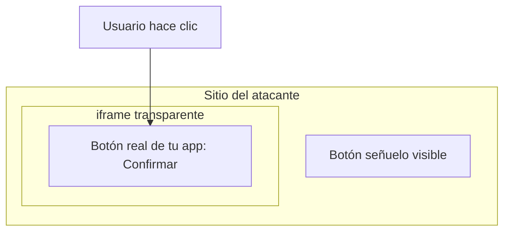

# Clickjacking

Parte de: [[12-Seguridad/04 Otras vulnerabilidades web/_Índice Otras vulnerabilidades web|Otras vulnerabilidades web]]

> [!info] Cómo avanzar
> `progreso`: **pendiente** → **viendo** (estudiando) → **visto** (contestaste la autoevaluación sin abrir las respuestas) → **dominado** (hiciste el laboratorio o lo aplicaste de verdad).

## Contenido

### Qué es
Clickjacking (secuestro de clics) es un ataque de interfaz: un sitio malicioso carga **tu página dentro de un iframe** casi invisible y la coloca encima de un contenido engañoso ("Gana un premio, haz clic aquí"). El usuario cree que hace clic en el sitio del atacante, pero en realidad pulsa un botón de tu app, donde ya tiene sesión iniciada: confirmar un pago, aceptar permisos, borrar algo. No se roba ningún dato directamente; se roban **acciones**.

### Cómo funciona
1. El usuario tiene sesión abierta en tu app.
2. Visita la página del atacante, que contiene un `iframe` apuntando a una pantalla de tu app con un botón sensible.
3. El atacante pone el iframe con opacidad casi cero y lo alinea para que el botón quede justo debajo de su señuelo.
4. El clic del usuario llega a tu página, con sus cookies, y la acción se ejecuta.



A diferencia de [[CSRF]], aquí la petición la genera tu propia página, así que los tokens antifalsificación **no** ayudan: el formulario legítimo ya los incluye. La defensa es impedir que tu página se muestre dentro de marcos de otros orígenes.

### Cómo se previene
La defensa principal es un header que le dice al navegador quién puede incrustarte:

- **`Content-Security-Policy: frame-ancestors 'none'`**: nadie puede ponerte en un iframe.
- **`frame-ancestors 'self'`**: solo páginas de tu mismo origen.
- **`frame-ancestors 'self' https://studio.midominio.com`**: tu origen más una lista explícita.
- **`X-Frame-Options: DENY` o `SAMEORIGIN`**: el header antiguo, todavía útil para navegadores que no soportan `frame-ancestors`. Su variante `ALLOW-FROM` está obsoleta y los navegadores modernos la ignoran; para listas de orígenes usa CSP.

Si envías ambos, los navegadores modernos dan prioridad a `frame-ancestors`. La directiva `frame-ancestors` **no funciona en una etiqueta `<meta>`**, solo como header HTTP. Detalle en [[Content Security Policy]].

Las técnicas en JavaScript para "romper el marco" (*frame busting*, por ejemplo comparar `window.top` con `window.self`) son frágiles y se pueden neutralizar con el atributo `sandbox` del iframe; no las uses como defensa principal.

### Ejemplo
Middleware en Itzamna.Dionisio (o en el servidor que sirve el build de Itzamna.Clio) que agrega los headers en todas las respuestas, con los orígenes permitidos tomados de configuración por entorno:

```csharp
// appsettings.json -> "Seguridad": { "OrigenesQuePuedenIncrustar": [ "https://studio.midominio.com" ] }
var permitidos = builder.Configuration
    .GetSection("Seguridad:OrigenesQuePuedenIncrustar").Get<string[]>() ?? [];
var frameAncestors = string.Join(' ', new[] { "'self'" }.Concat(permitidos));

app.Use(async (ctx, next) =>
{
    ctx.Response.OnStarting(() =>
    {
        // CSP con frame-ancestors (navegadores modernos)
        ctx.Response.Headers["Content-Security-Policy"] = $"frame-ancestors {frameAncestors}";
        // Respaldo para navegadores viejos; si hay orígenes externos, SAMEORIGIN no los incluye
        ctx.Response.Headers["X-Frame-Options"] = permitidos.Length == 0 ? "DENY" : "SAMEORIGIN";
        return Task.CompletedTask;
    });
    await next();
});
```

Si tu app ya tiene una CSP completa, agrega `frame-ancestors` a esa misma política en lugar de mandar dos headers CSP distintos (el navegador aplicaría ambas, lo cual es válido pero confuso de mantener). Si el front se publica como sitio estático en Azure (App Service, Static Web Apps o Front Door), el header se puede configurar ahí; lo importante es que llegue en la respuesta del HTML.

Para el caso en que tu propio sitio sí debe incrustar algo (un panel que muestra una vista previa en un iframe), combina esto con [[postMessage seguro (validar origen)]] y el atributo `sandbox` en el iframe.

### Cómo se detecta
- Abre DevTools, pestaña Network, y revisa los headers de respuesta del documento HTML: ¿está `frame-ancestors` o `X-Frame-Options`?
- Crea un HTML local con `<iframe src="https://tuapp...">`: si se ve tu página, eres incrustable.
- El escaneo pasivo de [[OWASP ZAP]] reporta la falta de protección contra clickjacking.

### Cuándo usarlo y cuándo no
Ponlo **por defecto** en cualquier app con sesión (`'none'` o `'self'`). Solo abre la lista cuando exista un caso real de incrustación, con orígenes exactos. Widgets públicos pensados para incrustarse en sitios de terceros (por ejemplo un mapa) son la excepción: en ese caso, esas páginas no deben tener acciones sensibles.

### Errores comunes
- **Proteger solo la página de login** y olvidar las de confirmación o configuración, que son las valiosas.
- **Poner `frame-ancestors` en `<meta>`**: se ignora.
- **Escribir el origen permitido a mano en cada entorno** con errores de esquema o puerto: `https://studio.midominio.com` no es lo mismo que `https://studio.midominio.com:8443`.
- **Usar `X-Frame-Options: ALLOW-FROM`**: obsoleto.

### Para profundizar
- [MDN - CSP: frame-ancestors](https://developer.mozilla.org/es/docs/Web/HTTP/Headers/Content-Security-Policy/frame-ancestors)
- [OWASP - Clickjacking Defense Cheat Sheet](https://cheatsheetseries.owasp.org/cheatsheets/Clickjacking_Defense_Cheat_Sheet.html)
- [PortSwigger Academy - Clickjacking](https://portswigger.net/web-security/clickjacking)

## Autoevaluación

Contesta primero en voz alta o en papel; luego despliega la respuesta.

> [!question]- ¿Qué es clickjacking?
> Cargar tu página en un iframe invisible sobre otra página engañosa, para que el usuario haga clic en botones de tu app sin saberlo.

> [!question]- ¿Cómo se previene?
> Con el header `Content-Security-Policy: frame-ancestors 'self'` (o la lista de orígenes que sí pueden incrustarte) y, para navegadores viejos, `X-Frame-Options: DENY` o `SAMEORIGIN`.

> [!question]- Si tu sitio debe poder incrustarse en un panel propio (como Studio), ¿qué pones?
> `frame-ancestors 'self' https://studio.midominio.com`, con el origen exacto, idealmente leído de configuración por entorno y no escrito a mano.

