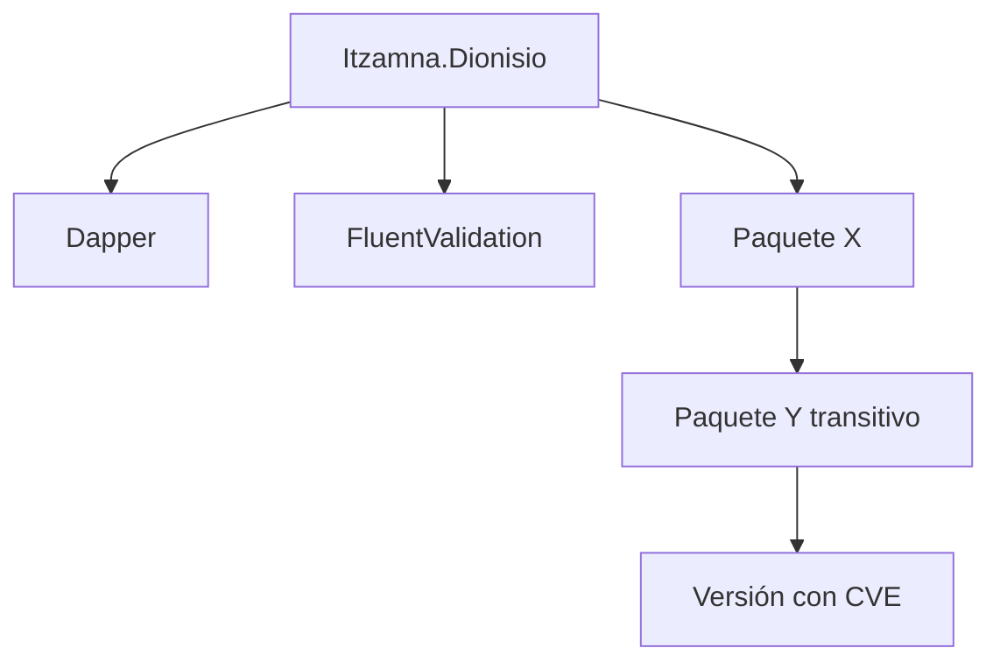

# Componentes y dependencias vulnerables

Parte de: [[12-Seguridad/04 Otras vulnerabilidades web/_Índice Otras vulnerabilidades web|Otras vulnerabilidades web]]

> [!info] Cómo avanzar
> `progreso`: **pendiente** → **viendo** (estudiando) → **visto** (contestaste la autoevaluación sin abrir las respuestas) → **dominado** (hiciste el laboratorio o lo aplicaste de verdad).

## Contenido

### Qué es
Tu aplicación es, en su mayor parte, código que no escribiste: paquetes NuGet, paquetes npm, imágenes de contenedor, el propio runtime de .NET. Cuando una de esas piezas tiene una vulnerabilidad conocida y publicada, cualquiera puede buscar sistemas que la usen. En el OWASP Top 10 2025 este riesgo se amplió a *A03: Software Supply Chain Failures*, que además incluye paquetes maliciosos y compromisos del proceso de construcción (ver [[Seguridad de la cadena de suministro (SBOM y firmas)]]). Aquí nos enfocamos en lo más frecuente: **dependencias desactualizadas con CVE conocidos**.

### Cómo funciona
1. Se descubre una vulnerabilidad en una librería y se publica un aviso con su identificador (ver [[CVE y CVSS]]) y las versiones afectadas.
2. Los avisos llegan a bases públicas como la GitHub Advisory Database, que usan NuGet y npm.
3. Tu proyecto declara dependencias **directas**, y cada una trae las suyas (**transitivas**). Un proyecto React con unas cuantas dependencias directas suele terminar con cientos de paquetes en `node_modules`.
4. Si cualquiera de ellas está en un rango vulnerable y el código vulnerable es alcanzable desde tu app, estás expuesto, aunque nunca hayas oído hablar de ese paquete.



### Cómo se detecta
**En .NET**:

```bash
# Lista dependencias directas y transitivas con vulnerabilidades conocidas
dotnet list package --vulnerable --include-transitive

# Explica qué dependencia directa trae a un paquete transitivo
dotnet nuget why Itzamna.Dionisio.csproj NombreDelPaquete
```

Además, `dotnet restore` ejecuta **NuGetAudit** y muestra advertencias `NU1901` a `NU1904` (baja a crítica). En proyectos que apuntan a .NET 10, el modo por defecto audita también las transitivas (`NuGetAuditMode` = `all`).

**En npm (Itzamna.Clio)**:

```bash
npm audit                 # todo el árbol
npm audit --omit=dev      # solo lo que llega a producción
npm ls nombre-paquete     # quién trae ese paquete
```

**Automatizado**: Dependabot o Renovate abren pull requests con actualizaciones ([[Dependabot y Renovate]]), y las herramientas de SCA en el pipeline fallan el build según umbrales (ver [[SAST, DAST y SCA]] y [[Escaneo de dependencias y de secretos]]). No olvides la imagen base de tus contenedores: también tiene paquetes del sistema operativo con CVE.

### Cómo se previene
- **Inventario**: saber qué usas. Un SBOM generado en el build lo documenta.
- **Actualizar seguido y en pasos chicos**: es más fácil subir una versión menor cada semana que tres mayores al año.
- **Fijar versiones** con archivos de bloqueo (`package-lock.json`; en NuGet, `packages.lock.json` con `RestorePackagesWithLockFile`) y usar `npm ci` en CI.
- **Romper el build** ante vulnerabilidades altas o críticas nuevas:

```xml
<!-- Directory.Build.props -->
<PropertyGroup>
  <NuGetAudit>true</NuGetAudit>
  <NuGetAuditLevel>moderate</NuGetAuditLevel>
  <WarningsAsErrors>$(WarningsAsErrors);NU1903;NU1904</WarningsAsErrors> <!-- alta y crítica -->
</PropertyGroup>
```

- **Mantener el runtime al día**: los parches mensuales de .NET corrigen vulnerabilidades del framework; usar una versión fuera de soporte significa no recibirlos.
- **Menos dependencias**: antes de agregar un paquete para una función de diez líneas, pregúntate si vale el riesgo.

### Ejemplo
Dependabot avisa que un paquete transitivo usado por una librería de Excel en Wee.Reporteria tiene un CVE alto. Pasos:

1. `dotnet nuget why` muestra que llega a través de la librería de Excel.
2. Revisas si hay versión nueva de la librería de Excel que ya use la versión corregida: actualizas esa dependencia directa.
3. Si no la hay, agregas un `PackageReference` directo al paquete transitivo con la versión corregida (NuGet toma la versión más alta), compilas y corres pruebas.
4. Si **no existe parche**: evalúas si el código vulnerable se usa realmente (por ejemplo, la falla está en un formato que no procesas), mitigas por configuración o con un [[WAF]], buscas alternativa, y documentas la excepción con fecha de revisión (`NuGetAuditSuppress` con la URL del aviso, más un comentario y un ticket).

### Cuándo usarlo y cuándo no
El escaneo de dependencias debe estar en **todos** los proyectos, sin excepción: es barato y atrapa el riesgo más común. Lo que se ajusta es el umbral para romper el build y la frecuencia de actualizaciones, según qué tan crítica es la app.

### Errores comunes
- **Revisar solo dependencias directas**: la mayoría del riesgo está en las transitivas.
- **Silenciar avisos en bloque** (`NuGetAudit=false`, `npm audit` ignorado) porque "hacen ruido".
- **`npm audit fix --force` sin revisar**: puede saltar versiones mayores y romper la app.
- **Ignorar las `devDependencies`**: no llegan al navegador, pero se ejecutan en tu máquina y en el pipeline, donde hay secretos.
- **No tener dueño**: las alertas existen, pero nadie las atiende. Asigna responsable y SLA por gravedad.

### Para profundizar
- [Microsoft Learn - Auditoría de dependencias de paquetes (NuGetAudit)](https://learn.microsoft.com/nuget/concepts/auditing-packages)
- [npm Docs - npm audit](https://docs.npmjs.com/cli/commands/npm-audit)
- [OWASP Top 10 2025 - A03 Software Supply Chain Failures](https://owasp.org/Top10/2025/)
- [GitHub Docs - Acerca de las alertas de Dependabot](https://docs.github.com/es/code-security/dependabot/dependabot-alerts/about-dependabot-alerts)

## Autoevaluación

Contesta primero en voz alta o en papel; luego despliega la respuesta.

> [!question]- ¿Cómo sabes si tus dependencias tienen vulnerabilidades conocidas en .NET y en npm?
> `dotnet list package --vulnerable --include-transitive` y `npm audit`. También Dependabot o Renovate en el repositorio.

> [!question]- ¿Qué haces si una dependencia vulnerable no tiene parche?
> Evaluar si el código vulnerable se usa realmente, mitigar (configuración, WAF), buscar alternativa o fork, y documentar la excepción con fecha de revisión.

> [!question]- ¿Por qué importan las dependencias transitivas?
> Porque la mayoría de tu código de terceros llega como dependencia de dependencias; una vulnerabilidad ahí te afecta igual aunque no la hayas instalado directamente.

## Práctica

- [[Lab 9 - Escaneo de dependencias y secretos en un repositorio propio]]

