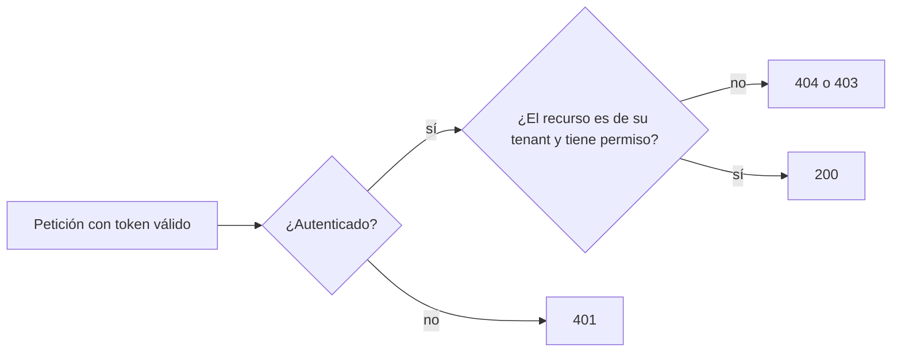

# Control de acceso roto e IDOR

Parte de: [[12-Seguridad/04 Otras vulnerabilidades web/_Índice Otras vulnerabilidades web|Otras vulnerabilidades web]]

> [!info] Cómo avanzar
> `progreso`: **pendiente** → **viendo** (estudiando) → **visto** (contestaste la autoevaluación sin abrir las respuestas) → **dominado** (hiciste el laboratorio o lo aplicaste de verdad).

## Contenido

### Qué es
El control de acceso decide **qué puede hacer** un usuario ya autenticado. Está "roto" cuando alguien logra ver, modificar o borrar algo que no le corresponde, o ejecutar funciones que no le tocan. Es el riesgo número uno del OWASP Top 10 (A01 en 2021 y en 2025) y el primero del OWASP API Security Top 10 2023 bajo el nombre BOLA. Su forma más conocida es **IDOR** (*Insecure Direct Object Reference*): el endpoint recibe un identificador (`/api/pedidos/1234`) y devuelve o modifica el recurso sin comprobar que pertenece al usuario o a su organización.

### Cómo funciona
1. El usuario A consulta su pedido: `GET /api/pedidos/1234`.
2. Cambia el número a `1235` en la URL o en el cuerpo.
3. La API busca el pedido por id, lo encuentra y lo devuelve, porque solo verificó que hubiera un token válido (autenticación), no que el pedido fuera suyo (autorización).



El IDOR vive en el segundo rombo. Otros casos de control de acceso roto:

- **Funciones de administración** protegidas solo ocultando el botón en el front: el endpoint responde a cualquiera que lo llame.
- **Mass assignment**: el cliente agrega `"rol": "admin"` o `"tenantId": 7` al JSON y el binder lo asigna (ver [[Seguridad de APIs]]).
- **Métodos sin proteger**: `GET` exige permiso, pero `DELETE` en la misma ruta no.
- **Escalamiento por parámetros**: `?esAdmin=true`, o un claim que el cliente puede influir.
- **Rutas de archivos** sin verificar dueño (ver [[Path traversal]]).

### Cómo se detecta
- **Pruebas con dos usuarios** de tenants distintos: con el token de A, pide recursos de B. Esto se puede automatizar en pruebas de integración.
- **Revisión de código**: cada consulta que recibe un id del cliente, ¿filtra también por dueño o tenant?
- **Herramientas**: el Repeater de [[Burp Suite Community]] para cambiar ids a mano contra tu entorno local. El [[Lab 8 - Control de acceso roto en OWASP Juice Shop local]] lo practica.

Los escáneres automáticos detectan poco de esto, porque no saben qué datos "deberían" ser tuyos: es una falla de lógica de negocio.

### Cómo se previene en una app multi-tenant con procedimientos
- **El `TenantId` y el `UsuarioId` salen del token, en el servidor**, nunca del cuerpo, la query o un header que mande el cliente.
- **Cada procedimiento recibe el `TenantId` y lo usa en todos los `WHERE`, `UPDATE` y `DELETE`**. Si no coincide, no hay filas.
- **Responder 404** cuando el recurso no existe o no es del tenant: no confirmas que el id existe.
- **Autorización por función** con policies de ASP.NET Core en controllers ([[Autorización con policies]]).
- **Denegar por defecto**: una policy de fallback que exige usuario autenticado en todo, y `[AllowAnonymous]` explícito donde aplique.
- Como capa adicional, [[Row-level security]] en SQL Server puede filtrar por tenant aunque un procedimiento olvide el filtro.

### Ejemplo
```sql
-- Sql/Pedidos/ObtenerPedido.sql (procedimiento dbo.ObtenerPedido)
CREATE OR ALTER PROCEDURE dbo.ObtenerPedido
    @PedidoId INT,
    @TenantId INT
AS
BEGIN
    SET NOCOUNT ON;
    SELECT p.Id, p.Folio, p.Total, p.Estado
      FROM dbo.Pedido AS p
     WHERE p.Id = @PedidoId
       AND p.TenantId = @TenantId;   -- sin esto, IDOR
END
```

```csharp
[ApiController]
[Route("api/pedidos")]
[Authorize(Policy = "LeerPedidos")]
public sealed class PedidosController(IObtenerPedido consulta) : ControllerBase
{
    [HttpGet("{id:int}")]
    public async Task<IActionResult> Obtener(int id, CancellationToken ct)
    {
        // El tenant viene del token validado, no de la petición
        var tenantId = int.Parse(User.FindFirstValue("tenant_id")!);
        var pedido = await consulta.EjecutarAsync(id, tenantId, ct);
        return pedido is null
            ? Problem(statusCode: 404, title: "Pedido no encontrado",
                      extensions: new Dictionary<string, object?> { ["codigo"] = "PEDIDO_NO_ENCONTRADO" })
            : Ok(pedido);
    }
}
```

Una prueba de integración con `WebApplicationFactory` crea un pedido en el tenant 1, pide ese id con un token del tenant 2 y espera `404`. Esa prueba protege contra regresiones mejor que cualquier revisión manual.

### ¿Y si uso GUID?
Cambiar ids consecutivos por GUID dificulta **adivinar**, pero no elimina el IDOR: los identificadores se filtran en URLs compartidas, logs, correos, respuestas de otras APIs y el historial del navegador. La verificación de propiedad sigue siendo obligatoria; el GUID es, como mucho, una capa adicional.

### Errores comunes
- **Confiar en el front**: ocultar el menú de administración no protege el endpoint.
- **Filtrar por tenant en `SELECT` pero no en `UPDATE` o `DELETE`**.
- **Tomar el `tenantId` del JSON** "porque el front ya lo tiene".
- **Responder 403 con "no es tuyo"**: confirma que el recurso existe; 404 revela menos.
- **Probar solo con un usuario**: sin un segundo tenant en las pruebas, el IDOR no aparece.

### Para profundizar
- [OWASP Top 10 2025 - A01 Broken Access Control](https://owasp.org/Top10/2025/)
- [OWASP - Authorization Cheat Sheet](https://cheatsheetseries.owasp.org/cheatsheets/Authorization_Cheat_Sheet.html)
- [OWASP API Security Top 10 2023 - API1 BOLA](https://owasp.org/API-Security/editions/2023/en/0xa1-broken-object-level-authorization/)
- [Microsoft Learn - Autorización basada en directivas en ASP.NET Core](https://learn.microsoft.com/aspnet/core/security/authorization/policies)

## Autoevaluación

Contesta primero en voz alta o en papel; luego despliega la respuesta.

> [!question]- ¿Qué es IDOR?
> Insecure Direct Object Reference: el endpoint recibe un identificador (`/pedidos/1234`) y devuelve o modifica el recurso sin comprobar que pertenece al usuario o a su organización.

> [!question]- ¿Cómo se previene en una app multi-tenant con procedimientos almacenados?
> Cada SP recibe el `TenantId` (tomado del token en el servidor, nunca del cuerpo de la petición) y lo usa en **todos** los `WHERE`, `UPDATE` y `DELETE`. Si el registro no coincide, se responde 404.

> [!question]- ¿Usar GUIDs en lugar de ids consecutivos elimina el IDOR?
> No, solo lo hace más difícil de adivinar. Los ids se filtran en URLs, logs y respuestas. La verificación de propiedad sigue siendo obligatoria.

> [!question]- ¿Qué otros casos de control de acceso roto conoces?
> Rutas de administración protegidas solo ocultando el botón en el front, cambio de rol enviando un campo extra en el JSON (mass assignment), métodos HTTP sin proteger (proteges GET pero no DELETE).

## Práctica

- [[Lab 8 - Control de acceso roto en OWASP Juice Shop local]]

