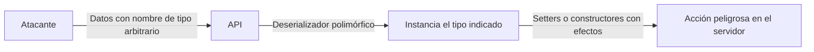

# Deserialización insegura

Parte de: [[12-Seguridad/04 Otras vulnerabilidades web/_Índice Otras vulnerabilidades web|Otras vulnerabilidades web]]

> [!info] Cómo avanzar
> `progreso`: **pendiente** → **viendo** (estudiando) → **visto** (contestaste la autoevaluación sin abrir las respuestas) → **dominado** (hiciste el laboratorio o lo aplicaste de verdad).

## Contenido

### Qué es
Deserializar es convertir bytes (JSON, XML, binario) de vuelta en objetos. Es inseguro cuando el formato permite que **el propio dato indique qué tipo de objeto crear** y la app deserializa datos que controla un atacante. Entonces el atacante elige tipos existentes en tu proceso cuyos constructores, setters o métodos de limpieza hacen algo peligroso (escribir archivos, iniciar procesos, cargar ensamblados). Encadenando varios de esos tipos, llamados **gadgets**, se puede llegar a ejecución remota de código. En el OWASP Top 10 2025 entra en *A08: Software or Data Integrity Failures*.

### Cómo funciona


1. Un serializador "polimórfico" guarda junto al dato el nombre completo del tipo, por ejemplo un campo `$type` con el nombre del ensamblado y la clase.
2. Al deserializar, el serializador crea **ese** tipo, no el que tu código esperaba.
3. Si el tipo existe en el proceso (en el framework o en alguna dependencia), se ejecutan su constructor y sus setters con los valores del atacante.
4. Aunque al final tu código lance una excepción por tipo inválido, el efecto ya ocurrió.

No hace falta que tú escribas un gadget: basta con que exista alguno en las librerías cargadas. Por eso la defensa no es "revisar mis clases", sino **no permitir que el dato elija el tipo**.

### Dónde aparece en .NET
- **`BinaryFormatter`**: el caso más conocido. Microsoft lo declaró inseguro sin remedio, lo marcó obsoleto y en .NET 9 retiró su implementación (lanza excepción al usarlo). Lo mismo aplica a `SoapFormatter`, `NetDataContractSerializer`, `LosFormatter` y `ObjectStateFormatter` cuando reciben datos no confiables.
- **Newtonsoft.Json con `TypeNameHandling`** distinto de `None` (`Auto`, `Objects`, `All`) sobre datos externos. Si es imprescindible, usa un `ISerializationBinder` con lista blanca de tipos.
- **ViewState** de Web Forms con llave de validación filtrada (aplicaciones heredadas).
- **Cachés y colas**: datos que "son internos" pero que un atacante puede escribir si compromete Redis o la cola.

En JavaScript el riesgo típico es diferente: librerías que usan `eval` para "parsear" o funciones que fusionan objetos sin cuidado y permiten *prototype pollution* con claves como `__proto__`. `JSON.parse` en sí no ejecuta código.

### Cómo se detecta
- **SAST y analizadores de .NET**: las reglas CA2300 a CA2330 de los analizadores de Roslyn advierten usos inseguros de serializadores (`BinaryFormatter`, `TypeNameHandling`, etc.).
- **Búsqueda en el código**: `BinaryFormatter`, `TypeNameHandling`, `JavaScriptSerializer` con `SimpleTypeResolver`, `$type` en contratos de API.
- **Revisión de integraciones**: cualquier punto que reciba blobs binarios o XML de terceros.

### Cómo se previene
- **Usar `System.Text.Json` deserializando a DTOs concretos** conocidos, sin información de tipo controlada por el cliente.
- **Polimorfismo solo con lista cerrada**: si necesitas jerarquías, `System.Text.Json` permite `[JsonPolymorphic]` y `[JsonDerivedType]` con un discriminador que mapea a tipos declarados por ti; el cliente solo elige entre opciones que tú definiste.
- **Validar después de deserializar** con [[FluentValidation]] (tamaños, rangos, formatos).
- **Integridad de datos persistidos**: si guardas objetos serializados fuera de tu control (cookies, campos ocultos), fírmalos (Data Protection de ASP.NET Core) para detectar manipulación.
- **Límites**: profundidad máxima y tamaño de cuerpo para evitar agotamiento de memoria.

### Ejemplo
Contrato de una notificación con varios tipos, usando polimorfismo cerrado:

```csharp
[JsonPolymorphic(TypeDiscriminatorPropertyName = "tipo")]
[JsonDerivedType(typeof(AvisoCorreo), "correo")]
[JsonDerivedType(typeof(AvisoSms), "sms")]
public abstract record Aviso(string Destino);

public sealed record AvisoCorreo(string Destino, string Asunto) : Aviso(Destino);
public sealed record AvisoSms(string Destino, string Texto) : Aviso(Destino);

// En el controller: el binder usa System.Text.Json por defecto
[HttpPost("avisos")]
public IActionResult Enviar([FromBody] Aviso aviso) => aviso switch
{
    AvisoCorreo => Accepted(),
    AvisoSms => Accepted(),
    _ => BadRequest()
};
```

Si el cliente manda `"tipo": "algo-raro"`, la deserialización falla con 400; nunca se instancia un tipo que no esté en la lista. Compáralo con `TypeNameHandling.All`, donde el cliente podría escribir cualquier nombre de tipo del proceso.

### Cuándo usarlo y cuándo no
Los formatos binarios no son malos en sí: Protobuf o MessagePack con contratos explícitos son seguros porque no llevan nombres de tipo arbitrarios. El problema son los serializadores que resuelven tipos dinámicamente desde el dato. Si heredas código con `BinaryFormatter`, planea migrarlo; Microsoft publica una guía de migración.

### Errores comunes
- **"Solo lo usamos internamente"**: los datos internos se vuelven externos cuando alguien compromete la caché, la cola o un archivo.
- **Habilitar `TypeNameHandling.Auto` para que funcione la herencia** en un DTO, sin binder.
- **Deserializar a `object` o `dynamic`** y decidir después.
- **Creer que validar después basta**: el daño ocurre durante la deserialización, antes de tu validación.

### Para profundizar
- [Microsoft Learn - Guía de seguridad de BinaryFormatter](https://learn.microsoft.com/dotnet/standard/serialization/binaryformatter-security-guide)
- [Microsoft Learn - Polimorfismo en System.Text.Json](https://learn.microsoft.com/dotnet/standard/serialization/system-text-json/polymorphism)
- [OWASP - Deserialization Cheat Sheet](https://cheatsheetseries.owasp.org/cheatsheets/Deserialization_Cheat_Sheet.html)
- [CWE-502: Deserialization of Untrusted Data](https://cwe.mitre.org/data/definitions/502.html)

## Autoevaluación

Contesta primero en voz alta o en papel; luego despliega la respuesta.

> [!question]- ¿Por qué es peligrosa la deserialización de datos no confiables?
> Algunos serializadores permiten que el dato indique qué tipo crear; un atacante puede elegir tipos cuyo constructor o setters ejecutan acciones peligrosas (cadenas de gadgets), llegando a ejecución de código.

> [!question]- ¿Qué serializador de .NET está obsoleto por esto?
> `BinaryFormatter`: Microsoft lo marcó obsoleto y en .NET 9 se quitó su implementación. Tampoco uses `TypeNameHandling` distinto de `None` en Newtonsoft.Json con datos externos.

> [!question]- Alternativa segura.
> `System.Text.Json` deserializando a tipos concretos conocidos (DTOs), sin información de tipo polimórfico controlada por el cliente, más validación del modelo.

