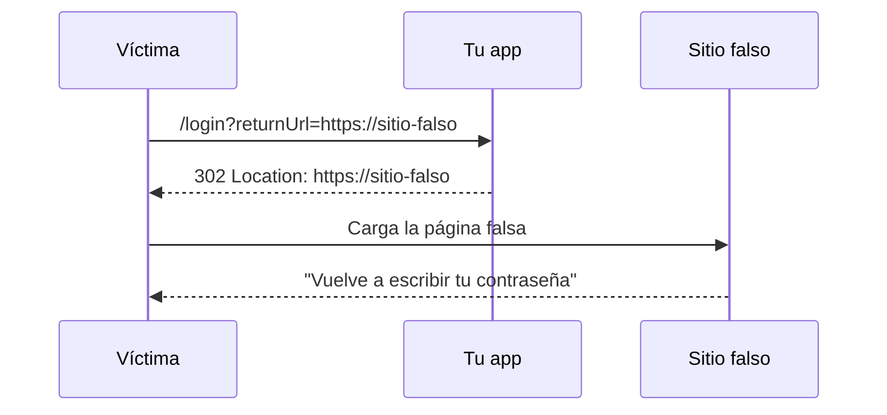

# Open redirect

Parte de: [[12-Seguridad/04 Otras vulnerabilidades web/_Índice Otras vulnerabilidades web|Otras vulnerabilidades web]]

> [!info] Cómo avanzar
> `progreso`: **pendiente** → **viendo** (estudiando) → **visto** (contestaste la autoevaluación sin abrir las respuestas) → **dominado** (hiciste el laboratorio o lo aplicaste de verdad).

## Contenido

### Qué es
Un *open redirect* (redirección abierta) es un endpoint de tu app que redirige a una URL tomada de un parámetro (`returnUrl`, `next`, `redirect_uri`) sin validarla. El atacante construye un enlace que empieza con tu dominio legítimo, la víctima confía en él, y termina en un sitio de phishing que imita tu login. Por sí solo parece menor, pero combinado con flujos de autenticación puede servir para **robar códigos o tokens** de OAuth.

### Cómo funciona
1. Tu login acepta `https://clio.midominio.com/login?returnUrl=/pedidos` y después del inicio de sesión hace `Redirect(returnUrl)`.
2. El atacante manda por correo `https://clio.midominio.com/login?returnUrl=https://clio-midominio.example/login`.
3. El usuario ve tu dominio, inicia sesión de verdad y es enviado al sitio falso, que le dice "sesión expirada, vuelve a ingresar" y captura su contraseña.



Las validaciones caseras fallan con frecuencia: comprobar que la URL "empieza con `/`" deja pasar `//sitio-falso.example` (una URL relativa al esquema, que el navegador trata como otro dominio) y variantes con `\`. Comprobar que "contiene `midominio.com`" deja pasar `midominio.com.sitio-falso.example`.

### OAuth y `redirect_uri`
En OAuth 2.0 y OpenID Connect, el servidor de autorización manda el **código de autorización** a la `redirect_uri`. Si tu servidor (por ejemplo Xolotl.Hecate) acepta cualquier subruta, comodines o prefijos, un atacante puede inyectar una URI que él controla, o encadenar un open redirect dentro de tu dominio, y recibir el código. Por eso las especificaciones actuales exigen que las `redirect_uri` estén **registradas previamente y se comparen de forma exacta** (cadena completa). PKCE agrega otra barrera, porque el código no sirve sin el verificador, pero no sustituye la comparación exacta. Ver [[OAuth 2.0 - Authorization Code con PKCE]].

### Cómo se previene en ASP.NET Core
- **Solo rutas locales**: `LocalRedirect(returnUrl)` lanza una excepción si la URL no es local, y `Url.IsLocalUrl(returnUrl)` te deja decidir. Ambos rechazan `//otro` y `/\otro`.
- **Lista blanca** cuando de verdad necesitas redirigir fuera (por ejemplo entre tus propios dominios): compara el origen completo contra una lista de configuración.
- **Identificadores en vez de URLs**: `?destino=pedidos` y un diccionario de destinos permitidos en el servidor.
- **Página intermedia** para redirecciones externas inevitables: "Vas a salir de nuestro sitio hacia...".

### Ejemplo
```csharp
[HttpPost("login")]
[AllowAnonymous]
public async Task<IActionResult> Login([FromForm] LoginSolicitud solicitud, string? returnUrl)
{
    var resultado = await autenticacion.IniciarSesionAsync(solicitud);
    if (!resultado.Exitoso)
        return Problem(statusCode: 401, title: "Usuario o contraseña incorrectos",
            extensions: new Dictionary<string, object?> { ["codigo"] = "CREDENCIALES_INVALIDAS" });

    // Solo rutas locales; cualquier otra cosa va al inicio
    return Url.IsLocalUrl(returnUrl) ? LocalRedirect(returnUrl!) : LocalRedirect("/");
}
```

En una SPA en React que recibe el destino por query string, valida igual antes de navegar:

```ts
// Itzamna.Clio: navegar solo a rutas internas
export function destinoSeguro(valor: string | null): string {
  if (!valor) return '/';
  try {
    const url = new URL(valor, window.location.origin);
    return url.origin === window.location.origin ? url.pathname + url.search + url.hash : '/';
  } catch {
    return '/';
  }
}
```

`new URL` con la base resuelve `//otro.example` como otro origen, y la comparación de `origin` lo rechaza. Además, nunca uses el valor directamente en `window.location.href` si puede empezar con `javascript:`; la comparación de origen también lo descarta.

En el servidor de identidad, la configuración de clientes guarda la lista exacta de `redirect_uri` por cliente y entorno; nada de comodines.

### Cómo se detecta
- Busca en el código `Redirect(` con valores que vengan de la petición.
- Prueba en local valores como una URL absoluta externa o `//ejemplo.test` en cada parámetro de redirección.
- [[OWASP ZAP]] tiene reglas de escaneo activo para open redirect (úsalas solo contra tus entornos).

### Errores comunes
- **Validar con `StartsWith("/")`**: deja pasar `//`.
- **Validar con `Contains("midominio.com")`**.
- **Registrar `redirect_uri` con comodines** "para no batallar con los entornos".
- **Olvidar el logout**: `/logout?post_logout_redirect_uri=...` tiene el mismo problema.

### Para profundizar
- [Microsoft Learn - Evitar ataques de redirección abierta en ASP.NET Core](https://learn.microsoft.com/aspnet/core/security/preventing-open-redirects)
- [OWASP - Unvalidated Redirects and Forwards Cheat Sheet](https://cheatsheetseries.owasp.org/cheatsheets/Unvalidated_Redirects_and_Forwards_Cheat_Sheet.html)
- [RFC 9700 - OAuth 2.0 Security Best Current Practice](https://datatracker.ietf.org/doc/html/rfc9700)

## Autoevaluación

Contesta primero en voz alta o en papel; luego despliega la respuesta.

> [!question]- ¿Qué es un open redirect?
> Un endpoint que redirige a una URL tomada de un parámetro (`returnUrl`, `redirect_uri`) sin validarla, así que un enlace de tu dominio puede llevar a un sitio de phishing.

> [!question]- ¿Cómo se evita en ASP.NET Core?
> Con `Url.IsLocalUrl(returnUrl)` o `LocalRedirect(returnUrl)`, que solo permiten rutas locales.

> [!question]- ¿Por qué en OAuth las `redirect_uri` deben coincidir exactamente?
> Porque el código o token de autorización se manda a esa URL. Si se acepta cualquier subruta o comodín, un atacante podría recibir el código. La lista debe estar registrada y compararse de forma exacta.

