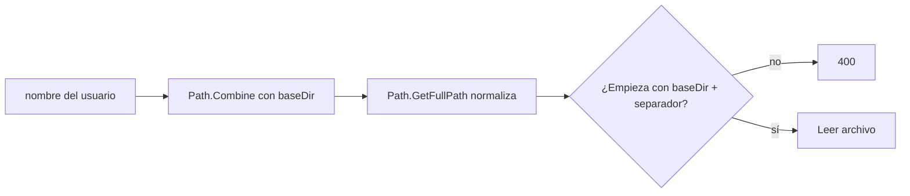

# Path traversal

Parte de: [[12-Seguridad/04 Otras vulnerabilidades web/_Índice Otras vulnerabilidades web|Otras vulnerabilidades web]]

> [!info] Cómo avanzar
> `progreso`: **pendiente** → **viendo** (estudiando) → **visto** (contestaste la autoevaluación sin abrir las respuestas) → **dominado** (hiciste el laboratorio o lo aplicaste de verdad).

## Contenido

### Qué es
*Path traversal* (recorrido de directorios) ocurre cuando la app arma una ruta de archivo con datos del usuario y este logra salirse de la carpeta permitida, usando segmentos de directorio padre (`..`) o una ruta absoluta. El resultado puede ser **leer** archivos del servidor (configuración, llaves, código) o **escribir** donde no debe (sobrescribir archivos, dejar algo ejecutable). Aparece en descargas de reportes, visores de documentos, subidas de archivos y extracción de ZIP.

### Cómo funciona
Tu endpoint recibe `nombre` y hace `Path.Combine(baseDir, nombre)`. Dos trampas de `Path.Combine`:

1. **No elimina `..`**: `Path.Combine(@"C:\datos\", @"..\secretos\llave.pem")` produce `C:\datos\..\secretos\llave.pem`, que el sistema resuelve como `C:\secretos\llave.pem`.
2. **Una ruta absoluta reemplaza a la base**: si el segundo argumento es absoluto, `Path.Combine` ignora el primero. `Path.Combine(@"C:\datos\", @"C:\Windows\win.ini")` devuelve `C:\Windows\win.ini`.



Hay más variantes: separadores mezclados (`/` y `\` en Windows), codificación URL (`%2e%2e%2f`) o doble codificación cuando la app decodifica dos veces, y en Linux, enlaces simbólicos dentro de la carpeta permitida.

### Cómo se previene en .NET
La mejor defensa es **no usar el nombre que manda el usuario**: guarda los archivos con un nombre generado (GUID) y busca por id en la base, verificando que el registro pertenece al usuario o tenant. Si de verdad necesitas aceptar un nombre:

1. Normaliza con `Path.GetFullPath` la base y el resultado.
2. Agrega el separador final a la base.
3. Compara con `StartsWith` usando la comparación adecuada del sistema de archivos.

El separador final importa: sin él, `C:\datos-privados\x.txt` "empieza con" `C:\datos` y pasaría la verificación.

### Ejemplo
Descarga de reportes en Wee.Reporteria:

```csharp
public sealed class AlmacenReportes(IOptions<OpcionesReportes> opciones)
{
    // Ej. "D:\\Reportes" en Windows o "/srv/reportes" en Linux
    private readonly string _base =
        Path.GetFullPath(opciones.Value.Carpeta).TrimEnd(Path.DirectorySeparatorChar)
        + Path.DirectorySeparatorChar;

    private static readonly StringComparison Comparacion =
        OperatingSystem.IsWindows() ? StringComparison.OrdinalIgnoreCase : StringComparison.Ordinal;

    public string? ResolverRuta(string nombre)
    {
        // Rechazo temprano de lo obvio: solo el nombre, sin directorios
        if (string.IsNullOrWhiteSpace(nombre) || nombre != Path.GetFileName(nombre))
            return null;

        var completa = Path.GetFullPath(Path.Combine(_base, nombre));
        return completa.StartsWith(_base, Comparacion) ? completa : null;
    }
}

// Controller
[HttpGet("reportes/{nombre}")]
public IActionResult Descargar(string nombre)
{
    var ruta = almacen.ResolverRuta(nombre);
    if (ruta is null || !System.IO.File.Exists(ruta))
        return Problem(statusCode: 404, title: "Reporte no encontrado",
            extensions: new Dictionary<string, object?> { ["codigo"] = "REPORTE_NO_ENCONTRADO" });

    return PhysicalFile(ruta, "application/vnd.openxmlformats-officedocument.spreadsheetml.sheet",
                        fileDownloadName: nombre);
}
```

Aún mejor: el endpoint recibe `reporteId`, un procedimiento devuelve el nombre de archivo guardado (GUID) solo si el reporte es del tenant del token, y el archivo vive en Blob Storage, donde no existe el concepto de "subir de carpeta" en el sistema de archivos del servidor.

### ZIP Slip
Al extraer un ZIP subido por usuarios, cada entrada trae su propia ruta, que puede contener `..`. Aplica la misma verificación a cada `entry.FullName` antes de escribir, o usa `ZipFile.ExtractToDirectory`, que en .NET moderno valida que las entradas no se salgan del destino. Aun así, limita tamaño total y número de entradas.

### Cómo se detecta
- **SAST**: CodeQL y otros analizadores detectan flujos de datos de la petición hacia `File.*`, `FileStream` o `PhysicalFile`.
- **Revisión de código**: busca `Path.Combine` con valores de `Request`, parámetros de ruta o `IFormFile.FileName`.
- **Pruebas unitarias** de `ResolverRuta` con `..\`, `../`, rutas absolutas, nombres vacíos y nombres con la base como prefijo (`datos-privados`).

### Errores comunes
- **Confiar en `Path.Combine`** como si validara.
- **Reemplazar `..` con cadena vacía**: `....//` se convierte en `../` después del reemplazo.
- **Usar `IFormFile.FileName` para guardar**: lo controla el cliente; genera tu propio nombre.
- **Comparar sin separador final** o con la sensibilidad a mayúsculas equivocada.
- **Validar antes de decodificar**: valida sobre el valor final que usarás.

### Para profundizar
- [PortSwigger Academy - Path traversal](https://portswigger.net/web-security/file-path-traversal)
- [Microsoft Learn - Path.GetFullPath](https://learn.microsoft.com/dotnet/api/system.io.path.getfullpath)
- [CWE-22: Improper Limitation of a Pathname to a Restricted Directory](https://cwe.mitre.org/data/definitions/22.html)

## Ejercicios

Resuélvelos en papel o en la herramienta; la solución está plegada.

> [!question]- Con `baseDir = C:\datos\`, ¿qué devuelve `Path.Combine(baseDir, "C:\Windows\win.ini")`?
> `C:\Windows\win.ini`: la ruta absoluta reemplaza a la base. Por eso hay que normalizar con `GetFullPath` y comprobar el prefijo.

> [!question]- ¿Por qué se agrega el separador final a `baseDir` antes de comparar con `StartsWith`?
> Para que `C:\datos-privados\x` no pase como si estuviera dentro de `C:\datos`.

## Autoevaluación

Contesta primero en voz alta o en papel; luego despliega la respuesta.

> [!question]- ¿Qué es path traversal?
> Usar secuencias de directorio padre o rutas absolutas en un parámetro de nombre de archivo para leer o escribir fuera de la carpeta permitida.

> [!question]- Defensa en .NET.
> ```csharp
> var baseDir = Path.GetFullPath("/srv/archivos") + Path.DirectorySeparatorChar;
> var full = Path.GetFullPath(Path.Combine(baseDir, nombre));
> if (!full.StartsWith(baseDir, StringComparison.Ordinal)) return Results.BadRequest();
> ```
> Mejor aún: no usar el nombre del usuario; buscar el archivo por un id en la base.

> [!question]- ¿Por qué `Path.Combine` no protege por sí solo?
> Si el segundo argumento es una ruta absoluta, `Path.Combine` la devuelve tal cual e ignora la base; y no elimina los segmentos `..`.

