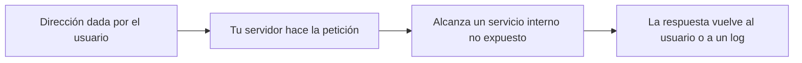

# SSRF

Parte de: [[12-Seguridad/04 Otras vulnerabilidades web/_Índice Otras vulnerabilidades web|Otras vulnerabilidades web]]

> [!info] Cómo avanzar
> `progreso`: **pendiente** → **viendo** (estudiando) → **visto** (contestaste la autoevaluación sin abrir las respuestas) → **dominado** (hiciste el laboratorio o lo aplicaste de verdad).

## Contenido

### Qué es
SSRF (*Server-Side Request Forgery*, falsificación de petición del lado del servidor) ocurre cuando tu servidor realiza una petición de red hacia una dirección que proviene de la entrada del usuario, y esa dirección termina apuntando a recursos internos que el servidor sí alcanza pero el usuario no debería. El atacante no accede directamente: usa tu servidor como intermediario para llegar a servicios de la red privada, paneles internos o el servicio de metadatos de la nube. En el OWASP Top 10 aparece como riesgo propio (A10:2021) y en el API Security Top 10 como API7.

### Cómo funciona
Funciones que suelen abrir la puerta: cargar un recurso a partir de una dirección que da el usuario, webhooks configurables, generadores de documentos que incrustan recursos remotos y validadores que consultan una dirección proporcionada.



El punto clave es que el servidor vive en una red con confianza implícita: servicios internos sin autenticación, bases con panel HTTP, y en la nube un endpoint de metadatos de la instancia que entrega credenciales temporales. Una petición originada por tu servidor llega a lugares que el atacante no alcanza desde fuera.

### Por qué es crítico en la nube
Los proveedores exponen un servicio de metadatos en una dirección fija de enlace local para que la instancia lea su configuración. Si ese servicio no está protegido, una SSRF puede pedirle **credenciales temporales** de la identidad de la máquina y, con ellas, actuar contra tus recursos. Por eso las nubes endurecieron ese servicio (en AWS, IMDSv2 exige un token por sesión; en Azure, el endpoint de Instance Metadata requiere un header específico y no es accesible desde dentro de un contenedor por defecto). Aun así, la mitigación en la nube es una capa más, no un sustituto de validar la dirección.

### Cómo te defiendes
La defensa combina varias capas, porque las listas negras simples se evaden con redirecciones, representaciones alternativas de la dirección y nombres de dominio que resuelven a direcciones internas:

- **Lista blanca de destinos**: si solo necesitas hablar con unos cuantos dominios conocidos, permite exactamente esos y nada más. Es lo más efectivo.
- **Resolver el nombre y validar la dirección resuelta**: bloquea rangos privados, loopback, enlace local y multicast **después** de resolver DNS, no sobre el texto de la dirección.
- **Validar también tras cada redirección**: no sigas redirecciones de forma automática, o vuelve a aplicar la validación en cada salto.
- **Egress restringido**: reglas de red que impidan que el servicio salga a la red interna o al endpoint de metadatos.
- **Metadatos protegidos** en la nube (IMDSv2 / header obligatorio).
- **No devolver la respuesta cruda** al usuario ni volcarla en errores: reduce lo que el atacante aprende.
- **Tiempos de espera y límites** de tamaño para evitar abusos.

### Ejemplo
Validador de destino en Itzamna.Dionisio para una función que debe consultar solo proveedores conocidos. La idea es resolver el nombre y rechazar direcciones internas; se apoya en `IHttpClientFactory` con redirecciones desactivadas.

```csharp
public sealed class ValidadorDestino(IOptions<OpcionesSalida> opciones)
{
    private readonly HashSet<string> _hostsPermitidos =
        new(opciones.Value.HostsPermitidos, StringComparer.OrdinalIgnoreCase);

    public async Task<bool> EsPermitidoAsync(Uri uri, CancellationToken ct)
    {
        // Solo https y solo hosts de la lista blanca
        if (uri.Scheme != Uri.UriSchemeHttps) return false;
        if (!_hostsPermitidos.Contains(uri.Host)) return false;

        // Resolver el nombre y rechazar cualquier dirección interna
        var direcciones = await Dns.GetHostAddressesAsync(uri.DnsSafeHost, ct);
        return direcciones.Length > 0 && direcciones.All(EsPublica);
    }

    private static bool EsPublica(IPAddress ip)
    {
        if (IPAddress.IsLoopback(ip)) return false;
        var b = ip.GetAddressBytes();
        if (ip.AddressFamily == AddressFamily.InterNetwork)
        {
            // 10.0.0.0/8, 172.16.0.0/12, 192.168.0.0/16, 169.254.0.0/16 (enlace local), 127.0.0.0/8
            if (b[0] == 10 || b[0] == 127) return false;
            if (b[0] == 172 && b[1] >= 16 && b[1] <= 31) return false;
            if (b[0] == 192 && b[1] == 168) return false;
            if (b[0] == 169 && b[1] == 254) return false;
            return true;
        }
        // IPv6: rechazar loopback, enlace local (fe80::/10) y direcciones únicas locales (fc00::/7)
        var esUnicaLocal = (b[0] & 0xFE) == 0xFC;
        return !ip.IsIPv6LinkLocal && !esUnicaLocal && !ip.Equals(IPAddress.IPv6Loopback);
    }
}
```

```csharp
// Registro del HttpClient que NO sigue redirecciones (para re-validar cada salto si las hubiera)
builder.Services.AddHttpClient("salida")
    .ConfigurePrimaryHttpMessageHandler(() => new HttpClientHandler
    {
        AllowAutoRedirect = false,
        MaxResponseContentBufferSize = 2 * 1024 * 1024
    });
```

En el flujo real, primero validas con `ValidadorDestino`, luego haces la petición con un tiempo de espera corto; si la respuesta es una redirección (3xx), vuelves a validar el nuevo destino antes de seguir. Para el navegador no hay equivalente: SSRF es un problema del servidor.

### Cómo se detecta
- **Revisión de código**: busca dónde el servidor hace peticiones (`HttpClient`, generadores de PDF, clientes de webhooks) con una dirección que venga del usuario.
- **SAST** como CodeQL marca el flujo de datos de la petición hacia un cliente HTTP.
- **Inventario** de funciones que aceptan direcciones: importaciones, webhooks, callbacks, validadores.

### Cuándo usarlo y cuándo no
Si la función solo necesita hablar con proveedores fijos, la lista blanca de hosts resuelve casi todo. La validación de direcciones resueltas es imprescindible cuando los destinos no se pueden enumerar de antemano. Si de plano no necesitas que el usuario indique un destino, no ofrezcas esa opción.

### Errores comunes
- **Validar el texto de la dirección** en vez de la dirección resuelta: un nombre de dominio puede apuntar a una dirección interna.
- **Seguir redirecciones automáticamente**: la primera dirección pasa la validación y la redirección lleva a un destino interno.
- **Usar lista negra de cadenas** (`contains "localhost"`): hay muchas representaciones equivalentes.
- **Confiar solo en el firewall** o solo en la protección de metadatos: usa varias capas.
- **Devolver la respuesta íntegra** o el mensaje de error, dando información del interior.

### Para profundizar
- [OWASP - Server Side Request Forgery Prevention Cheat Sheet](https://cheatsheetseries.owasp.org/cheatsheets/Server_Side_Request_Forgery_Prevention_Cheat_Sheet.html)
- [PortSwigger Academy - SSRF](https://portswigger.net/web-security/ssrf)
- [CWE-918: Server-Side Request Forgery (SSRF)](https://cwe.mitre.org/data/definitions/918.html)
- [Microsoft Learn - Azure Instance Metadata Service](https://learn.microsoft.com/azure/virtual-machines/instance-metadata-service)

## Autoevaluación

Contesta primero en voz alta o en papel; luego despliega la respuesta.

> [!question]- ¿Qué es SSRF?
> Server-Side Request Forgery: la app hace peticiones a una URL que controla el usuario (importar imagen por URL, webhooks) y el atacante la usa para llegar a recursos internos que el servidor sí alcanza.

> [!question]- ¿Por qué es crítico en la nube?
> Porque desde el servidor se puede llegar al servicio de metadatos de la instancia (en `169.254.169.254`) que entrega credenciales temporales, además de servicios internos sin autenticación.

> [!question]- ¿Cómo te defiendes?
> Lista blanca de dominios destino; resolver el DNS y bloquear rangos privados, loopback y link-local; no seguir redirecciones o volver a validarlas; salida de red restringida; en la nube, metadatos con protección (IMDSv2 en AWS, header obligatorio en Azure).

