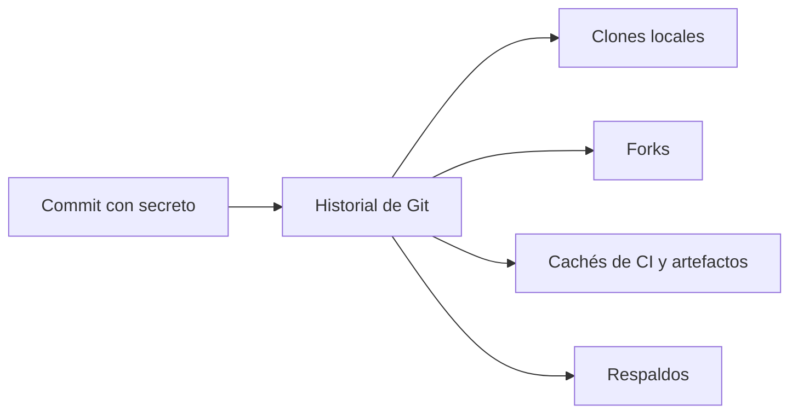

# Secretos en repositorios

Parte de: [[12-Seguridad/04 Otras vulnerabilidades web/_Índice Otras vulnerabilidades web|Otras vulnerabilidades web]]

> [!info] Cómo avanzar
> `progreso`: **pendiente** → **viendo** (estudiando) → **visto** (contestaste la autoevaluación sin abrir las respuestas) → **dominado** (hiciste el laboratorio o lo aplicaste de verdad).

## Contenido

### Qué es
Un secreto en un repositorio es cualquier credencial que quedó guardada en Git: cadenas de conexión con contraseña, llaves de API, llaves privadas, tokens de acceso personal, certificados con su contraseña. El problema no es solo el archivo actual: Git guarda **todo el historial**, y cada clon, fork, caché de CI o respaldo tiene una copia. Por eso un secreto que llegó a un commit se considera **comprometido** aunque se borre en el siguiente.

### Cómo ocurre
- Alguien pone la cadena de conexión real en `appsettings.json` "para probar" y hace commit.
- Un archivo `.env` o `appsettings.Development.json` con valores reales no estaba en `.gitignore`.
- Se copia un script de despliegue con un token incrustado.
- Un archivo de configuración del IDE o un export de Postman con tokens se agrega sin revisar.
- En el front, una llave de servicio se pone en una variable `VITE_...`, que termina **dentro del bundle público**: todo lo que va en el código del navegador es público por definición.



### Por qué borrarlo no basta
Un commit nuevo que elimina el archivo solo cambia la punta de la rama: el commit anterior sigue ahí y cualquiera con acceso puede verlo con `git log -p`. Limpiar el historial (con `git filter-repo`) ayuda a reducir la exposición futura, pero no recupera las copias que ya existen. Por eso el orden correcto ante una filtración es:

1. **Rotar** el secreto (generar uno nuevo y revocar el viejo). Esto es lo único que realmente elimina el riesgo.
2. Revisar los logs del servicio afectado por si alguien lo usó.
3. Quitar el secreto del código y moverlo al almacén correcto.
4. Opcionalmente, limpiar el historial y avisar a quienes tengan clones.

### ¿Y si el repo es privado?
Un repositorio privado **no** es un lugar seguro para secretos: todas las personas con acceso (actuales y futuras), las integraciones y las herramientas de CI pueden leerlos; los permisos cambian, los repos se hacen públicos por error, y una cuenta de desarrollador comprometida expone todo lo que esa cuenta ve.

### Cómo se previene
- **Secretos fuera del repo desde el inicio**: en local, [[Secretos con User Secrets]]; en Azure, [[Key Vault]] con [[Managed Identity]] para no necesitar ni siquiera una credencial para leerlo; en Azure DevOps, variables secretas o variable groups enlazados a Key Vault.
- **`.gitignore`** para `.env`, `*.pfx`, `appsettings.*.local.json` y similares.
- **Hook de pre-commit** con un escáner como gitleaks, para detectar el secreto antes de que salga de tu máquina.
- **Escaneo en el servidor**: en GitHub, *secret scanning* y *push protection* (disponibles por defecto en repos públicos; en privados requieren GitHub Secret Protection). En Azure DevOps existe Advanced Security con escaneo de secretos (Pendiente de confirmar planes y precios vigentes).
- **Escaneo del historial completo** una vez, cuando adoptas la herramienta. Ver [[Escaneo de dependencias y de secretos]].

### Ejemplo
Configuración de Itzamna.Dionisio que no contiene ningún secreto en el repositorio:

```json
// appsettings.json (sí va al repo)
{
  "ConnectionStrings": { "Dionisio": "" },
  "KeyVault": { "Uri": "https://kv-dionisio-prod.vault.azure.net/" }
}
```

```csharp
// Program.cs: en Azure, Key Vault con la identidad administrada; en local, User Secrets
if (!builder.Environment.IsDevelopment())
{
    builder.Configuration.AddAzureKeyVault(
        new Uri(builder.Configuration["KeyVault:Uri"]!),
        new DefaultAzureCredential());
}
```

```bash
# En tu máquina (no se guarda en el repo)
dotnet user-secrets init
dotnet user-secrets set "ConnectionStrings:Dionisio" "Server=localhost;Database=Dionisio;Trusted_Connection=True;TrustServerCertificate=True"
```

Y el hook con pre-commit:

```yaml
# .pre-commit-config.yaml
repos:
  - repo: https://github.com/gitleaks/gitleaks
    rev: v8.24.2   # usa la versión vigente: pre-commit autoupdate
    hooks:
      - id: gitleaks
```

### Cuándo usarlo y cuándo no
Todo proyecto debe tener secretos fuera del repo, sin excepción. Lo que sí puede ir al repo: plantillas con valores vacíos, nombres de variables, URIs de Key Vault y configuración no sensible. Valores de ejemplo deben ser obviamente falsos.

### Errores comunes
- **Borrar el archivo y dar el tema por cerrado** sin rotar.
- **"Es solo la de desarrollo"**: muchas veces apunta a datos reales o se reutiliza en otros entornos.
- **Poner llaves en variables `VITE_`** creyendo que quedan ocultas.
- **Saltarse el hook** (`--no-verify`) por prisa; el escaneo en CI debe ser la segunda red.
- **Imprimir secretos en logs del pipeline** al depurar.

### Para profundizar
- [GitHub Docs - Acerca del escaneo de secretos](https://docs.github.com/es/code-security/secret-scanning/introduction/about-secret-scanning)
- [Microsoft Learn - Almacenamiento seguro de secretos en desarrollo (User Secrets)](https://learn.microsoft.com/aspnet/core/security/app-secrets)
- [OWASP - Secrets Management Cheat Sheet](https://cheatsheetseries.owasp.org/cheatsheets/Secrets_Management_Cheat_Sheet.html)
- [gitleaks en GitHub](https://github.com/gitleaks/gitleaks)

## Autoevaluación

Contesta primero en voz alta o en papel; luego despliega la respuesta.

> [!question]- ¿Por qué borrar el archivo en un commit nuevo no basta?
> El secreto sigue en el historial de Git y en clones, forks y cachés. Hay que rotarlo y, si se quiere, limpiar el historial (`git filter-repo`).

> [!question]- ¿Cómo prevenir que se suban?
> `.gitignore` para archivos locales, [[Secretos con User Secrets]], hooks de pre-commit con un escáner (gitleaks), secret scanning con protección de push en GitHub.

> [!question]- ¿Es seguro un repo privado para guardar secretos?
> No: todos los que tienen acceso (y las integraciones) lo ven, y los repos privados también se filtran o se hacen públicos por error.

## Práctica

- [[Lab 1 - Sacar secretos del código en una API .NET]]
- [[Lab 9 - Escaneo de dependencias y secretos en un repositorio propio]]

