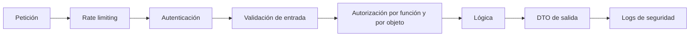

# Seguridad de APIs

Parte de: [[12-Seguridad/04 Otras vulnerabilidades web/_Índice Otras vulnerabilidades web|Otras vulnerabilidades web]]

> [!info] Cómo avanzar
> `progreso`: **pendiente** → **viendo** (estudiando) → **visto** (contestaste la autoevaluación sin abrir las respuestas) → **dominado** (hiciste el laboratorio o lo aplicaste de verdad).

## Contenido

### Qué es
La seguridad de APIs es el conjunto de controles para que una API HTTP solo haga lo que debe, para quien debe y en la cantidad que debe. Las APIs tienen riesgos propios porque exponen directamente objetos y operaciones de negocio, sin una interfaz que "esconda" nada. OWASP mantiene una lista específica, el **OWASP API Security Top 10** (edición 2023), cuyo primer riesgo es **BOLA** (*Broken Object Level Authorization*), el equivalente a [[Control de acceso roto e IDOR]].

### El OWASP API Security Top 10 2023
| # | Riesgo | Idea clave |
|---|---|---|
| API1 | Broken Object Level Authorization | Verificar que el objeto pedido es del usuario o tenant |
| API2 | Broken Authentication | Tokens bien validados, login protegido |
| API3 | Broken Object Property Level Authorization | No exponer ni aceptar propiedades de más (incluye mass assignment) |
| API4 | Unrestricted Resource Consumption | Límites de tasa, tamaño y paginación |
| API5 | Broken Function Level Authorization | Proteger funciones administrativas |
| API6 | Unrestricted Access to Sensitive Business Flows | Proteger flujos de negocio del abuso automatizado |
| API7 | Server Side Request Forgery | No hacer peticiones a URLs arbitrarias del usuario |
| API8 | Security Misconfiguration | Configuración segura por entorno |
| API9 | Improper Inventory Management | Saber qué versiones y endpoints existen |
| API10 | Unsafe Consumption of APIs | Validar también lo que responden terceros |

### Controles básicos


- **Autenticación robusta** con tokens bien validados ([[Ataques a JWT y cómo evitarlos]]).
- **Autorización por función** (policies) **y por objeto** (filtro por dueño o tenant en cada consulta).
- **Validación de entrada** con esquemas: [[FluentValidation]] para reglas, límites de tamaño de cuerpo.
- **DTOs de entrada y salida** explícitos.
- **Rate limiting** y **paginación con tamaño máximo**.
- **CORS estricto** si la consume un navegador ([[CORS]]).
- **Errores genéricos** con [[ProblemDetails]].
- **Logs de seguridad**: logins fallidos, accesos denegados, cambios de permisos, sin datos sensibles.
- **Inventario y versionado**: documentación OpenAPI al día y retiro real de versiones viejas.

### Mass assignment
Ocurre cuando el model binding asigna al objeto de dominio **todas** las propiedades que vienen en el JSON, incluidas las que el cliente no debería poder cambiar (`EsAdmin`, `TenantId`, `Saldo`). Si el controller recibe la entidad completa, basta con agregar el campo al cuerpo. Se evita con **DTOs de entrada** que solo tienen los campos permitidos para ese caso de uso; los demás valores (tenant, usuario, fechas de auditoría) los pone el servidor.

### Ejemplo
DTO de entrada, validación y rate limiting en Itzamna.Dionisio:

```csharp
// Solo lo que el usuario puede cambiar de su perfil
public sealed record ActualizarPerfilSolicitud(string Nombre, string Telefono);

public sealed class ActualizarPerfilValidador : AbstractValidator<ActualizarPerfilSolicitud>
{
    public ActualizarPerfilValidador()
    {
        RuleFor(x => x.Nombre).NotEmpty().MaximumLength(120);
        RuleFor(x => x.Telefono).Matches(@"^\d{10}$");
    }
}
```

```csharp
// Program.cs: límite por usuario autenticado (o por IP si es anónimo)
builder.Services.AddRateLimiter(o =>
{
    o.RejectionStatusCode = StatusCodes.Status429TooManyRequests;
    o.AddPolicy("por-usuario", ctx =>
        RateLimitPartition.GetFixedWindowLimiter(
            partitionKey: ctx.User.FindFirst("sub")?.Value
                          ?? ctx.Connection.RemoteIpAddress?.ToString() ?? "anonimo",
            factory: _ => new FixedWindowRateLimiterOptions
            {
                PermitLimit = 100,
                Window = TimeSpan.FromMinutes(1),
                QueueLimit = 0
            }));
});

var app = builder.Build();
app.UseAuthentication();
app.UseRateLimiter();      // después de autenticación para poder particionar por usuario
app.UseAuthorization();
app.MapControllers();
```

```csharp
[ApiController]
[Route("api/perfil")]
[Authorize]
[EnableRateLimiting("por-usuario")]
public sealed class PerfilController(IActualizarPerfil comando) : ControllerBase
{
    [HttpPut]
    public async Task<IActionResult> Actualizar(ActualizarPerfilSolicitud solicitud, CancellationToken ct)
    {
        var usuarioId = int.Parse(User.FindFirstValue("sub")!);   // del token, no del cuerpo
        await comando.EjecutarAsync(usuarioId, solicitud, ct);
        return NoContent();
    }
}
```

Si el cliente manda `"esAdmin": true`, el binder lo ignora porque el DTO no tiene esa propiedad. Para límites en endpoints de minimal APIs se usa `.RequireRateLimiting("por-usuario")`. Más detalle en [[Rate limiting]].

Detrás de varias instancias, el limitador en memoria cuenta por instancia; para un límite global usa el del gateway (Azure API Management o Front Door) además del de la app.

### Cuándo usarlo y cuándo no
Todos estos controles aplican a cualquier API expuesta. Lo que varía es el ajuste: límites distintos para endpoints costosos (reportes de Wee.Reporteria) y para login; paginación más estricta en endpoints públicos.

### Errores comunes
- **Recibir la entidad de base de datos** en el controller.
- **Rate limiting solo en login**: los endpoints de búsqueda o exportación también se abusan.
- **Páginas sin máximo** (`?tamano=100000`).
- **Versiones viejas olvidadas** (`/v1`) que no tienen los controles nuevos.
- **Confiar ciegamente en lo que responde otra API** (API10): valida también esas respuestas.

### Para profundizar
- [OWASP API Security Top 10 2023](https://owasp.org/API-Security/editions/2023/en/0x11-t10/)
- [Microsoft Learn - Middleware de limitación de velocidad en ASP.NET Core](https://learn.microsoft.com/aspnet/core/performance/rate-limit)
- [OWASP - Mass Assignment Cheat Sheet](https://cheatsheetseries.owasp.org/cheatsheets/Mass_Assignment_Cheat_Sheet.html)

## Autoevaluación

Contesta primero en voz alta o en papel; luego despliega la respuesta.

> [!question]- ¿Qué es el OWASP API Security Top 10 y cuál es su primer riesgo?
> Una lista específica para APIs; el primer lugar de la edición 2023 es Broken Object Level Authorization (BOLA), equivalente a IDOR.

> [!question]- Lista de controles básicos para una API.
> Autenticación robusta, autorización por objeto y por función, validación de entrada con esquemas, DTOs de salida, límites de tasa (rate limiting), paginación con tamaño máximo, CORS estricto, logs de seguridad y versionado/inventario de endpoints.

> [!question]- ¿Qué es mass assignment y cómo lo evitas?
> Que el cliente envíe propiedades extra (por ejemplo `esAdmin`) y el binder las asigne a la entidad. Se evita con DTOs de entrada que solo tienen los campos permitidos.

> [!question]- ¿Cómo agregas rate limiting en ASP.NET Core?
> Con el middleware integrado: `builder.Services.AddRateLimiter(...)` con una política (por ejemplo ventana fija por usuario o IP) y `app.UseRateLimiter()` + `.RequireRateLimiting("politica")` en los endpoints.

## Práctica

- [[Lab 8 - Control de acceso roto en OWASP Juice Shop local]]
- [[Lab 7 - Revisión de un JWT mal validado en tu propio código]]

