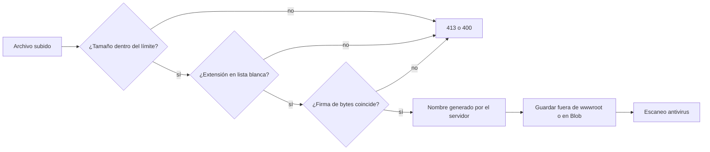

# Subida de archivos insegura

Parte de: [[12-Seguridad/04 Otras vulnerabilidades web/_Índice Otras vulnerabilidades web|Otras vulnerabilidades web]]

> [!info] Cómo avanzar
> `progreso`: **pendiente** → **viendo** (estudiando) → **visto** (contestaste la autoevaluación sin abrir las respuestas) → **dominado** (hiciste el laboratorio o lo aplicaste de verdad).

## Contenido

### Qué es
Una función de subida de archivos es insegura cuando acepta lo que el usuario mande y lo guarda o lo sirve sin controles. Es uno de los puntos más delicados de una app, porque un archivo es contenido que otros (el servidor, otros usuarios, herramientas de procesamiento) van a abrir. Los riesgos principales: que el archivo **se ejecute** en el servidor, que se sirva a otros usuarios como **HTML o SVG con scripts**, que su nombre se use para **escribir fuera de la carpeta** destino, que sea **enorme** y agote recursos, o que distribuya **malware**.

### Cómo ocurre
Los fallos típicos son decisiones de diseño:

- Guardar en una carpeta servida por el sitio (por ejemplo `wwwroot/uploads`) con el nombre y la extensión originales.
- Validar solo la extensión, o solo el `Content-Type` que manda el navegador. Ambos los controla el cliente.
- Servir el archivo con el tipo de contenido que "adivina" el navegador, sin `X-Content-Type-Options: nosniff`.
- No limitar tamaño ni cantidad.
- Procesar el archivo (miniaturas, lectura de Excel, extracción de ZIP) con librerías desactualizadas.

### Controles mínimos


1. **Límite de tamaño** por endpoint (`[RequestSizeLimit]`) y global.
2. **Lista blanca de extensiones** según el caso (por ejemplo solo `.pdf`, `.png`, `.jpg`, `.xlsx`).
3. **Verificar el contenido real** leyendo los primeros bytes (la "firma" o número mágico). Para imágenes, lo más robusto es **volver a codificarlas** con una librería de imágenes, lo que descarta contenido inesperado.
4. **Nombre generado por el servidor** (GUID) y extensión decidida por ti; el nombre original solo se guarda como dato, nunca como ruta (ver [[Path traversal]]).
5. **Guardar fuera de la raíz web**, idealmente en [[Azure Blob Storage]] sin acceso público.
6. **Servir con cuidado**: `Content-Type` correcto, `X-Content-Type-Options: nosniff`, `Content-Disposition: attachment` para lo que no deba mostrarse en el navegador, y de preferencia desde otro dominio o mediante URL SAS de corta duración.
7. **Escaneo antivirus** (por ejemplo Microsoft Defender for Storage en Azure) antes de entregar el archivo a otros.
8. **No aceptar SVG ni HTML** de usuarios salvo que los sanitices o los sirvas siempre como descarga: pueden contener scripts.

### Ejemplo
Endpoint en Itzamna.Dionisio para adjuntar comprobantes (PDF, PNG o JPEG, máximo 5 MB):

```csharp
public static class FirmasArchivo
{
    private static readonly Dictionary<string, byte[]> Firmas = new()
    {
        [".pdf"] = "%PDF"u8.ToArray(),                               // 25 50 44 46
        [".png"] = [0x89, 0x50, 0x4E, 0x47, 0x0D, 0x0A, 0x1A, 0x0A],
        [".jpg"] = [0xFF, 0xD8, 0xFF],
    };

    public static bool EsValido(string extension, ReadOnlySpan<byte> inicio) =>
        Firmas.TryGetValue(extension, out var firma) && inicio.StartsWith(firma);
}

[HttpPost("comprobantes")]
[RequestSizeLimit(5 * 1024 * 1024)]
public async Task<IActionResult> Subir(IFormFile archivo, CancellationToken ct)
{
    var ext = Path.GetExtension(archivo.FileName).ToLowerInvariant();
    if (ext == ".jpeg") ext = ".jpg";

    var inicio = new byte[8];
    await using (var s = archivo.OpenReadStream())
        await s.ReadAtLeastAsync(inicio, inicio.Length, throwOnEndOfStream: false, ct);

    if (archivo.Length == 0 || !FirmasArchivo.EsValido(ext, inicio))
        return Problem(statusCode: 400, title: "Tipo de archivo no permitido",
            extensions: new Dictionary<string, object?> { ["codigo"] = "ARCHIVO_NO_PERMITIDO" });

    var nombreBlob = $"{Guid.NewGuid():N}{ext}";            // nombre del servidor
    var blob = contenedor.GetBlobClient(nombreBlob);
    await using var datos = archivo.OpenReadStream();
    await blob.UploadAsync(datos, new BlobUploadOptions
    {
        HttpHeaders = new BlobHttpHeaders
        {
            ContentType = ext switch { ".pdf" => "application/pdf", ".png" => "image/png", _ => "image/jpeg" },
            ContentDisposition = "attachment"
        }
    }, ct);

    // Guardar en la base: nombreBlob, nombre original (como texto), tenant, usuario
    return Created($"/api/comprobantes/{nombreBlob}", null);
}
```

La verificación de firma reduce mucho el riesgo, pero no prueba que un PDF sea inofensivo: por eso el escaneo antivirus y servirlo como descarga.

### Cuándo usarlo y cuándo no
Aplica todos los controles a cualquier subida pública o de usuarios. Para cargas internas de administradores (por ejemplo plantillas de Excel en Wee.Reporteria) sigue aplicando tamaño, tipo y almacenamiento fuera de la raíz web: las cuentas internas también se comprometen.

### Errores comunes
- **Confiar en el `Content-Type`** o en la extensión: los decide el cliente.
- **Usar `IFormFile.FileName` como ruta**.
- **Guardar en `wwwroot`** y servir estático.
- **Leer el archivo completo a memoria** sin límite (usa streams y límites).
- **Olvidar los archivos comprimidos**: un ZIP pequeño puede descomprimirse a gigabytes; limita tamaño descomprimido y número de entradas.

### Para profundizar
- [OWASP - File Upload Cheat Sheet](https://cheatsheetseries.owasp.org/cheatsheets/File_Upload_Cheat_Sheet.html)
- [Microsoft Learn - Cargar archivos en ASP.NET Core](https://learn.microsoft.com/aspnet/core/mvc/models/file-uploads)
- [Microsoft Learn - Defender for Storage](https://learn.microsoft.com/azure/defender-for-cloud/defender-for-storage-introduction)

## Autoevaluación

Contesta primero en voz alta o en papel; luego despliega la respuesta.

> [!question]- ¿Qué riesgos tiene una subida de archivos?
> Ejecutar código si el archivo se guarda en una carpeta servida y ejecutable, XSS con SVG o HTML subidos, path traversal en el nombre, archivos enormes (denegación de servicio), malware distribuido a otros usuarios.

> [!question]- Controles mínimos.
> Límite de tamaño; lista blanca de extensiones **y** verificación del contenido real (firma de bytes); nombre generado por el servidor (GUID); guardar fuera de `wwwroot` o en Blob Storage; servir con `Content-Type` correcto, `X-Content-Type-Options: nosniff` y `Content-Disposition: attachment` cuando aplique; escaneo antivirus.

> [!question]- ¿Confiar en el `Content-Type` que manda el navegador es suficiente?
> No, lo controla el cliente. Hay que inspeccionar el contenido; para imágenes, volver a codificarlas (por ejemplo a WebP) elimina contenido inesperado.

