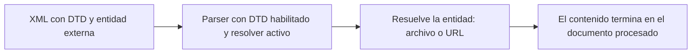

# XXE

Parte de: [[12-Seguridad/04 Otras vulnerabilidades web/_Índice Otras vulnerabilidades web|Otras vulnerabilidades web]]

> [!info] Cómo avanzar
> `progreso`: **pendiente** → **viendo** (estudiando) → **visto** (contestaste la autoevaluación sin abrir las respuestas) → **dominado** (hiciste el laboratorio o lo aplicaste de verdad).

## Contenido

### Qué es
XXE (*XML External Entity*) es una vulnerabilidad de los procesadores de XML. El estándar XML permite declarar, dentro de un DTD, **entidades** que el parser sustituye por contenido; algunas pueden apuntar a recursos **externos** (un archivo o una URL). Si tu parser procesa DTD y resuelve entidades externas sobre XML que manda un usuario, ese XML puede hacer que tu servidor lea archivos locales, haga peticiones a la red interna o consuma memoria hasta caerse (expansión exponencial de entidades). La defensa es sencilla y conviene dejarla explícita: **no procesar DTD** en XML no confiable.

### Cómo funciona


1. El documento incluye una declaración `DOCTYPE` con entidades.
2. Un parser configurado para procesar DTD y con un resolvedor de recursos activo va a buscar lo que la entidad indica.
3. El contenido resuelto se incorpora al documento, y puede terminar en la respuesta, en un error o en un log.

No necesitas memorizar el ataque: lo importante como defensor es reconocer **dónde entra XML** y asegurar la configuración del parser.

### Dónde se esconde el XML
Aunque tu API sea JSON, XML aparece en más lugares de los que parece:

- **SVG**: las imágenes vectoriales son XML.
- **Office Open XML**: `.docx`, `.xlsx` y `.pptx` son ZIP con archivos XML dentro. Relevante si Wee.Reporteria lee Excel subidos por usuarios.
- **SAML**: las aserciones de inicio de sesión federado son XML firmado.
- **RSS y Atom**, **SOAP** e integraciones heredadas, archivos de configuración subidos, y en México, documentos fiscales como los CFDI en XML.

### Cómo se previene en .NET
- En .NET moderno (.NET Core y posteriores), `XmlReaderSettings` tiene `DtdProcessing = Prohibit` por defecto y `XmlDocument` no resuelve recursos externos por defecto. Aun así, **sé explícito**, porque un cambio de configuración o código copiado de .NET Framework puede reabrirlo.
- Usa `XmlReader` con `DtdProcessing.Prohibit` y `XmlResolver = null`, y pasa ese reader a `XmlDocument`, `XDocument` o `XmlSerializer`.
- Nunca pongas `DtdProcessing.Parse` con un resolvedor activo sobre datos externos.
- Limita el tamaño del documento (`MaxCharactersInDocument`) y de las entidades (`MaxCharactersFromEntities`).
- Mantén actualizadas las librerías que procesan Office o SAML; ellas usan parsers internamente.
- En JavaScript del navegador, `DOMParser` no carga entidades externas; el riesgo está en el servidor.

### Ejemplo
Lectura segura de un XML recibido (por ejemplo un CFDI que un usuario adjunta) en Itzamna.Dionisio:

```csharp
public static class XmlSeguro
{
    private static readonly XmlReaderSettings Opciones = new()
    {
        DtdProcessing = DtdProcessing.Prohibit,   // rechaza documentos con DOCTYPE
        XmlResolver = null,                       // no resolver recursos externos
        MaxCharactersInDocument = 5_000_000,      // límite de tamaño
        MaxCharactersFromEntities = 0,
        IgnoreComments = true,
        Async = true
    };

    public static async Task<XDocument> CargarAsync(Stream contenido, CancellationToken ct)
    {
        using var reader = XmlReader.Create(contenido, Opciones);
        return await XDocument.LoadAsync(reader, LoadOptions.None, ct);
    }
}

// Uso en el controller
try
{
    var doc = await XmlSeguro.CargarAsync(archivo.OpenReadStream(), ct);
    // ... leer nodos con XNamespace y validar contra el esquema esperado
}
catch (XmlException)
{
    return Problem(statusCode: 400, title: "XML inválido",
        extensions: new Dictionary<string, object?> { ["codigo"] = "XML_INVALIDO" });
}
```

Si el documento trae `DOCTYPE`, el reader lanza `XmlException` y respondes 400 sin procesarlo. Si necesitas validar contra un XSD, agrega el esquema a `Opciones.Schemas` desde un archivo local de confianza y `ValidationType = ValidationType.Schema`.

### Cómo se detecta
- **Búsqueda en el código**: `DtdProcessing.Parse`, `XmlUrlResolver`, `XmlTextReader` (antiguo), `ProhibitDtd = false`.
- **Analizadores de Roslyn**: las reglas CA3075 y CA3077 advierten procesamiento inseguro de DTD.
- **SAST** como CodeQL marca flujos de entrada del usuario hacia parsers XML mal configurados.
- **Inventario**: lista cada punto donde la app acepta archivos o integra servicios con XML.

### Cuándo usarlo y cuándo no
Si puedes elegir el formato, JSON evita esta clase de problema. Cuando el XML es obligatorio (CFDI, SAML, SOAP), aplica siempre la configuración segura y valida contra el esquema.

### Errores comunes
- **Copiar código de .NET Framework** donde los valores por defecto eran inseguros en versiones viejas.
- **Habilitar DTD para "que funcione" un documento** que trae `DOCTYPE`: mejor rechazarlo o pedir el formato correcto.
- **Olvidar los formatos que son XML por dentro** (SVG, Office).
- **No limitar tamaño**, dejando abierta la denegación de servicio.

### Para profundizar
- [OWASP - XML External Entity Prevention Cheat Sheet](https://cheatsheetseries.owasp.org/cheatsheets/XML_External_Entity_Prevention_Cheat_Sheet.html)
- [Microsoft Learn - XmlReaderSettings.DtdProcessing](https://learn.microsoft.com/dotnet/api/system.xml.xmlreadersettings.dtdprocessing)
- [CWE-611: Improper Restriction of XML External Entity Reference](https://cwe.mitre.org/data/definitions/611.html)

## Autoevaluación

Contesta primero en voz alta o en papel; luego despliega la respuesta.

> [!question]- ¿Qué es XXE?
> XML External Entity: el XML recibido declara entidades externas que el parser resuelve, lo que permite leer archivos locales, hacer peticiones internas (SSRF) o agotar memoria.

> [!question]- ¿Cómo se previene en .NET?
> Con `XmlReaderSettings { DtdProcessing = DtdProcessing.Prohibit, XmlResolver = null }`. En .NET Core/.NET moderno los valores por defecto ya son seguros, pero conviene ser explícito y no habilitar DTD.

> [!question]- ¿Qué formatos traen XML escondido?
> SVG, archivos de Office (`.docx`, `.xlsx`), SAML, RSS y SOAP.

