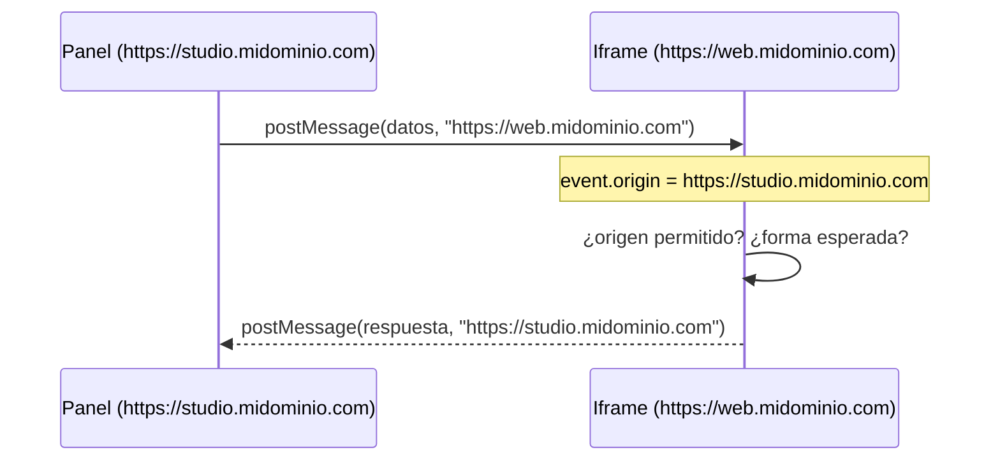

# postMessage seguro (validar origen)

Parte de: [[12-Seguridad/04 Otras vulnerabilidades web/_Índice Otras vulnerabilidades web|Otras vulnerabilidades web]]

> [!info] Cómo avanzar
> `progreso`: **pendiente** → **viendo** (estudiando) → **visto** (contestaste la autoevaluación sin abrir las respuestas) → **dominado** (hiciste el laboratorio o lo aplicaste de verdad).

## Contenido

### Qué es
`window.postMessage` permite que dos ventanas de **orígenes distintos** se comuniquen de forma controlada: una página con su iframe, una ventana con el popup que abrió (por ejemplo un login), o un panel que muestra una vista previa. Es la alternativa segura a relajar la [[Same-origin policy]], pero solo si se usa bien: el navegador entrega el mensaje, y **tu código decide si confía en él**. El patrón seguro tiene dos reglas: al recibir, validar origen y forma del mensaje; al enviar, indicar el origen destino exacto.

### Cómo funciona


- El emisor llama `otraVentana.postMessage(datos, origenDestino)`. Si la ventana destino no está en ese origen en ese momento, el navegador **no entrega** el mensaje.
- El receptor escucha el evento `message`. El evento trae `data` (el contenido, copiado con el algoritmo de clonación estructurada), `origin` (el origen real del emisor, puesto por el navegador y no falsificable desde JavaScript) y `source` (referencia a la ventana emisora).

### El riesgo
Cualquier página que tenga una referencia a tu ventana puede mandarte mensajes: la que te incrusta en un iframe, la que te abrió con `window.open`, o una que tú abriste. Si tu listener no revisa `event.origin`, procesará mensajes de cualquier sitio como si fueran legítimos. Las consecuencias dependen de qué hace el listener: si inserta `data` con `innerHTML`, es un XSS basado en DOM ([[XSS - basado en DOM]]); si navega a una URL del mensaje, es una redirección controlada por terceros; si ejecuta acciones ("guardar", "borrar"), es una acción no autorizada.

Al enviar, el error simétrico es usar `'*'` como destino: si la ventana destino navegó a otro sitio (alguien cambió el `src` del iframe o el popup fue redirigido), los datos llegan a quien sea que esté ahí.

### Patrón correcto al recibir
1. Compara `event.origin` con una **lista exacta** de orígenes permitidos (no con `includes` ni `endsWith`).
2. Opcionalmente verifica que `event.source` sea la ventana que esperas (por ejemplo `iframe.contentWindow`).
3. Valida la **forma** del mensaje: tipo, campos y tipos de datos.
4. Trata los datos como texto: `textContent`, nunca `innerHTML` ni `eval`.

### Patrón correcto al enviar
Pasa siempre el origen destino exacto. `'*'` solo es aceptable para datos que no te importa que lea cualquiera, y aun así es mejor evitarlo.

### Ejemplo
Un panel de administración ("Studio") en React muestra una vista previa de Itzamna.Clio en un iframe y le manda el contenido a previsualizar.

```ts
// Studio (padre): enviar al origen exacto
const ORIGEN_WEB = import.meta.env.VITE_ORIGEN_WEB; // 'https://web.midominio.com' por entorno

function enviarVistaPrevia(iframe: HTMLIFrameElement, titulo: string, cuerpo: string) {
  iframe.contentWindow?.postMessage({ tipo: 'preview', titulo, cuerpo }, ORIGEN_WEB);
}
```

```ts
// Clio (iframe): recibir validando origen, ventana y forma
type MensajePreview = { tipo: 'preview'; titulo: string; cuerpo: string };

const ORIGENES_PERMITIDOS = new Set([import.meta.env.VITE_ORIGEN_STUDIO]);

function esPreview(d: unknown): d is MensajePreview {
  if (typeof d !== 'object' || d === null) return false;
  const m = d as Record<string, unknown>;
  return m.tipo === 'preview' && typeof m.titulo === 'string' && typeof m.cuerpo === 'string';
}

useEffect(() => {
  function alRecibir(e: MessageEvent) {
    if (!ORIGENES_PERMITIDOS.has(e.origin)) return;     // 1. origen exacto
    if (e.source !== window.parent) return;             // 2. viene del padre
    if (!esPreview(e.data)) return;                     // 3. forma esperada
    setVista({ titulo: e.data.titulo, cuerpo: e.data.cuerpo }); // 4. React lo renderiza como texto
  }
  window.addEventListener('message', alRecibir);
  return () => window.removeEventListener('message', alRecibir);
}, []);
```

React escapa el texto al renderizar `{vista.cuerpo}`, así que no hay inserción de HTML. Si la vista previa necesita HTML con formato, sanitízalo con DOMPurify ([[XSS - sanitización de HTML (DOMPurify)]]). Además, la página de Clio debe permitir ser incrustada solo por Studio con `frame-ancestors` (ver [[Clickjacking]]), y el iframe en Studio puede llevar `sandbox` con los permisos mínimos.

### Cómo se detecta
- Busca `addEventListener('message'` y `onmessage` en el código y revisa que cada uno valide `origin`.
- Busca `postMessage(` con `'*'`.
- En DevTools, en el panel Sources, la sección de *Event Listeners* de `window` muestra los listeners de `message` registrados.
- Linters con reglas de seguridad (por ejemplo plugins de ESLint orientados a seguridad) marcan listeners sin validación.

### Errores comunes
- **Validar con `e.origin.includes('midominio.com')`**: acepta `midominio.com.otro.example`.
- **Olvidar quitar el listener** en React, lo que acumula manejadores duplicados.
- **Confiar en `e.data.origen`**: ese campo lo escribe el emisor; el origen confiable es `e.origin`.
- **Usar `'*'` al enviar** tokens o datos personales.

### Para profundizar
- [MDN - Window.postMessage()](https://developer.mozilla.org/es/docs/Web/API/Window/postMessage)
- [OWASP - HTML5 Security Cheat Sheet (Web Messaging)](https://cheatsheetseries.owasp.org/cheatsheets/HTML5_Security_Cheat_Sheet.html)
- [MDN - iframe: atributo sandbox](https://developer.mozilla.org/es/docs/Web/HTML/Element/iframe)

## Autoevaluación

Contesta primero en voz alta o en papel; luego despliega la respuesta.

> [!question]- ¿Qué riesgo tiene un `message` listener que no valida el origen?
> Cualquier página que tenga una referencia a tu ventana (te abrió o te incrusta) puede mandarte mensajes, y tu código los procesaría como si fueran legítimos.

> [!question]- Patrón correcto al recibir.
> ```js
> window.addEventListener('message', e => {
>   if (e.origin !== ORIGEN_PERMITIDO) return;
>   if (typeof e.data !== 'object' || e.data.tipo !== 'preview') return;
>   // usar e.data con textContent, nunca innerHTML
> });
> ```

> [!question]- ¿Y al enviar?
> Indicar el origen destino exacto: `iframe.contentWindow.postMessage(datos, 'https://web.midominio.com')`, nunca `'*'` si los datos son sensibles.

