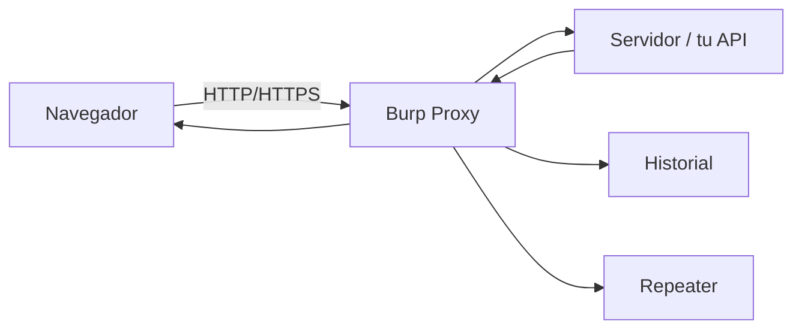

# Burp Suite Community

Parte de: [[12-Seguridad/05 Herramientas defensivas/_Índice Herramientas defensivas|Herramientas defensivas]]

> [!info] Cómo avanzar
> `progreso`: **pendiente** → **viendo** (estudiando) → **visto** (contestaste la autoevaluación sin abrir las respuestas) → **dominado** (hiciste el laboratorio o lo aplicaste de verdad).

## Contenido

### Qué es
Burp Suite es un conjunto de herramientas de PortSwigger para probar la seguridad de aplicaciones web, construido alrededor de un **proxy de interceptación**: se coloca entre el navegador y el servidor para ver, modificar y repetir el tráfico HTTP(S). La **edición Community** es gratuita y pensada para aprender y para pruebas manuales; es la herramienta que acompaña a los ejercicios de [[PortSwigger Web Security Academy]]. Para un desarrollador que defiende su propia app, sirve para entender exactamente qué manda y recibe su front, y para comprobar manualmente controles de autorización o validación.

### Cómo funciona

1. Configuras el navegador (o el navegador integrado de Burp) para pasar por el proxy de Burp.
2. Para ver HTTPS, instalas el certificado de CA de Burp en el navegador de pruebas; así Burp descifra el tráfico. Esto solo debe hacerse en un navegador y un entorno tuyos.
3. Cada petición queda en el **historial**. Desde ahí la envías al **Repeater** para modificarla y reenviarla, o al **Decoder** y **Comparer** para analizar.

Herramientas principales de Community:

- **Proxy**: interceptar y ver el tráfico, con historial.
- **Repeater**: reenviar una petición cambiando lo que quieras (ideal para probar IDOR cambiando un id, o validar que un endpoint rechaza un token manipulado).
- **Decoder** y **Comparer**: codificar/decodificar (Base64, URL) y comparar respuestas.
- **Intruder**: existe, pero en Community está en modo demostración, con velocidad limitada.

### Limitaciones frente a Professional
Según la página oficial de PortSwigger, Community es un "kit manual esencial" y **no** incluye varias cosas de Professional:

- El **escáner automático** de vulnerabilidades.
- **Intruder** completo (en Community va limitado/demo).
- **Guardar proyectos** para retomar el trabajo.
- **Burp Collaborator** (para detectar interacciones fuera de banda) y el **buscador**.
- Rastreo y descubrimiento de contenido automáticos, y las extensiones BApp exclusivas de Pro.

Para un desarrollador, Community alcanza perfectamente para inspección manual y aprendizaje. Si tu trabajo es pentesting profesional, Professional es de pago (revisa el precio vigente en la página oficial; Pendiente de confirmar).

### Ejemplo
Comprobar un posible [[Control de acceso roto e IDOR]] en tu entorno local de Itzamna.Dionisio:

1. Levanta la API en local y entra a Itzamna.Clio con el usuario del tenant 1.
2. Con el proxy activo, abre un pedido; en el historial aparece `GET /api/pedidos/1234` con el `Authorization` del usuario.
3. Envía esa petición al Repeater y cambia el id a uno del tenant 2.
4. Reenvía: si responde `200` con datos del otro tenant, encontraste un IDOR; si responde `404`, tu filtro por tenant funciona.

También sirve para verificar headers de seguridad en las respuestas, probar que tu endpoint rechaza un JWT con la firma alterada, o ver qué manda realmente tu formulario.

### Cuándo usarlo y cuándo no
Úsalo para inspección manual fina y aprendizaje. Para cobertura automática en tu pipeline, [[OWASP ZAP]] es gratuito y pensado para CI. Como alternativa de solo lectura dentro del navegador, las DevTools cubren mucho sin instalar nada. Burp brilla cuando necesitas **modificar y reenviar** con comodidad.

### Cuidado ético
Interceptar y modificar tráfico de **sistemas que no son tuyos** sin autorización es ilegal (ver [[Marco legal y autorización por escrito]]). Usa Burp solo contra tus propias apps, laboratorios diseñados para practicar ([[OWASP Juice Shop]], PortSwigger Academy) o dentro del alcance de una prueba autorizada por escrito. Instala el certificado de CA de Burp únicamente en tu navegador de pruebas y retíralo después; dejarlo en tu navegador diario debilita tu propia seguridad.

### Errores comunes
- **Dejar el certificado de Burp** instalado en el navegador de uso diario.
- **Proxyear todo tu tráfico** y mandar sesiones personales al historial.
- **Probar contra sistemas de terceros** "solo para ver".
- **Esperar que Community escanee solo**: no trae escáner; el hallazgo es manual.
- **Olvidar apagar el proxy** y luego no entender por qué "no hay internet".

### Para profundizar
- [PortSwigger - Descargar Burp Suite Community](https://portswigger.net/burp/communitydownload)
- [PortSwigger - Documentación de Burp Suite](https://portswigger.net/burp/documentation)
- [PortSwigger Web Security Academy](https://portswigger.net/web-security)

## Autoevaluación

Contesta primero en voz alta o en papel; luego despliega la respuesta.

> [!question]- ¿Para qué sirve Burp Suite Community?
> Es un proxy de interceptación gratuito de PortSwigger para ver, modificar y repetir peticiones HTTP (Proxy, Repeater, Decoder, Comparer). Es la herramienta que acompaña a [[PortSwigger Web Security Academy]].

> [!question]- ¿Qué limitaciones tiene frente a la versión Professional?
> No incluye el escáner automático y algunas funciones (como Intruder) están limitadas en velocidad. Revisa las diferencias actuales en la página oficial.

> [!question]- ¿Qué cuidado ético aplica?
> Interceptar y modificar tráfico de sistemas ajenos sin autorización es ilegal. Úsalo con tus apps, laboratorios de práctica o dentro del alcance de una prueba autorizada.

