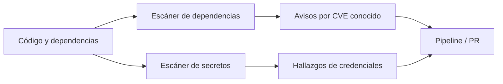

# Escaneo de dependencias y de secretos

Parte de: [[12-Seguridad/05 Herramientas defensivas/_Índice Herramientas defensivas|Herramientas defensivas]]

> [!info] Cómo avanzar
> `progreso`: **pendiente** → **viendo** (estudiando) → **visto** (contestaste la autoevaluación sin abrir las respuestas) → **dominado** (hiciste el laboratorio o lo aplicaste de verdad).

## Contenido

### Qué es
Son dos tipos de análisis automático que buscan problemas sin ejecutar la app: el **escaneo de dependencias** (parte de SCA) revisa las librerías de terceros contra bases de vulnerabilidades conocidas, y el **escaneo de secretos** busca credenciales que se hayan colado en el código o el historial. Los dos son baratos, se automatizan fácil y atrapan dos de los riesgos más comunes: [[Componentes y dependencias vulnerables]] y [[Secretos en repositorios]].

### Cómo funciona


- **Dependencias**: la herramienta lee tus manifiestos y archivos de bloqueo, arma el árbol completo (directas y transitivas) y lo compara con bases como la GitHub Advisory Database o la National Vulnerability Database.
- **Secretos**: la herramienta recorre archivos (y opcionalmente todo el historial de Git) buscando patrones de credenciales con expresiones regulares y entropía: cadenas de conexión, llaves de API, tokens, llaves privadas.

### Herramientas gratuitas
**Dependencias**:

- `dotnet list package --vulnerable --include-transitive` y **NuGetAudit** integrado en `dotnet restore` (para .NET).
- `npm audit` (para el front).
- **OWASP Dependency-Check** (multiplataforma, se integra en CI).
- **Dependabot** y **Renovate** abren pull requests con las actualizaciones ([[Dependabot y Renovate]]).

**Secretos**:

- **gitleaks**: código abierto, corre en local, como hook de pre-commit y en CI; escanea el historial con el comando `git` y carpetas con `dir`.
- **GitHub secret scanning** y **push protection**: disponibles por defecto en repositorios públicos; en privados requieren GitHub Secret Protection (de pago; verificar plan vigente, Pendiente de confirmar).
- **Azure DevOps Advanced Security** incluye escaneo de secretos (de pago; Pendiente de confirmar).

### Cuándo conviene escanear
Varias capas, de la más temprana a la más tardía:

1. **Antes del commit**, con un hook de pre-commit (gitleaks): el secreto ni siquiera sale de tu máquina.
2. **En cada push o pull request** (CI): segunda red por si alguien se saltó el hook.
3. **Una vez sobre todo el historial**, cuando adoptas la herramienta, para encontrar lo que ya estaba.
4. **Programado** (semanal) para dependencias, porque aparecen CVE nuevos sobre versiones que no cambiaste.

### Ejemplo
Hook de pre-commit y paso de CI para Itzamna.Dionisio.

```yaml
# .pre-commit-config.yaml  (gitleaks antes de cada commit)
repos:
  - repo: https://github.com/gitleaks/gitleaks
    rev: v8.24.2          # pre-commit autoupdate para subir la versión
    hooks:
      - id: gitleaks
```

```yaml
# azure-pipelines.yml (fragmento): auditoría de dependencias y secretos
steps:
  - task: UseDotNet@2
    inputs: { packageType: sdk, version: '10.x' }

  - script: dotnet restore   # NuGetAudit emite NU1901..NU1904
    displayName: 'Restore con auditoría NuGet'

  - script: |
      dotnet list package --vulnerable --include-transitive 2>&1 | tee audit.txt
      if grep -E 'Critical|High' audit.txt; then
        echo "##vso[task.logissue type=error]Dependencia vulnerable (alta o crítica)"; exit 1
      fi
    displayName: 'Dependencias vulnerables'

  - script: |
      docker run --rm -v "$(Build.SourcesDirectory):/repo" \
        ghcr.io/gitleaks/gitleaks:latest git /repo --no-banner --redact
    displayName: 'Escaneo de secretos (gitleaks)'
```

El flag `--redact` evita imprimir el secreto en los logs del pipeline (que a su vez podrían exponerlo). Para npm, un paso con `npm audit --omit=dev` cubre el front.

### Qué hacer cuando encuentra un secreto real
El orden importa y es el mismo que en [[Secretos en repositorios]]:

1. **Rotarlo** (crear uno nuevo, revocar el viejo). Es lo único que elimina el riesgo, porque el secreto ya está en el historial.
2. Revisar logs del servicio por uso indebido.
3. Quitarlo del código y moverlo al almacén correcto ([[Key Vault]], [[Secretos con User Secrets]]).
4. Opcionalmente limpiar el historial y avisar a quienes tengan clones.

### Cuándo usarlo y cuándo no
Ambos escaneos deben estar en todos los repositorios. Lo que se ajusta es el umbral que rompe el build (empieza por crítico/alto) y la tolerancia a falsos positivos de los escáneres de secretos, que se calman con un archivo de configuración (`.gitleaks.toml`) y listas de excepciones revisadas.

### Errores comunes
- **Tratar un hallazgo de secreto como falso positivo sin rotar**: ante la duda, rota.
- **Escanear solo el commit actual** y no el historial al adoptar la herramienta.
- **Silenciar `npm audit` o `NuGetAudit`** porque "hace ruido".
- **Secretos del propio escáner o del pipeline** impresos en logs; usa variables secretas y `--redact`.
- **Hallazgos sin dueño**: nadie los atiende. Asigna responsable y SLA.

### Para profundizar
- [Microsoft Learn - Auditoría de paquetes NuGet](https://learn.microsoft.com/nuget/concepts/auditing-packages)
- [OWASP Dependency-Check](https://owasp.org/www-project-dependency-check/)
- [gitleaks en GitHub](https://github.com/gitleaks/gitleaks)
- [GitHub Docs - Push protection para repositorios](https://docs.github.com/es/code-security/secret-scanning/push-protection-for-repositories-and-organizations)

## Autoevaluación

Contesta primero en voz alta o en papel; luego despliega la respuesta.

> [!question]- ¿Qué herramientas gratuitas usarías?
> Dependencias: `dotnet list package --vulnerable`, `npm audit`, Dependabot, OWASP Dependency-Check. Secretos: gitleaks, secret scanning de GitHub (gratuito en repos públicos; en privados depende del plan, verificar en la página oficial).

> [!question]- ¿En qué momentos conviene escanear secretos?
> Antes del commit (hook), en cada push o pull request (CI) y una vez sobre todo el historial cuando adoptas la herramienta.

> [!question]- ¿Qué haces cuando el escáner encuentra un secreto real?
> Rotarlo primero; luego quitarlo del código, moverlo al almacén correcto y, si aplica, limpiar el historial.

## Práctica

- [[Lab 9 - Escaneo de dependencias y secretos en un repositorio propio]]

