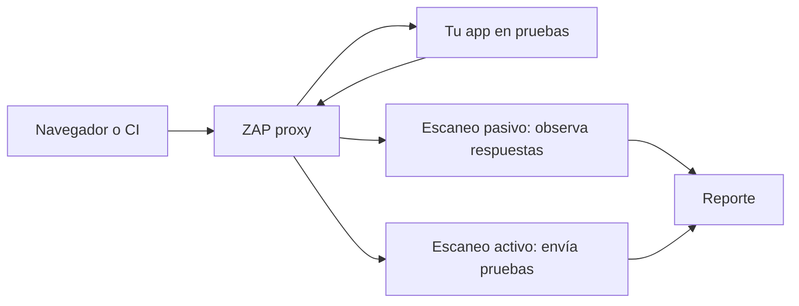

# OWASP ZAP

Parte de: [[12-Seguridad/05 Herramientas defensivas/_Índice Herramientas defensivas|Herramientas defensivas]]

> [!info] Cómo avanzar
> `progreso`: **pendiente** → **viendo** (estudiando) → **visto** (contestaste la autoevaluación sin abrir las respuestas) → **dominado** (hiciste el laboratorio o lo aplicaste de verdad).

## Contenido

### Qué es
ZAP (*Zed Attack Proxy*, hoy mantenido como "ZAP by Checkmarx") es un proxy y escáner de seguridad de aplicaciones web de **código abierto y gratuito**. Es la herramienta DAST (*Dynamic Application Security Testing*) de referencia: prueba la app **en ejecución** desde fuera, como lo haría un cliente, sin ver el código fuente. Para un desarrollador sirve para encontrar, en tu propio entorno de pruebas, problemas de configuración, headers faltantes y vulnerabilidades comunes, y se integra bien en el pipeline.

### Cómo funciona


ZAP se coloca como proxy y explora la app (spider tradicional o spider para apps con mucho JavaScript). A partir del tráfico hace dos tipos de análisis:

- **Escaneo pasivo**: solo **observa** las peticiones y respuestas que pasan. Detecta headers de seguridad ausentes, cookies sin `Secure`/`HttpOnly`, divulgación de información, contenido mixto. No envía ataques, así que es seguro de correr en cualquier momento, incluso contra entornos compartidos.
- **Escaneo activo**: **envía** peticiones modificadas para comprobar vulnerabilidades (inyección, XSS, etc.). Puede alterar datos y disparar alertas, por lo que **solo** debe usarse contra sistemas propios o con autorización explícita, nunca en producción sin acuerdo.

### En CI/CD
La forma típica es el **baseline scan** en un contenedor de Docker: corre el spider y el escaneo **pasivo** por unos minutos y genera un reporte, sin ataques activos. Es rápido y seguro para integrarlo tras desplegar a un entorno de pruebas.

```yaml
# Paso de pipeline: ZAP baseline contra el entorno de pruebas
- script: |
    docker run --rm -v "$(Build.ArtifactStagingDirectory):/zap/wrk:rw" \
      ghcr.io/zaproxy/zaproxy:stable zap-baseline.py \
      -t https://dionisio-test.midominio.com \
      -r reporte-zap.html \
      -I            # no fallar por avisos de nivel WARN
  displayName: 'ZAP baseline (pasivo)'
```

El script `zap-baseline.py` devuelve un código de salida distinto de cero si encuentra reglas marcadas como fallo, lo que puede romper el build; `-I` evita fallar solo por avisos. Un archivo de reglas (`-c reglas.conf`) permite decidir qué es `WARN`, `FAIL` o `IGNORE` para controlar falsos positivos. El **full scan** (`zap-full-scan.py`) sí hace escaneo activo y tarda mucho más: resérvalo para entornos de pruebas dedicados y con autorización.

### Ejemplo
Flujo para Itzamna.Dionisio e Itzamna.Clio:

1. El pipeline despliega a un entorno de pruebas aislado (sin datos reales).
2. Corre el baseline de ZAP contra la URL del front y de la API.
3. ZAP reporta, por ejemplo, falta de `Content-Security-Policy`, cookies sin `SameSite` y ausencia de protección contra clickjacking.
4. El equipo corrige en el código (los headers del middleware de [[Configuración insegura]]) y vuelve a correr.
5. Una vez limpio, se endurecen las reglas para que un retroceso rompa el build.

Para pruebas manuales más profundas sobre tu entorno local, la interfaz de escritorio de ZAP permite lanzar el escaneo activo contra, por ejemplo, [[OWASP Juice Shop]] corriendo en tu máquina, como en el [[Lab 10 - Escaneo pasivo con OWASP ZAP contra Juice Shop local]].

### Cuándo usarlo y cuándo no
Usa el baseline **pasivo** en CI de forma rutinaria. Usa el escaneo **activo** solo en entornos de pruebas propios, con datos ficticios y autorización. ZAP (DAST) complementa pero no reemplaza al análisis estático (SAST) ni al de dependencias (SCA): cada uno ve cosas distintas ([[SAST, DAST y SCA]]). DAST no encuentra fallas de lógica de negocio como el IDOR, que requieren pruebas con conocimiento del dominio.

### Errores comunes
- **Correr el escaneo activo contra producción** o contra sistemas de terceros: puede alterar datos y es ilegal sin permiso.
- **Esperar que ZAP encuentre todo**: no detecta lógica de autorización ni fallas de negocio.
- **Ignorar el reporte** por tener falsos positivos sin configurar las reglas.
- **Escanear con la app vacía**: sin autenticación ni datos, ZAP ve poca superficie; configura un usuario de prueba.
- **No fijar la versión de la imagen** y que el resultado cambie entre corridas.

### Para profundizar
- [ZAP - Sitio oficial](https://www.zaproxy.org/)
- [ZAP - Docker Baseline Scan](https://www.zaproxy.org/docs/docker/baseline-scan/)
- [ZAP - Getting Started](https://www.zaproxy.org/getting-started/)
- [OWASP - DAST en el proyecto ZAP](https://owasp.org/www-project-zap/)

## Autoevaluación

Contesta primero en voz alta o en papel; luego despliega la respuesta.

> [!question]- ¿Qué es ZAP?
> Un proxy y escáner DAST de código abierto (ahora mantenido bajo el nombre ZAP by Checkmarx) que intercepta tráfico, explora la app y busca vulnerabilidades de forma pasiva y activa.

> [!question]- ¿Diferencia entre escaneo pasivo y activo?
> Pasivo: solo observa las respuestas (headers, cookies, información expuesta), sin enviar ataques. Activo: envía peticiones modificadas para probar vulnerabilidades; **solo contra sistemas propios o con autorización**.

> [!question]- ¿Cómo se usa en CI?
> Con el escaneo baseline (pasivo) en un contenedor de Docker contra un entorno de pruebas, que genera un reporte y puede fallar el pipeline según reglas.

## Práctica

- [[Lab 10 - Escaneo pasivo con OWASP ZAP contra Juice Shop local]]

