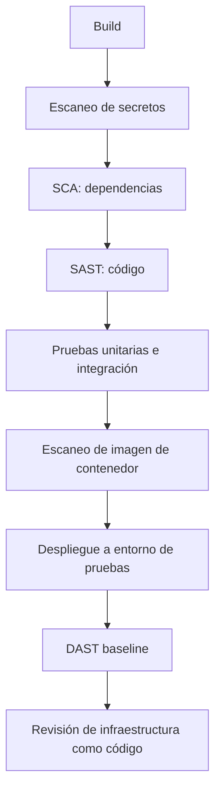

# Pruebas de seguridad en el pipeline

Parte de: [[12-Seguridad/05 Herramientas defensivas/_Índice Herramientas defensivas|Herramientas defensivas]]

> [!info] Cómo avanzar
> `progreso`: **pendiente** → **viendo** (estudiando) → **visto** (contestaste la autoevaluación sin abrir las respuestas) → **dominado** (hiciste el laboratorio o lo aplicaste de verdad).

## Contenido

### Qué es
Integrar pruebas de seguridad en el pipeline de CI/CD significa automatizar comprobaciones de seguridad en cada cambio, para detectar problemas temprano y de forma consistente, en lugar de depender de una auditoría anual. Es la idea central de DevSecOps: "mover la seguridad a la izquierda" (shift left), es decir, acercarla al momento de escribir el código, donde corregir es más barato. En Azure DevOps esto se traduce en etapas y tareas dentro de tu [[Azure Pipelines|pipeline YAML]].

### Cómo funciona
Cada tipo de prueba cubre una parte distinta ([[SAST, DAST y SCA]]). Un pipeline maduro las combina en orden:



Etapas típicas y herramientas gratuitas:

- **Escaneo de secretos**: gitleaks, para que no se publique una credencial ([[Escaneo de dependencias y de secretos]]).
- **SCA de dependencias**: NuGetAudit, `npm audit`, OWASP Dependency-Check.
- **SAST**: CodeQL (gratuito para repos públicos y para uso con GitHub Advanced Security; para .NET también hay reglas de analizadores de Roslyn y SonarCloud/SonarQube).
- **Escaneo de imagen de contenedor**: Trivy, para CVE en la imagen base ([[Dockerfile para .NET]]).
- **DAST baseline**: el baseline pasivo de [[OWASP ZAP]] contra un entorno de pruebas desplegado.
- **Infraestructura como código**: analizadores de Bicep/Terraform para configuración insegura.

### ¿Todo hallazgo debe romper el build?
No, sobre todo al empezar. Si el primer día haces que cualquier aviso falle, el equipo se frustra y termina desactivando las comprobaciones (fatiga de alertas). El enfoque recomendado:

1. **Fase de observación**: las pruebas corren y reportan, pero no rompen el build.
2. **Define umbrales**: rompe solo ante lo serio y **nuevo** (por ejemplo, vulnerabilidades críticas o altas introducidas por este cambio), y da margen a lo existente con fecha de arreglo.
3. **Endurece con el tiempo**: baja el umbral conforme el equipo se pone al día.

Así la seguridad se vuelve parte del flujo sin convertirse en un obstáculo que todos aprenden a saltar.

### Ejemplo
Esqueleto de un pipeline de Itzamna.Dionisio con una etapa de seguridad:

```yaml
stages:
  - stage: Seguridad
    jobs:
      - job: Analisis
        steps:
          - script: docker run --rm -v "$(Build.SourcesDirectory):/repo" \
              ghcr.io/gitleaks/gitleaks:latest git /repo --redact
            displayName: 'Secretos (gitleaks)'

          - script: dotnet restore && dotnet list package --vulnerable --include-transitive
            displayName: 'Dependencias (NuGetAudit)'

          - script: dotnet build -warnaserror
            displayName: 'Build con analizadores de seguridad'

  - stage: Pruebas
    dependsOn: Seguridad
    jobs:
      - job: Tests
        steps:
          - script: dotnet test --collect:"XPlat Code Coverage"
            displayName: 'Unitarias e integración'

  - stage: DAST
    dependsOn: DesplegarPruebas    # requiere el entorno desplegado
    jobs:
      - job: Zap
        steps:
          - script: docker run --rm ghcr.io/zaproxy/zaproxy:stable \
              zap-baseline.py -t https://dionisio-test.midominio.com -I
            displayName: 'ZAP baseline'
```

Las aprobaciones manuales antes de producción se configuran con **environments** de Azure Pipelines ([[Azure Pipelines - environments y aprobaciones]]).

### Secretos del propio pipeline
El pipeline es un objetivo en sí mismo: tiene credenciales para desplegar. Cuídalo:

- **Identidades federadas (OIDC)** o service connections en vez de llaves largas guardadas, para que no haya un secreto reutilizable ([[Azure Pipelines - service connections]]).
- **Mínimo privilegio** para la cuenta de despliegue: solo lo que ese pipeline necesita.
- **No imprimir secretos en los logs**: usa variables secretas (que Azure enmascara) y flags de redacción en los escáneres.
- **Fijar versiones** de tareas e imágenes para evitar que una dependencia del pipeline cambie sin que te des cuenta.

### Cuándo usarlo y cuándo no
Las etapas rápidas (secretos, SCA, SAST ligero) deben correr en cada pull request. Las lentas (DAST full, análisis profundo) se dejan para pipelines nocturnos o previos a liberación, para no alargar cada cambio. Ajusta según cuán crítica sea la app y cuánto tarde cada etapa.

### Errores comunes
- **Romper el build con todo desde el día uno**: genera fatiga y se termina desactivando.
- **Correr DAST sin entorno desplegado** o contra producción.
- **No fijar versiones** de herramientas y obtener resultados inconsistentes.
- **Guardar secretos del pipeline en variables no secretas** o imprimirlos al depurar.
- **Reportes que nadie lee**: sin dueño ni seguimiento, el pipeline "pasa" pero nada se corrige.

### Para profundizar
- [OWASP - DevSecOps Guideline](https://owasp.org/www-project-devsecops-guideline/)
- [Microsoft Learn - Seguridad en Azure Pipelines](https://learn.microsoft.com/azure/devops/pipelines/security/overview)
- [GitHub Docs - Acerca del análisis de código con CodeQL](https://docs.github.com/es/code-security/code-scanning/introduction-to-code-scanning/about-code-scanning-with-codeql)

## Autoevaluación

Contesta primero en voz alta o en papel; luego despliega la respuesta.

> [!question]- ¿Qué etapas de seguridad pondrías en un pipeline de CI/CD?
> Escaneo de secretos, SCA de dependencias, SAST (por ejemplo CodeQL), análisis de imágenes de contenedor, DAST baseline contra un entorno de pruebas y verificación de infraestructura como código.

> [!question]- ¿Todo hallazgo debe romper el build?
> No al inicio. Empieza reportando, define umbrales (por ejemplo romper solo en críticos/altos nuevos) y endurece con el tiempo para no generar fatiga.

> [!question]- ¿Qué cuidado hay con los secretos del propio pipeline?
> Usar variables secretas o identidades federadas (OIDC) en lugar de llaves largas, mínimo privilegio para la cuenta de despliegue y no imprimir secretos en los logs.

## Práctica

- [[Lab 9 - Escaneo de dependencias y secretos en un repositorio propio]]

