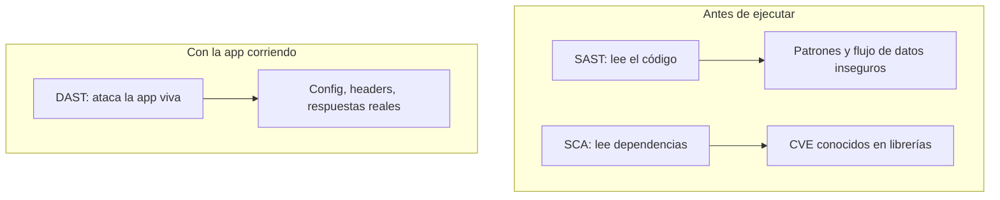

# SAST, DAST y SCA

Parte de: [[12-Seguridad/05 Herramientas defensivas/_Índice Herramientas defensivas|Herramientas defensivas]]

> [!info] Cómo avanzar
> `progreso`: **pendiente** → **viendo** (estudiando) → **visto** (contestaste la autoevaluación sin abrir las respuestas) → **dominado** (hiciste el laboratorio o lo aplicaste de verdad).

## Contenido

### Qué es
Son las tres familias de pruebas de seguridad automatizadas más comunes, y se complementan porque miran la aplicación desde ángulos distintos:

- **SAST** (*Static Application Security Testing*): analiza el **código fuente** sin ejecutarlo.
- **DAST** (*Dynamic Application Security Testing*): prueba la **app en ejecución** desde fuera, sin ver el código.
- **SCA** (*Software Composition Analysis*): revisa las **dependencias de terceros** contra bases de vulnerabilidades conocidas.

Ninguna sustituye a las otras: juntas cubren código propio, comportamiento en ejecución y código ajeno.

### Cómo funciona cada una

- **SAST** sigue el flujo de datos: desde dónde entra algo que controla el usuario (una fuente) hasta dónde se usa de forma peligrosa (un sumidero), por ejemplo de un parámetro de la petición a una consulta SQL concatenada. Encuentra el problema en la **línea exacta**, antes de desplegar. Herramientas: CodeQL, SonarQube/SonarCloud, los analizadores de Roslyn integrados en el SDK de .NET.
- **DAST** no sabe nada del código: manda peticiones y observa respuestas, como un atacante externo. Encuentra problemas de **configuración y ejecución**: headers faltantes, cookies inseguras, mensajes de error, comportamiento real. Herramienta típica: [[OWASP ZAP]].
- **SCA** arma el árbol de dependencias (directas y transitivas) y lo compara con avisos públicos. Encuentra **CVE en librerías que tú no escribiste**. Herramientas: NuGetAudit, `npm audit`, OWASP Dependency-Check, Dependabot ([[Componentes y dependencias vulnerables]]).

### Qué encuentra cada una que las otras no
| | Encuentra bien | No ve |
|---|---|---|
| SAST | Inyección en una línea concreta, uso inseguro de criptografía, secretos en código | Si el problema es explotable en el entorno real; fallas de configuración del servidor |
| DAST | Headers faltantes, cookies inseguras, errores filtrados, comportamiento real | La causa exacta en el código; rutas que no exploró |
| SCA | CVE en dependencias directas y transitivas | Bugs de tu propio código |

Por eso un pipeline maduro usa las tres ([[Pruebas de seguridad en el pipeline]]). Ninguna detecta bien fallas de **lógica de negocio** como el [[Control de acceso roto e IDOR]]: eso requiere pruebas con conocimiento del dominio.

### Falsos positivos
Un **falso positivo** es un hallazgo que la herramienta marca pero que **no es explotable en tu contexto** (por ejemplo, SAST señala una concatenación de SQL que en realidad usa solo constantes internas). Son inevitables, sobre todo en SAST y en los escáneres de secretos. El manejo correcto:

1. **Revisarlo**, no ignorarlo a ciegas: confirma que de verdad no aplica.
2. **Documentar la razón** (comentario, ticket).
3. **Suprimirlo en la herramienta** con su mecanismo (atributos `[SuppressMessage]` para analizadores de Roslyn, `NuGetAuditSuppress` para un aviso de NuGet, archivos de configuración en ZAP o gitleaks), para que no tape los hallazgos reales.

El opuesto, un **falso negativo** (algo real que la herramienta no detectó), es más peligroso y es la razón para combinar varias técnicas y no confiar en una sola.

### Ejemplo
En Itzamna.Dionisio:

- **SAST**: los analizadores de Roslyn del SDK marcan CA2100 (posible inyección SQL) si alguien concatena una consulta en lugar de usar [[SQL injection - Dapper y parámetros|parámetros]]. Con `<AnalysisMode>All</AnalysisMode>` y `-warnaserror` en CI, ese hallazgo rompe el build.
- **SCA**: `dotnet restore` con NuGetAudit avisa `NU1903` cuando una dependencia transitiva tiene un CVE alto.
- **DAST**: el baseline de ZAP contra el entorno de pruebas reporta que falta `Content-Security-Policy`.

Cada uno encontró algo que los otros dos no podían ver.

### Cuándo usarlo y cuándo no
- **SAST y SCA**: en cada pull request; son rápidos y tempranos.
- **DAST baseline (pasivo)**: tras desplegar a pruebas, en cada cambio.
- **DAST full (activo)**: en pipelines nocturnos o previos a liberación, solo en entornos propios.

Para un equipo pequeño, empieza por SCA y los analizadores de Roslyn (vienen "gratis" con el SDK) y agrega DAST baseline; es el mejor retorno por esfuerzo.

### Errores comunes
- **Creer que una técnica basta**: SAST sin SCA deja fuera las dependencias; DAST sin SAST no te dice dónde está el bug.
- **Silenciar falsos positivos sin revisarlos**, arriesgando tapar uno real.
- **No dar seguimiento**: los reportes se generan pero nadie corrige.
- **Correr DAST activo en producción**.
- **Confundir cobertura con seguridad**: estas herramientas no ven lógica de negocio.

### Para profundizar
- [OWASP - Source Code Analysis Tools (SAST)](https://owasp.org/www-community/Source_Code_Analysis_Tools)
- [OWASP - Vulnerability Scanning Tools (DAST)](https://owasp.org/www-community/Vulnerability_Scanning_Tools)
- [Microsoft Learn - Análisis de código de calidad (.NET)](https://learn.microsoft.com/dotnet/fundamentals/code-analysis/overview)
- [OWASP - Component Analysis (SCA)](https://owasp.org/www-community/Component_Analysis)

## Autoevaluación

Contesta primero en voz alta o en papel; luego despliega la respuesta.

> [!question]- Define SAST, DAST y SCA.
> **SAST**: análisis estático del código fuente sin ejecutarlo. **DAST**: pruebas contra la app en ejecución desde fuera. **SCA**: análisis de composición de software, revisa dependencias de terceros contra bases de vulnerabilidades conocidas.

> [!question]- ¿Qué encuentra cada uno que los otros no?
> SAST: la línea exacta de una inyección o un uso inseguro de criptografía. DAST: problemas de configuración y de ejecución (headers, cookies, respuestas reales). SCA: CVEs en librerías que tú no escribiste.

> [!question]- ¿Qué es un falso positivo y cómo se maneja?
> Un hallazgo que no es explotable en tu contexto. Se revisa, se documenta la razón y se marca como suprimido en la herramienta, para que no tape los reales.

## Práctica

- [[Lab 9 - Escaneo de dependencias y secretos en un repositorio propio]]
- [[Lab 10 - Escaneo pasivo con OWASP ZAP contra Juice Shop local]]

