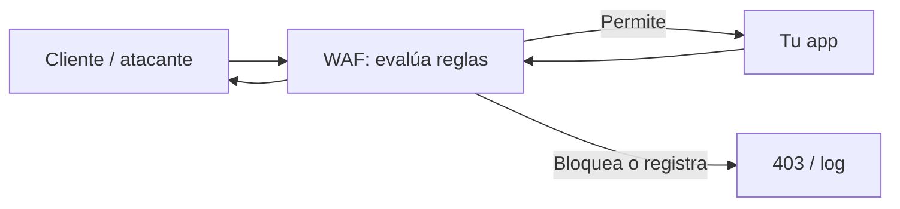

# WAF

Parte de: [[12-Seguridad/05 Herramientas defensivas/_Índice Herramientas defensivas|Herramientas defensivas]]

> [!info] Cómo avanzar
> `progreso`: **pendiente** → **viendo** (estudiando) → **visto** (contestaste la autoevaluación sin abrir las respuestas) → **dominado** (hiciste el laboratorio o lo aplicaste de verdad).

## Contenido

### Qué es
Un WAF (*Web Application Firewall*, cortafuegos de aplicaciones web) es un filtro que se coloca **delante** de tu aplicación e inspecciona el tráfico HTTP(S) antes de que llegue a ella. Aplica reglas para bloquear patrones de ataque conocidos (inyección, XSS, recorrido de rutas), limita la tasa de peticiones y puede frenar bots. Opera en la capa de aplicación (capa 7), a diferencia de un firewall de red tradicional que mira direcciones y puertos. Es una capa de **defensa en profundidad**: reduce el ruido y detiene ataques genéricos, pero no sustituye el código seguro.

### Cómo funciona

El WAF compara cada petición contra un conjunto de reglas. El más conocido es el **OWASP Core Rule Set (CRS)**, un conjunto de reglas genéricas de código abierto que detecta patrones de ataque comunes. Según cómo esté configurado, el WAF suma una "puntuación de anomalía" y bloquea al superar un umbral. Dos modos de operación:

- **Detección (detection)**: solo **registra** lo que bloquearía, sin bloquear. Sirve para afinar reglas y medir falsos positivos antes de activar el bloqueo.
- **Prevención (prevention)**: **bloquea** las peticiones que coinciden con las reglas.

La práctica recomendada es empezar en detección, revisar qué tráfico legítimo se marcaría (para no bloquear a usuarios reales), ajustar excepciones y recién entonces pasar a prevención.

### Opciones
- **En Azure**: **Azure Application Gateway WAF** (para una app en una región, con el CRS gestionado) y **Azure Front Door WAF** (en el borde, para distribución global y protección más cercana al usuario). Ambos son servicios de pago gestionados por Microsoft.
- **De código abierto**: **ModSecurity** (clásico, como módulo de servidores web) y **Coraza** (motor compatible con ModSecurity escrito en Go), normalmente con el **OWASP CRS**.
- Muchas CDN ofrecen WAF integrado.

### Ejemplo
Para una app en Azure como Itzamna.Dionisio detrás de Front Door, el WAF se configura con una política. Conceptualmente (en Bicep o el portal):

1. Creas una **política de WAF** con el conjunto de reglas gestionado (CRS) en modo **Detección**.
2. La asocias al perfil de Front Door o al Application Gateway.
3. Observas durante unos días qué peticiones legítimas dispararían reglas (por ejemplo, un endpoint que recibe JSON con contenido que el CRS confunde con inyección) y agregas exclusiones para esos casos concretos.
4. Agregas una regla personalizada de **limitación de tasa** por IP para endpoints sensibles (login).
5. Cambias a modo **Prevención**.

El WAF complementa, no reemplaza, los controles de la app: las [[SQL injection - consultas parametrizadas|consultas parametrizadas]], la [[XSS - codificación de salida según el contexto|codificación de salida]], la validación con [[FluentValidation]] y el [[Rate limiting]] de la propia API siguen siendo obligatorios. Un atacante puede encontrar una forma de evadir una regla del WAF; si el código es seguro, el ataque falla de todos modos.

### Cuándo usarlo y cuándo no
Un WAF aporta más valor en apps expuestas a internet, especialmente las que no puedes parchear al instante (sistemas heredados, software de terceros) o que reciben mucho tráfico hostil. Para una API interna detrás de la red corporativa, el beneficio es menor. Nunca lo uses como excusa para no corregir el código: es una capa adicional, no la principal.

### Errores comunes
- **Activar prevención sin fase de detección**: bloqueas a usuarios reales y generas incidentes.
- **Creer que el WAF "ya protege todo"** y descuidar el código: las reglas genéricas se evaden y no conocen tu lógica de negocio (no detienen un IDOR).
- **No mantener las reglas**: el CRS se actualiza; una versión vieja protege menos.
- **No revisar los logs del WAF**: son una fuente valiosa de intentos de ataque y de falsos positivos por ajustar.
- **Colocar la app también accesible por una ruta que no pasa por el WAF**: deja la puerta trasera abierta.

### Para profundizar
- [OWASP ModSecurity Core Rule Set](https://owasp.org/www-project-modsecurity-core-rule-set/)
- [Microsoft Learn - Azure Web Application Firewall](https://learn.microsoft.com/azure/web-application-firewall/overview)
- [Microsoft Learn - WAF en Azure Front Door](https://learn.microsoft.com/azure/web-application-firewall/afds/afds-overview)

## Autoevaluación

Contesta primero en voz alta o en papel; luego despliega la respuesta.

> [!question]- ¿Qué es un WAF?
> Web Application Firewall: filtra tráfico HTTP antes de llegar a la app, con reglas contra patrones de ataque comunes (inyección, XSS) y límites de tasa.

> [!question]- Menciona opciones en Azure y de código abierto.
> Azure Application Gateway WAF y Azure Front Door WAF; de código abierto, ModSecurity o Coraza con el OWASP Core Rule Set.

> [!question]- ¿Qué es el modo detección vs prevención?
> Detección: registra lo que bloquearía sin bloquear (útil para ajustar falsos positivos). Prevención: bloquea.

## Práctica

- [[Lab 10 - Escaneo pasivo con OWASP ZAP contra Juice Shop local]]

