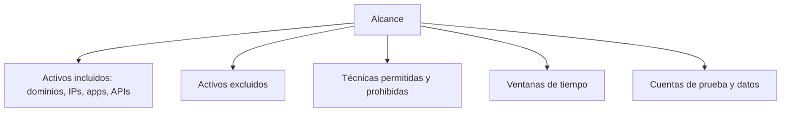

# Alcance (scope) de una prueba de seguridad

Parte de: [[12-Seguridad/06 Hacking ético/_Índice Hacking ético|Hacking ético]]

> [!info] Cómo avanzar
> `progreso`: **pendiente** → **viendo** (estudiando) → **visto** (contestaste la autoevaluación sin abrir las respuestas) → **dominado** (hiciste el laboratorio o lo aplicaste de verdad).

## Contenido

### Qué es
El alcance (*scope*) de una prueba de seguridad define, antes de empezar, **qué se puede tocar y qué no**. Es parte de la autorización y de las reglas de enfrentamiento: delimita los activos a probar, los que quedan fuera, las técnicas permitidas, las ventanas de tiempo y los recursos disponibles (como cuentas de prueba). Sin un alcance claro, no hay forma de saber si una acción es legítima o si te saliste de lo autorizado.

### Qué define el alcance

- **Activos incluidos**: dominios, direcciones IP, aplicaciones, APIs, apps móviles. Deben nombrarse con precisión (`dionisio-test.midominio.com`, no "los sistemas de la empresa").
- **Activos excluidos**: subdominios, servicios de terceros, sistemas de producción que no deben tocarse.
- **Técnicas permitidas y prohibidas**: por ejemplo, sin denegación de servicio, sin ingeniería social, sin pruebas que modifiquen datos reales.
- **Ventanas de tiempo**: fechas y horarios; a veces solo fuera de horario pico.
- **Cuentas de prueba y datos**: usuarios creados para la prueba, en un entorno con datos ficticios.

### Por qué se piden cuentas de prueba
Se solicitan cuentas creadas para la prueba (y, cuando aplica, un entorno de pruebas con datos ficticios) por dos razones:

1. **No tocar datos ni cuentas de usuarios reales**: probar con cuentas reales arriesga su privacidad y puede alterar su información.
2. **Probar autorización de forma controlada**: para verificar un [[Control de acceso roto e IDOR|IDOR]] necesitas dos usuarios de distintos tenants y comprobar que uno no ve lo del otro; eso requiere cuentas que puedas usar sin afectar a nadie.

### Qué hacer ante algo fuera del alcance
Durante la prueba es común encontrar algo interesante que **no** está en el alcance: un subdominio olvidado, un servicio relacionado. La conducta correcta es clara:

- **No lo pruebes.** Aunque sea del mismo cliente, no está autorizado.
- **Anótalo** y **repórtalo** al contacto, para que decidan si lo agregan al alcance **por escrito**.
- Espera la ampliación formal antes de tocarlo.

Salirte del alcance, aunque sea con buena intención, rompe la autorización y puede convertir tu prueba en un acceso no autorizado ([[Qué nunca hacer]]).

### Ejemplo
Alcance de una prueba a Itzamna.Dionisio, redactado de forma concreta:

- **Incluido**: `https://dionisio-test.midominio.com/api/*` y el front `https://clio-test.midominio.com`, ambos en el entorno de pruebas.
- **Excluido**: cualquier dominio de producción, el servidor de identidad Xolotl.Hecate (que corre en infraestructura compartida), y servicios de terceros.
- **Técnicas**: pruebas manuales y escaneo pasivo; escaneo activo solo con aviso previo; sin denegación de servicio ni ingeniería social.
- **Tiempo**: del 10 al 14 de marzo, 9:00 a 18:00.
- **Cuentas**: `tester1` (tenant A) y `tester2` (tenant B), con datos ficticios.

Durante la prueba aparece un subdominio `legacy.midominio.com` que no estaba en la lista: el tester lo anota, lo reporta y **no** lo prueba hasta que el cliente lo agregue por escrito.

### Cuándo usarlo y cuándo no
Todo trabajo autorizado necesita alcance; es inseparable de la autorización ([[Marco legal y autorización por escrito]]). En bug bounty, el alcance lo publica el programa y funciona igual: lo que está fuera de alcance no se toca ([[Programas de bug bounty]]). En tus propios laboratorios, el alcance eres tú mismo.

### Errores comunes
- **Alcance vago** ("los sistemas de la empresa"): imposible saber qué es legítimo.
- **Probar algo "porque es del mismo cliente"** sin que esté en la lista.
- **No pedir cuentas de prueba** y terminar usando datos reales.
- **Olvidar excluir servicios de terceros** que viven en el mismo dominio.
- **Ampliar el alcance de palabra**: toda ampliación debe quedar por escrito.

### Para profundizar
- [OWASP - Web Security Testing Guide: Scoping](https://owasp.org/www-project-web-security-testing-guide/)
- [PTES - Pre-engagement Interactions](http://www.pentest-standard.org/index.php/Pre-engagement)
- [NIST SP 800-115 - Technical Guide to Information Security Testing](https://csrc.nist.gov/pubs/sp/800/115/final)

## Autoevaluación

Contesta primero en voz alta o en papel; luego despliega la respuesta.

> [!question]- ¿Qué define el alcance?
> Qué activos se prueban (dominios, IPs, apps, APIs), qué está fuera, qué tipo de pruebas se permiten (por ejemplo sin denegación de servicio ni ingeniería social), ventanas de tiempo y cuentas de prueba.

> [!question]- Durante una prueba encuentras un subdominio que no está en el alcance. ¿Qué haces?
> No lo pruebas. Lo anotas y lo reportas al contacto para que decidan si lo agregan por escrito.

> [!question]- ¿Por qué se piden cuentas de prueba?
> Para no tocar datos ni cuentas de usuarios reales y poder probar autorización entre usuarios de forma controlada.

## Práctica

- [[Lab 11 - Carta de autorización y reporte de vulnerabilidad]]

