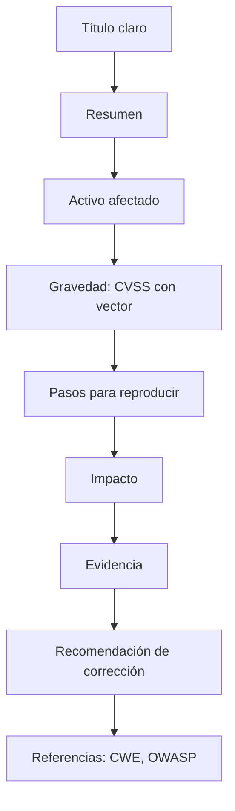

# Cómo escribir un reporte de vulnerabilidad

Parte de: [[12-Seguridad/06 Hacking ético/_Índice Hacking ético|Hacking ético]]

> [!info] Cómo avanzar
> `progreso`: **pendiente** → **viendo** (estudiando) → **visto** (contestaste la autoevaluación sin abrir las respuestas) → **dominado** (hiciste el laboratorio o lo aplicaste de verdad).

## Contenido

### Qué es
El reporte de vulnerabilidad es el entregable que convierte un hallazgo en una corrección. Por bueno que sea el descubrimiento, si no se comunica con claridad el equipo que debe arreglarlo no podrá confirmarlo ni repararlo. Un buen reporte es preciso, reproducible y orientado a la acción; describe el problema, su impacto real y cómo solucionarlo, con evidencia suficiente para no dejar dudas.

### Qué secciones tiene un buen reporte

- **Título claro**: qué y dónde ("IDOR en `GET /api/pedidos/{id}` permite ver pedidos de otros tenants").
- **Resumen**: una o dos frases para quien no leerá el detalle.
- **Activo afectado**: URL, endpoint, componente, versión.
- **Gravedad**: puntuación y **vector** CVSS ([[CVE y CVSS]]), para justificar la urgencia.
- **Pasos para reproducir**: la parte más importante (ver abajo).
- **Impacto**: qué consigue un atacante y por qué le importa al negocio.
- **Evidencia**: capturas, peticiones y respuestas, con datos sensibles **redactados**.
- **Recomendación de corrección**: cómo arreglarlo, concreta y accionable.
- **Referencias**: CWE, categoría de OWASP, enlaces útiles.

### Por qué los pasos para reproducir son lo más importante
Son el corazón del reporte porque el equipo que corrige necesita **confirmar** el problema antes de arreglarlo y **verificar** después que quedó resuelto. Sin pasos claros:

- El hallazgo puede descartarse como "no se reproduce".
- Se retrasa mientras alguien adivina qué hiciste.
- No hay forma objetiva de comprobar la corrección.

Los pasos deben ser exactos y mínimos: el endpoint, los valores usados, el orden, y qué se observa. Cualquier persona del equipo, siguiéndolos, debe llegar al mismo resultado. Incluye precondiciones (qué cuenta, qué rol) y el resultado esperado frente al obtenido.

### Describir el impacto en términos de negocio
Traduce lo técnico a consecuencias: no "falta validación de autorización", sino "un usuario puede leer los pedidos de cualquier otro cliente, exponiendo datos personales y montos". El impacto de negocio es lo que mueve la prioridad y lo que entienden quienes deciden.

### Ejemplo
Reporte breve de un hallazgo en el entorno de pruebas de Itzamna.Dionisio:

> **Título**: IDOR en `GET /api/pedidos/{id}` permite ver pedidos de otros tenants
>
> **Resumen**: El endpoint devuelve cualquier pedido por id sin verificar que pertenezca al tenant del usuario autenticado.
>
> **Activo**: `https://dionisio-test.midominio.com/api/pedidos/{id}` (versión de pruebas, build 1234).
>
> **Gravedad**: Alta. CVSS 3.1 7.5 (`AV:N/AC:L/PR:N/UI:N`) — ajustar según datos expuestos.
>
> **Pasos para reproducir**:
> 1. Inicia sesión como `tester1` (tenant A). Crea un pedido; anota su id (ej. 5012).
> 2. Inicia sesión como `tester2` (tenant B) en otra sesión; obtén su token.
> 3. Con el token de `tester2`, envía `GET /api/pedidos/5012`.
> 4. **Resultado**: responde `200` con el pedido del tenant A. **Esperado**: `404`.
>
> **Impacto**: Cualquier usuario autenticado puede leer pedidos de otros clientes (datos personales y montos), lo que incumple la [[Privacidad - ley mexicana de datos personales (LFPDPPP)|obligación de proteger datos personales]].
>
> **Evidencia**: captura de la respuesta con los datos del cliente redactados.
>
> **Recomendación**: filtrar por `TenantId` (tomado del token) en el procedimiento `dbo.ObtenerPedido` y responder `404` si no coincide. Ver [[Control de acceso roto e IDOR]].
>
> **Referencias**: CWE-639, OWASP API1:2023 (BOLA).

El [[Lab 11 - Carta de autorización y reporte de vulnerabilidad]] practica este formato.

### Cuándo usarlo y cuándo no
Documenta así cualquier hallazgo que entregues a otro equipo o a un programa de bug bounty. Para tus propios hallazgos internos, un formato más ligero (título, pasos, corrección) basta, pero conserva siempre los pasos para reproducir: son útiles para la prueba de regresión.

### Errores comunes
- **Exagerar el impacto**: inflar la gravedad resta credibilidad a todo tu trabajo.
- **Reportar hallazgos sin impacto real** (un header faltante sin contexto) como si fueran críticos; sé preciso sobre cómo afecta al negocio.
- **Pasos vagos** que no se pueden reproducir.
- **Incluir datos sensibles reales** en la evidencia sin redactar.
- **No proponer corrección**: el reporte debe ayudar a arreglar, no solo a señalar.

### Para profundizar
- [OWASP - Vulnerability Disclosure Cheat Sheet](https://cheatsheetseries.owasp.org/cheatsheets/Vulnerability_Disclosure_Cheat_Sheet.html)
- [CWE - Common Weakness Enumeration](https://cwe.mitre.org/)
- [FIRST - CVSS calculator](https://www.first.org/cvss/calculator/3.1)

## Autoevaluación

Contesta primero en voz alta o en papel; luego despliega la respuesta.

> [!question]- ¿Qué secciones tiene un buen reporte?
> Título claro, resumen, activo afectado, gravedad (CVSS con vector), pasos para reproducir, impacto, evidencia (capturas, peticiones), recomendación de corrección y referencias (CWE, OWASP).

> [!question]- ¿Por qué los pasos para reproducir son lo más importante?
> Porque el equipo que corrige debe poder confirmar el problema y luego verificar la corrección. Sin pasos claros el reporte se descarta o se retrasa.

> [!question]- Error común en reportes.
> Exagerar el impacto o reportar hallazgos sin impacto real (headers faltantes sin contexto). Mejor ser preciso y mostrar cómo afecta al negocio.

## Práctica

- [[Lab 11 - Carta de autorización y reporte de vulnerabilidad]]

