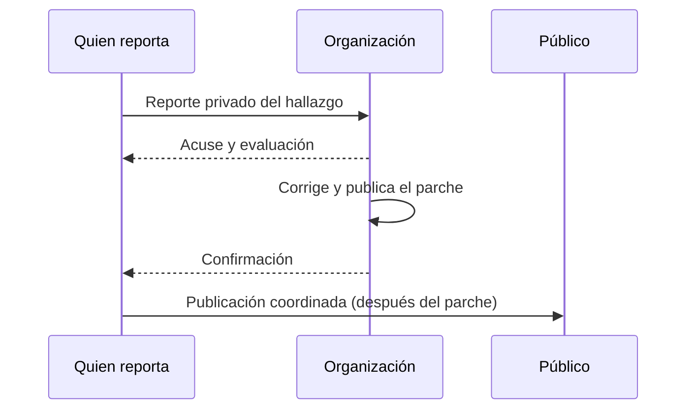

# Divulgación responsable

Parte de: [[12-Seguridad/06 Hacking ético/_Índice Hacking ético|Hacking ético]]

> [!info] Cómo avanzar
> `progreso`: **pendiente** → **viendo** (estudiando) → **visto** (contestaste la autoevaluación sin abrir las respuestas) → **dominado** (hiciste el laboratorio o lo aplicaste de verdad).

## Contenido

### Qué es
La divulgación responsable (hoy llamada más bien **divulgación coordinada**) es el proceso de reportar una vulnerabilidad **en privado** a quien puede corregirla, darle un **plazo razonable** para hacerlo, y publicar los detalles solo después, de común acuerdo. Busca el equilibrio entre dos objetivos: que el problema se arregle antes de que lo aprovechen los atacantes, y que la comunidad aprenda de él una vez corregido. Es lo opuesto tanto al silencio total como a la publicación inmediata ("full disclosure") que deja a los usuarios expuestos.

### Cómo funciona

1. **Reporte privado** a través del canal de seguridad de la organización.
2. **Acuse de recibo** y evaluación por parte de la organización.
3. **Corrección** y liberación del parche.
4. **Publicación coordinada** de los detalles, ya con el arreglo disponible, a veces con crédito a quien reportó.

Si la organización no responde o no corrige en un plazo razonable, quien reporta puede, con criterio, publicar para que los usuarios se protejan; es un punto delicado y debe manejarse con cuidado.

### Cómo encontrar el contacto de seguridad
- **`/.well-known/security.txt`**: un archivo estándar (RFC 9116) donde muchos sitios publican su contacto de seguridad, su política y a veces su clave de cifrado. Es el primer lugar donde mirar.
- **Página de seguridad** o de divulgación de la organización.
- **Programa de bug bounty** en plataformas como HackerOne o Bugcrowd, que define el canal y las reglas ([[Programas de bug bounty]]).
- Un correo del tipo `security@` como último recurso.

### Qué plazo se usa
No hay un plazo único; depende de la política de cada organización y de la gravedad. Como **referencia**, muchos equipos usan alrededor de **90 días** desde el reporte hasta la publicación (es el plazo conocido de Google Project Zero), con posibilidad de extenderlo si el parche está por salir o acortarlo si la falla ya se explota. Lo importante es **acordar** el plazo, no imponerlo.

### Ejemplo
Un desarrollador encuentra, de forma incidental, que una librería de código abierto que usa en Itzamna.Dionisio expone datos en ciertos casos. En lugar de abrir un issue público (que avisaría a los atacantes):

1. Busca `https://github.com/<proyecto>/security/policy` o un `security.txt`.
2. Reporta en privado por el canal indicado (muchos proyectos usan los *security advisories* privados de GitHub), con pasos para reproducir ([[Cómo escribir un reporte de vulnerabilidad]]).
3. Acuerda un plazo y espera el parche.
4. Actualiza su propia dependencia cuando sale la versión corregida y, si se publica un aviso, aporta o confirma los detalles.

Para sistemas propios, el equivalente es tener **tú** un canal de divulgación: un `security.txt` y una dirección donde investigadores externos puedan reportarte en privado.

### Cuándo usarlo y cuándo no
Aplica siempre que encuentres una vulnerabilidad en software o servicios de terceros. Si el sistema es tuyo, prepara el lado receptor (canal, política). En bug bounty, el programa ya define el proceso y debes seguirlo. Nunca publiques detalles de una falla sin corregir ni pidas dinero a cambio de guardar silencio: eso deja de ser divulgación responsable ([[Qué nunca hacer]]).

### Errores comunes
- **Abrir un issue público** o tuitear la falla antes del parche.
- **No dar tiempo** razonable para corregir.
- **Confundir divulgación con extorsión**: condicionar el silencio a un pago es ilegal.
- **No documentar** el reporte ni los acuerdos de plazo.
- **Reportar a un canal equivocado** y asumir que no respondieron; revisa `security.txt` primero.

### Para profundizar
- [RFC 9116 - A File Format to Aid in Security Vulnerability Disclosure (security.txt)](https://datatracker.ietf.org/doc/html/rfc9116)
- [OWASP - Vulnerability Disclosure Cheat Sheet](https://cheatsheetseries.owasp.org/cheatsheets/Vulnerability_Disclosure_Cheat_Sheet.html)
- [CERT/CC Guide to Coordinated Vulnerability Disclosure](https://vuls.cert.org/confluence/display/CVD)

## Autoevaluación

Contesta primero en voz alta o en papel; luego despliega la respuesta.

> [!question]- ¿Qué es la divulgación responsable (coordinada)?
> Reportar la vulnerabilidad en privado al responsable, darle un plazo razonable para corregir y publicar detalles solo después, de común acuerdo.

> [!question]- ¿Cómo encuentras el contacto de seguridad de un sitio?
> En su archivo `/.well-known/security.txt` (RFC 9116), su política de divulgación o su programa de bug bounty.

> [!question]- ¿Qué plazo se suele usar como referencia?
> Muchas organizaciones usan alrededor de 90 días (por ejemplo Google Project Zero), pero depende de la política de cada empresa y de la gravedad.

## Práctica

- [[Lab 11 - Carta de autorización y reporte de vulnerabilidad]]

