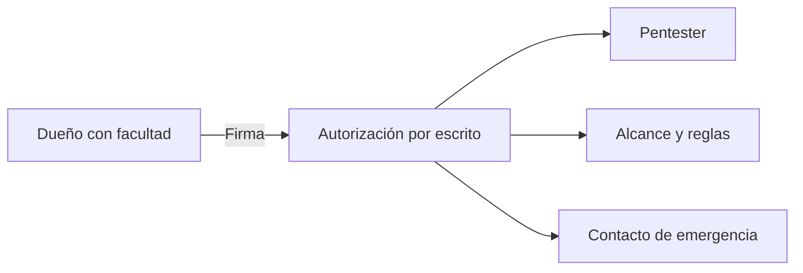

# Marco legal y autorización por escrito

Parte de: [[12-Seguridad/06 Hacking ético/_Índice Hacking ético|Hacking ético]]

> [!info] Cómo avanzar
> `progreso`: **pendiente** → **viendo** (estudiando) → **visto** (contestaste la autoevaluación sin abrir las respuestas) → **dominado** (hiciste el laboratorio o lo aplicaste de verdad).

## Contenido

### Qué es
La autorización por escrito es el documento que convierte una prueba de seguridad en una actividad legal. Sin ella, acceder o probar un sistema que no es tuyo puede constituir un delito, aunque no causes daño. En México, el acceso no autorizado a sistemas informáticos con medidas de seguridad está tipificado en el **Código Penal Federal**. Antes de cualquier prueba formal, el hacking ético exige una autorización firmada por quien tiene la facultad de darla; es el equivalente a un contrato que define qué puedes hacer y te protege a ti y al cliente.

### Qué debe tener una autorización por escrito
Un documento de autorización (a veces llamado "regla de enfrentamiento" o *rules of engagement*) debe incluir:

- **Quién autoriza**, con nombre, cargo y **facultad** para hacerlo (que sea dueño o representante legal del sistema).
- **Quién realiza la prueba** (personas o empresa).
- **Sistemas y direcciones incluidos y excluidos** (el alcance; ver [[Alcance (scope) de una prueba de seguridad]]).
- **Fechas y horarios** permitidos.
- **Técnicas permitidas y prohibidas** (por ejemplo, sin denegación de servicio ni ingeniería social salvo acuerdo).
- **Contacto de emergencia** para detener la prueba si algo sale mal.
- **Manejo de datos** que se encuentren (confidencialidad, no extracción, destrucción al terminar).
- **Firma** de las partes y vigencia.

### Por qué la debe dar el dueño del sistema
No basta con que "tu jefe te lo pida". La autorización debe venir de quien tiene **facultad legal** sobre el sistema, porque es quien puede consentir que se pruebe. Dos matices importantes:

- Si el sistema corre en **infraestructura de un tercero** (nube, hosting, un SaaS), también aplican los **términos de ese proveedor**: el cliente no puede autorizar pruebas sobre infraestructura que no controla. Los grandes proveedores (Azure, AWS, Google) publican su política de pruebas de penetración; revísala antes.
- Un sistema puede tener **datos de terceros** (clientes, usuarios); el consentimiento del dueño no siempre cubre todo, y hay que cuidar la privacidad ([[Privacidad - ley mexicana de datos personales (LFPDPPP)]]).

### Qué leyes revisar en México
Como punto de partida, y sin que esto sea asesoría legal:

- **Código Penal Federal, Título Noveno** ("Revelación de secretos y acceso ilícito a sistemas y equipos de informática"), **Capítulo II**. El artículo **211 bis 1** sanciona a quien, sin autorización, modifique, destruya o provoque pérdida de información en sistemas protegidos por algún mecanismo de seguridad, y también a quien solo conozca o copie esa información. Los artículos siguientes (211 bis 2 a 211 bis 7) agravan las penas según el sistema sea del Estado, del sistema financiero, etc.
- **Ley Federal de Protección de Datos Personales en Posesión de los Particulares (LFPDPPP)**, por si durante la prueba se encuentran datos personales.
- Legislación local y contratos aplicables.

Verifica siempre el **texto vigente** en una fuente oficial y consulta a un abogado antes de una prueba formal; las penas exactas y la redacción pueden cambiar (Pendiente de confirmar detalles de artículos y reformas recientes).

### Ejemplo
Flujo realista antes de que un desarrollador pruebe la seguridad de un sistema de la empresa que no es solo suyo:

1. Propone por escrito el alcance (por ejemplo, "probar autorización en los endpoints de Itzamna.Dionisio del entorno de pruebas, sin denegación de servicio, del 10 al 14 de marzo, en horario laboral").
2. El responsable del sistema **con facultad** (no solo el líder técnico) firma la autorización.
3. Se define contacto de emergencia y cómo se manejarán los datos.
4. Si el entorno está en Azure, se revisa la política de pruebas de Microsoft.
5. Solo entonces comienza la prueba, documentando todo.

El [[Lab 11 - Carta de autorización y reporte de vulnerabilidad]] practica la redacción de este documento.

### Cuándo usarlo y cuándo no
Siempre que la prueba toque un sistema que no es exclusivamente tuyo. Para laboratorios diseñados para practicar ([[PortSwigger Web Security Academy]], [[OWASP Juice Shop]] local) el permiso ya está dado por su naturaleza y sus términos. En bug bounty, el "permiso" lo da el alcance del programa, que debes leer como si fuera el contrato ([[Programas de bug bounty]]).

### Errores comunes
- **Permiso verbal**: "me dijeron que sí" no es defensa; necesitas firma.
- **Autorización de quien no tiene facultad** (un compañero, un líder sin autoridad sobre el sistema).
- **Ignorar los términos del proveedor de nube**.
- **Alcance ambiguo**: sin direcciones ni fechas, cualquier cosa puede interpretarse como fuera de lugar.
- **Sin contacto de emergencia**: si algo se cae, nadie sabe a quién avisar.

### Para profundizar
- [Código Penal Federal (texto vigente en la Cámara de Diputados)](https://www.diputados.gob.mx/LeyesBiblio/index.htm)
- [Microsoft - Reglas de interacción para pruebas de penetración](https://www.microsoft.com/msrc/pentest-rules-of-engagement)
- [OWASP - Firmware/Penetration Testing Methodologies (rules of engagement)](https://owasp.org/www-project-web-security-testing-guide/)

## Autoevaluación

Contesta primero en voz alta o en papel; luego despliega la respuesta.

> [!question]- ¿Qué debe tener una autorización por escrito para una prueba de seguridad?
> Quién autoriza (con facultad para hacerlo), quién prueba, sistemas y direcciones incluidos y excluidos, fechas y horarios, técnicas permitidas y prohibidas, contacto de emergencia, manejo de datos encontrados y firma.

> [!question]- ¿Por qué la autorización la debe dar el dueño del sistema y no solo tu jefe?
> Si el sistema está en un proveedor (nube, hosting, SaaS de un tercero), también aplican sus términos; el cliente no puede autorizar sobre infraestructura que no controla. Revisa la política de pruebas del proveedor.

> [!question]- ¿Qué leyes conviene revisar en México?
> El Código Penal Federal tipifica el acceso ilícito a sistemas y equipos de informática (Título Noveno, Capítulo II). Consulta el texto vigente y a un abogado antes de una prueba formal (Pendiente de confirmar detalles de artículos).

## Práctica

- [[Lab 11 - Carta de autorización y reporte de vulnerabilidad]]

