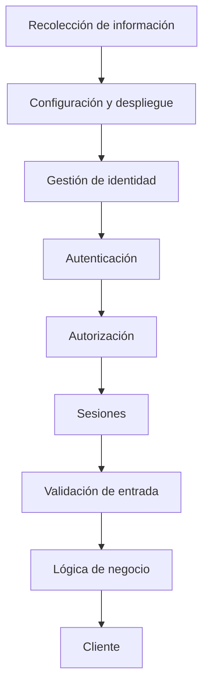

# Metodología de pruebas web (OWASP WSTG)

Parte de: [[12-Seguridad/06 Hacking ético/_Índice Hacking ético|Hacking ético]]

> [!info] Cómo avanzar
> `progreso`: **pendiente** → **viendo** (estudiando) → **visto** (contestaste la autoevaluación sin abrir las respuestas) → **dominado** (hiciste el laboratorio o lo aplicaste de verdad).

## Contenido

### Qué es
El **OWASP Web Security Testing Guide (WSTG)** es una guía gratuita y mantenida por la comunidad que describe **cómo probar** la seguridad de una aplicación web de forma sistemática. Organiza cientos de casos de prueba por categorías (recolección de información, configuración, identidad, autenticación, autorización, gestión de sesiones, validación de entrada, lógica de negocio, cliente, APIs). No es una herramienta, sino una **metodología**: un mapa para no probar al azar y no olvidar áreas enteras.

### Cómo se organiza

Cada categoría agrupa pruebas concretas con un identificador, qué buscar y cómo verificarlo. Por ejemplo, en autenticación hay casos para credenciales por defecto, enumeración de usuarios, política de contraseñas y bloqueo de cuentas; en validación de entrada, para inyección SQL, XSS y recorrido de rutas. Esa estructura la convierte en una **lista de verificación** exhaustiva.

### Cómo te sirve como desarrollador
No necesitas ser pentester para aprovecharla:

- Como **checklist** para revisar tu propia app antes de producción: recorres las categorías relevantes y confirmas que tienes el control correspondiente (por ejemplo, que el login tiene límite de intentos, que los endpoints verifican autorización por objeto).
- Para **entender qué revisará un pentester** y anticiparte, llegando a la prueba con los controles básicos ya cubiertos.
- Para **dar lenguaje común** al equipo: referirse a un caso del WSTG evita ambigüedades en un reporte.

Buena parte de los temas de esta área de Seguridad corresponden a casos del WSTG; la guía te ayuda a organizarlos en un recorrido completo.

### Relación con OWASP ASVS
El WSTG se complementa con el **OWASP Application Security Verification Standard (ASVS)**:

- **ASVS** define **qué** requisitos de seguridad debe cumplir la app, organizados en **niveles 1 a 3** según cuánta seguridad necesita (1 para apps de bajo riesgo, 3 para las más críticas). Es el "qué".
- **WSTG** explica **cómo probar** que esos requisitos se cumplen. Es el "cómo".

En la práctica, usas ASVS para fijar el objetivo (qué controles exigir) y WSTG para verificarlo (cómo comprobarlo). Hay un tercer documento, el **OWASP Testing Checklist**, que condensa el WSTG en una lista marcable.

### Ejemplo
Antes de liberar una nueva versión de Itzamna.Dionisio, el equipo usa el WSTG como guía de autorrevisión:

1. **Configuración**: ¿hay headers de seguridad? ¿Swagger está cerrado en producción? ([[Configuración insegura]])
2. **Autenticación**: ¿límite de intentos? ¿mensajes genéricos? ([[Autenticación rota]])
3. **Autorización**: ¿cada endpoint verifica tenant y permiso? Prueban un [[Control de acceso roto e IDOR|IDOR]] con dos cuentas.
4. **Validación de entrada**: ¿consultas parametrizadas? ¿codificación de salida en el front?
5. **Sesiones y APIs**: ¿tokens bien validados? ¿rate limiting?

Fijan como meta el **nivel 1 de ASVS** para esta app y usan el WSTG para comprobar cada punto. Lo que falla se vuelve tarea antes de liberar.

### Cuándo usarlo y cuándo no
Úsala como referencia de autorrevisión en cualquier app web, adaptando las categorías a tu caso (una API no necesita las pruebas de interfaz de usuario). No es un sustituto de una prueba hecha por alguien externo con mirada fresca, pero reduce muchísimo lo que esa prueba encontraría.

### Errores comunes
- **Tratarla como herramienta**: es metodología; las herramientas (ZAP, Burp) se usan **dentro** de ella.
- **Querer cubrir todo el WSTG de golpe**: prioriza por riesgo y por el nivel de ASVS que buscas.
- **Confundir WSTG con ASVS**: uno prueba, el otro define requisitos.
- **Revisar una sola vez**: la app cambia; la autorrevisión debe repetirse.

### Para profundizar
- [OWASP Web Security Testing Guide](https://owasp.org/www-project-web-security-testing-guide/)
- [OWASP Application Security Verification Standard (ASVS)](https://owasp.org/www-project-application-security-verification-standard/)
- [OWASP Testing Checklist](https://owasp.org/www-project-web-security-testing-guide/stable/6-Appendix/)

## Autoevaluación

Contesta primero en voz alta o en papel; luego despliega la respuesta.

> [!question]- ¿Qué es el OWASP WSTG?
> Web Security Testing Guide: una guía con la metodología y los casos de prueba para evaluar la seguridad de aplicaciones web, organizados por categorías (identidad, autenticación, autorización, sesiones, validación de entrada, etc.).

> [!question]- ¿Cómo te sirve como desarrollador?
> Como checklist para revisar tus propias apps antes de producción y para entender qué va a revisar un pentester.

> [!question]- ¿Qué relación tiene con OWASP ASVS?
> ASVS define **qué** requisitos de seguridad debe cumplir la app (niveles 1 a 3); WSTG explica **cómo probarlos**.

