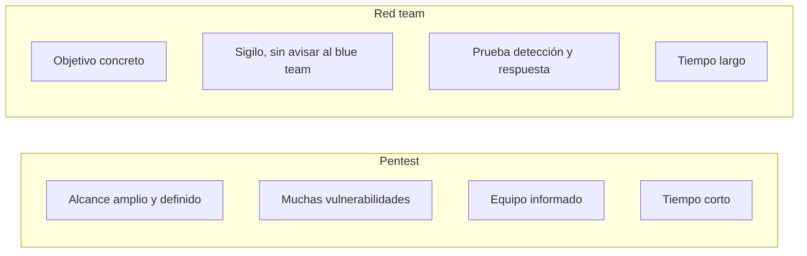

# Pentesting vs red team

Parte de: [[12-Seguridad/06 Hacking ético/_Índice Hacking ético|Hacking ético]]

> [!info] Cómo avanzar
> `progreso`: **pendiente** → **viendo** (estudiando) → **visto** (contestaste la autoevaluación sin abrir las respuestas) → **dominado** (hiciste el laboratorio o lo aplicaste de verdad).

## Contenido

### Qué es
Pentesting y red team son dos tipos de ejercicio ofensivo autorizado, con objetivos distintos. Un **pentest** (prueba de penetración) busca **encontrar y documentar la mayor cantidad de vulnerabilidades** en un alcance definido y un tiempo acotado. Un **red team** simula a un **adversario real** con un objetivo concreto (llegar a cierto dato o sistema), operando en sigilo, para poner a prueba no solo la tecnología sino también la **detección y respuesta** del equipo defensivo. No son lo mismo y no se piden en el mismo momento de madurez de una organización.

### En qué se diferencian

| | Pentest | Red team |
|---|---|---|
| Objetivo | Hallar muchas vulnerabilidades | Lograr un objetivo específico |
| Amplitud | Cobertura amplia del alcance | Profundidad por un camino |
| Sigilo | El equipo suele saber | En secreto para los defensores |
| Qué prueba | La seguridad del sistema | También la detección y respuesta |
| Duración | Días o pocas semanas | Semanas o meses |

El **blue team** es el equipo defensivo (monitoreo, detección, respuesta). Un red team lo pone a prueba sin avisarle, para medir si detecta y reacciona ante un adversario real.

### Qué es un purple team
Un **purple team** no es un tercer equipo, sino una **forma de colaboración** entre el red team (ofensivo) y el blue team (defensivo): trabajan juntos durante el ejercicio, compartiendo técnicas y resultados en tiempo real, para que los defensores mejoren su detección sobre la marcha. En vez del secreto del red team puro, el propósito es **aprender en conjunto**: el rojo muestra cómo ataca, el azul ajusta sus detecciones y vuelven a probar.

### Cuál pediría una empresa que nunca ha hecho pruebas
Una organización sin experiencia previa debería empezar por lo más básico y de mayor retorno:

1. Primero, una **evaluación de vulnerabilidades** (escaneo y revisión) y/o un **pentest**, que le dará un panorama amplio de qué arreglar.
2. Un **red team** tiene sentido **después**, cuando ya existen controles maduros y un **equipo de monitoreo** al que valga la pena poner a prueba. Hacer red team sin defensas que medir es gastar esfuerzo: encontraría todo abierto y no habría detección que evaluar.

En otras palabras: el red team mide qué tan bien detectas y respondes; si aún no tienes esa capacidad, primero constrúyela con pentests y correcciones.

### Ejemplo
Una empresa que estrena su primer programa de seguridad para Itzamna.Dionisio e Itzamna.Clio:

- **Año 1**: pentest del alcance de pruebas (autorización, APIs, configuración), corrige los hallazgos, integra [[SAST, DAST y SCA]] en el pipeline y monta monitoreo básico.
- **Año 2**, con controles y monitoreo ya funcionando: contrata un ejercicio de red team con el objetivo "exfiltrar un registro de prueba marcado", sin avisar al equipo de monitoreo, para medir si lo detectan.
- Luego hace un ejercicio **purple team** para que el blue team aprenda a detectar las técnicas que el red usó.

### Cuándo usarlo y cuándo no
- **Pentest**: cuando quieres cobertura amplia y una lista de qué corregir; adecuado para casi cualquier organización.
- **Red team**: cuando ya tienes defensas y quieres probar detección y respuesta frente a un adversario realista.
- **Purple team**: cuando el objetivo es que los defensores mejoren, no "ganar" el ejercicio.

### Errores comunes
- **Pedir red team sin madurez**: sin defensas que medir, aporta poco.
- **Confundir purple team con un equipo aparte**: es una forma de colaboración.
- **Esperar cobertura total de un red team**: va por un camino hacia un objetivo, no revisa todo.
- **No definir objetivo** en un red team: sin meta clara no se puede medir el éxito.
- **Saltarse lo básico**: sin corregir lo que un pentest encuentra, el ejercicio avanzado es prematuro.

### Para profundizar
- [NIST SP 800-115 - Technical Guide to Information Security Testing and Assessment](https://csrc.nist.gov/pubs/sp/800/115/final)
- [MITRE ATT&CK](https://attack.mitre.org/)
- [CISA - Red Team Assessments](https://www.cisa.gov/resources-tools/services/red-team-assessments)

## Autoevaluación

Contesta primero en voz alta o en papel; luego despliega la respuesta.

> [!question]- ¿En qué se diferencian?
> Pentest: buscar el mayor número de vulnerabilidades en un alcance definido y en un tiempo acotado, con el equipo informado. Red team: simular a un adversario real con un objetivo (llegar a cierto dato), en sigilo, para probar también la detección y respuesta del equipo defensivo (blue team).

> [!question]- ¿Qué es un purple team?
> Una colaboración entre red y blue team para mejorar la detección en conjunto, compartiendo técnicas y resultados durante el ejercicio.

> [!question]- ¿Cuál pediría una empresa que nunca ha hecho pruebas?
> Primero un pentest (o una evaluación de vulnerabilidades). El red team tiene sentido cuando ya hay controles maduros y un equipo de monitoreo.

