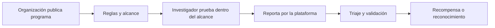

# Programas de bug bounty

Parte de: [[12-Seguridad/06 Hacking ético/_Índice Hacking ético|Hacking ético]]

> [!info] Cómo avanzar
> `progreso`: **pendiente** → **viendo** (estudiando) → **visto** (contestaste la autoevaluación sin abrir las respuestas) → **dominado** (hiciste el laboratorio o lo aplicaste de verdad).

## Contenido

### Qué es
Un programa de bug bounty es una invitación, pública o privada, de una organización para que investigadores de seguridad busquen vulnerabilidades en sus sistemas, dentro de un alcance definido, a cambio de **reconocimiento** o **recompensa económica**. Es una forma de divulgación coordinada a escala: en lugar de esperar a que alguien reporte por casualidad, la organización abre la puerta y pone reglas claras. Para quien aprende, es una vía **legal** de practicar sobre sistemas reales, siempre que respete el alcance y las reglas.

### Cómo funciona

1. La organización publica el programa en una plataforma, con su **alcance**, exclusiones, tipos de vulnerabilidad que acepta y recompensas.
2. El investigador prueba **solo** lo que está en alcance y reporta con pasos para reproducir.
3. Un equipo de triaje valida el hallazgo y asigna gravedad.
4. Se paga la recompensa (según la gravedad) o se da crédito.

Muchos programas ofrecen un **safe harbor** (puerto seguro): un compromiso de no emprender acciones legales contra quien actúe de buena fe dentro de las reglas. Ese compromiso es parte de por qué el bug bounty es legal donde probar por tu cuenta no lo sería.

### Qué leer antes de probar
Antes de tocar nada, lee **las reglas del programa** como si fueran un contrato:

- **Alcance**: qué dominios y sistemas están incluidos y cuáles excluidos ([[Alcance (scope) de una prueba de seguridad]]).
- **Vulnerabilidades excluidas**: muchas descartan ciertos hallazgos (por ejemplo, reportes solo de escáner automático, o problemas de bajo impacto).
- **Técnicas prohibidas**: casi siempre sin denegación de servicio, sin ingeniería social, sin tocar datos de usuarios reales ([[Qué nunca hacer]]).
- **Cómo reportar**: el canal y el formato exigidos.
- **Safe harbor**: qué protección legal ofrecen y bajo qué condiciones.

Salirte del alcance o de las técnicas permitidas te saca del paraguas legal del programa y puede convertir tu actividad en un delito.

### Plataformas conocidas
- **HackerOne** y **Bugcrowd**: las dos plataformas más grandes.
- **Intigriti** (fuerte en Europa) y **YesWeHack**.
- **Hacker101** es el programa de formación gratuito de HackerOne, con material y un CTF para aprender antes de participar.

También conviene practicar primero en entornos sin reglas estrictas ([[PortSwigger Web Security Academy]], [[OWASP Juice Shop]], [[TryHackMe]], [[Hack The Box]]) para llegar al bug bounty con bases.

### Ejemplo
Alguien que ya domina [[XSS]] e [[Control de acceso roto e IDOR|IDOR]] en laboratorios quiere dar el salto a sistemas reales de forma legal:

1. Crea cuenta en una plataforma y elige un programa con alcance amplio y buena reputación.
2. Lee el alcance y las exclusiones; confirma que la app donde quiere probar **está incluida**.
3. Prueba solo esa app, sin tocar datos de usuarios reales, documentando cada paso.
4. Al encontrar un IDOR, demuestra el impacto con **un** ejemplo redactado y reporta por la plataforma con el formato de [[Cómo escribir un reporte de vulnerabilidad]].
5. El triaje valida y paga la recompensa según la gravedad.

### Cuándo usarlo y cuándo no
El bug bounty es ideal cuando quieres practicar sobre sistemas reales dentro de un marco legal y, con el tiempo, obtener recompensas. No es el primer paso: sin bases, generas ruido y reportes inválidos. Tampoco sustituye un pentest contratado: el bounty es continuo y variable, el pentest es dirigido y con alcance garantizado.

### Errores comunes
- **Probar fuera de alcance**: pierdes el safe harbor y te expones legalmente.
- **No leer las exclusiones**: reportar algo que el programa ya descarta es tiempo perdido.
- **Usar técnicas prohibidas** (DoS, tocar datos reales).
- **Reportes de baja calidad** (solo salida de un escáner, sin impacto): muchos programas los rechazan.
- **Esperar pago fácil**: encontrar algo válido en programas maduros es competitivo.

### Para profundizar
- [HackerOne](https://www.hackerone.com/)
- [Bugcrowd](https://www.bugcrowd.com/)
- [Hacker101 (formación gratuita)](https://www.hacker101.com/)
- [disclose.io - Safe harbor y buenas prácticas](https://disclose.io/)

## Autoevaluación

Contesta primero en voz alta o en papel; luego despliega la respuesta.

> [!question]- ¿Qué es un programa de bug bounty?
> Una invitación pública o privada de una organización para que investigadores busquen vulnerabilidades en un alcance definido, a cambio de reconocimiento o recompensa.

> [!question]- ¿Qué debes leer antes de probar?
> Las reglas del programa: alcance, vulnerabilidades excluidas, técnicas prohibidas, cómo reportar y el puerto seguro (safe harbor) legal que ofrecen.

> [!question]- Menciona plataformas conocidas.
> HackerOne, Bugcrowd, Intigriti y YesWeHack. [[Hacker101]] es el programa de formación gratuito de HackerOne.

